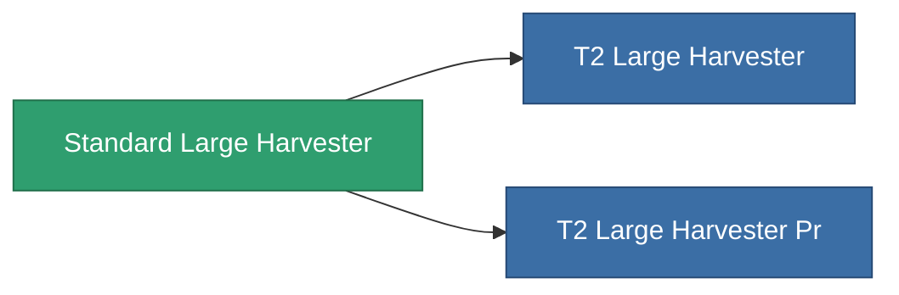

<!-- Generated by tools/generate from the live database (source: entitydefaults definition 8861, aggregatevalues via aggregatefields).
     Do not edit by hand; regenerate instead. -->

# Standard Large Harvester

|  |  |
|---|---|
| Definición | `def_standard_large_harvester` |
| Nivel | T1 |
| Salud | 100 |
| Volumen | 2.5 |
| Masa | 2000 |
| Categoría | Modules / Harvesting |
| Tier line | **Standard Large Harvester** (T1) → [T2 Large Harvester](/es/content/items/named1-large-harvester/) (T2) → [T3 Large Harvester](/es/content/items/named2-large-harvester/) (T3) → [T4 Large Harvester](/es/content/items/named3-large-harvester/) (T4) |

## Estadísticas

| Campo | Valor |
|---|---|
| core_usage | 165 |
| cpu_usage | 450 |
| cycle_time | 12k |
| powergrid_usage | 1.35k |

<!-- production:generated -->
## Producción

**Producido desde 2 componentes, nivel de investigación 5** — ensambla los componentes para construirlo (lista completa en [Recetas](/es/content/recipes/)):

**Planos:** [Standard Large Harvester Cprg](/es/content/items/standard-large-harvester-cprg/)

<svg class="prod-card-icon" aria-hidden="true"><use href="#mi-grid"/></svg><a class="prod-card-name" href="/es/content/items/axicol/">Cryoperine</a>

requerido: <b>1.6k</b>

<svg class="prod-card-icon" aria-hidden="true"><use href="#mi-grid"/></svg><a class="prod-card-name" href="/es/content/items/titanium/">Titanium</a>

requerido: <b>2.4k</b>

## Usado en producción

**Componente de 2 elementos** — todo lo que lo usa en producción:

