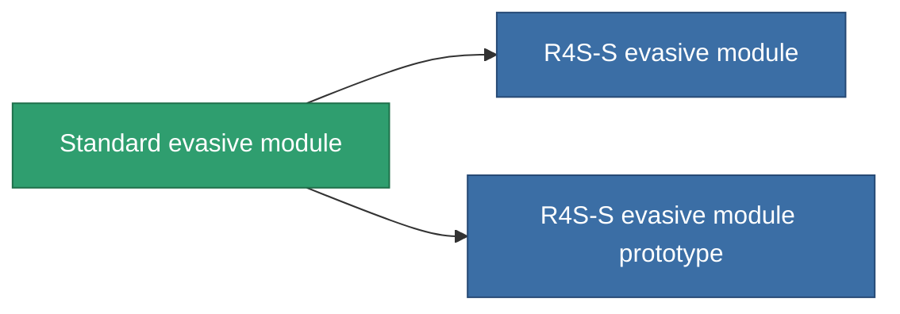

<!-- Generated by tools/generate from the live database (source: entitydefaults definition 2549, aggregatevalues via aggregatefields).
     Do not edit by hand; regenerate instead. -->

# Standard evasive module

|  |  |
|---|---|
| Definición | `def_standard_maneuvering_upgrade` |
| Nivel | T1 |
| Salud | 100 |
| Volumen | 0.5 |
| Masa | 25 |
| Categoría | Modules / Enhancements |
| Tier line | **Standard evasive module** (T1) → [R4S-S evasive module](/es/content/items/named1-maneuvering-upgrade/) (T2) → [Deflectik evasive module](/es/content/items/named2-maneuvering-upgrade/) (T3) → [Yridan RCD evasive module](/es/content/items/named3-maneuvering-upgrade/) (T4) |
| Nota | lab modul , moverezo, csokkenti a hit surfacet |

## Estadísticas

| Campo | Valor |
|---|---|
| cpu_usage | 25 |
| massiveness | 0.05 |
| powergrid_usage | 25 |
| signature_radius | -0.85 |

<!-- production:generated -->
## Producción

**Producido desde 3 componentes, nivel de investigación 5** — ensambla los componentes para construirlo (lista completa en [Recetas](/es/content/recipes/)):

**Planos:** [Standard evasive module CT](/content/items/standard-maneuvering-upgrade-cprg/)

<svg class="prod-card-icon" aria-hidden="true"><use href="#mi-grid"/></svg><a class="prod-card-name" href="/es/content/items/axicol/">Cryoperine</a>

requerido: <b>150</b>

<svg class="prod-card-icon" aria-hidden="true"><use href="#mi-grid"/></svg><a class="prod-card-name" href="/es/content/items/plasteosine/">Plasteosine</a>

requerido: <b>150</b>

<svg class="prod-card-icon" aria-hidden="true"><use href="#mi-grid"/></svg><a class="prod-card-name" href="/es/content/items/titanium/">Titanium</a>

requerido: <b>100</b>

## Usado en producción

**Componente de 2 elementos** — todo lo que lo usa en producción:

