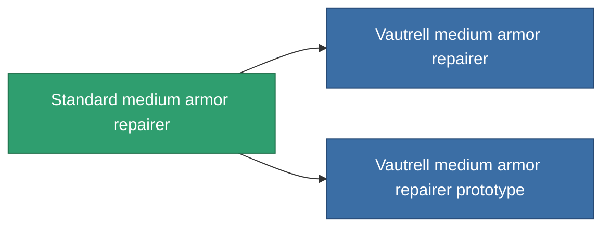

<!-- Generated by tools/generate from the live database (source: entitydefaults definition 19, aggregatevalues via aggregatefields).
     Do not edit by hand; regenerate instead. -->

# Standard medium armor repairer

|  |  |
|---|---|
| Definición | `def_standard_medium_armor_repairer` |
| Nivel | T1 |
| Salud | 100 |
| Volumen | 1.5 |
| Masa | 750 |
| Categoría | Modules / Repair |
| Tier line | **Standard medium armor repairer** (T1) → [Vautrell medium armor repairer](/es/content/items/named1-medium-armor-repairer/) (T2) → [FO-150 'Reparator' medium armor repairer](/es/content/items/named2-medium-armor-repairer/) (T3) → [CRC40 medium armor repairer](/es/content/items/named3-medium-armor-repairer/) (T4) |

## Estadísticas

| Campo | Valor |
|---|---|
| armor_repair_amount | 180 |
| core_usage | 330 |
| cpu_usage | 50 |
| cycle_time | 15k |
| powergrid_usage | 100 |

<!-- production:generated -->
## Producción

**Producido desde 5 componentes, nivel de investigación 4** — ensambla los componentes para construirlo (lista completa en [Recetas](/es/content/recipes/)):

**Planos:** [Standard medium armor repairer CT](/content/items/standard-medium-armor-repairer-cprg/)

<svg class="prod-card-icon" aria-hidden="true"><use href="#mi-grid"/></svg><a class="prod-card-name" href="/es/content/items/axicol/">Cryoperine</a>

requerido: <b>50</b>

<svg class="prod-card-icon" aria-hidden="true"><use href="#mi-grid"/></svg><a class="prod-card-name" href="/es/content/items/chollonin/">Chollonin</a>

requerido: <b>50</b>

<svg class="prod-card-icon" aria-hidden="true"><use href="#mi-grid"/></svg><a class="prod-card-name" href="/es/content/items/plasteosine/">Plasteosine</a>

requerido: <b>200</b>

<svg class="prod-card-icon" aria-hidden="true"><use href="#mi-grid"/></svg><a class="prod-card-name" href="/es/content/items/statichnol/">Statichnol</a>

requerido: <b>200</b>

<svg class="prod-card-icon" aria-hidden="true"><use href="#mi-grid"/></svg><a class="prod-card-name" href="/es/content/items/titanium/">Titanium</a>

requerido: <b>100</b>

## Usado en producción

**Componente de 2 elementos** — todo lo que lo usa en producción:

