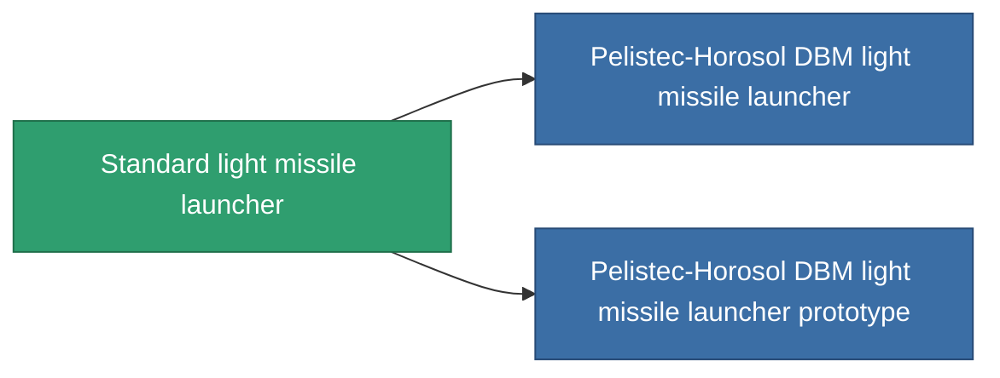

<!-- Generated by tools/generate from the live database (source: entitydefaults definition 63, aggregatevalues via aggregatefields).
     Do not edit by hand; regenerate instead. -->

# Standard light missile launcher

|  |  |
|---|---|
| Definición | `def_standard_rocket_launcher` |
| Nivel | T1 |
| Salud | 100 |
| Volumen | 1 |
| Masa | 250 |
| Categoría | Modules / Weapons |
| Tier line | **Standard light missile launcher** (T1) → [Pelistec-Horosol DBM light missile launcher](/es/content/items/named1-rocket-launcher/) (T2) → [Morteq light missile launcher](/es/content/items/named2-rocket-launcher/) (T3) → [Pelistec-TR110 light missile launcher](/es/content/items/named3-rocket-launcher/) (T4) |

## Estadísticas

| Campo | Valor |
|---|---|
| accuracy | 1 |
| core_usage | 1 |
| cpu_usage | 30 |
| cycle_time | 7.5k |
| damage_modifier | 1 |
| powergrid_usage | 25 |

<!-- production:generated -->
## Producción

**Producido desde 3 componentes, nivel de investigación 2** — ensambla los componentes para construirlo (lista completa en [Recetas](/es/content/recipes/)):

**Planos:** [Standard light missile launcher CT](/content/items/standard-rocket-launcher-cprg/)

<svg class="prod-card-icon" aria-hidden="true"><use href="#mi-grid"/></svg><a class="prod-card-name" href="/es/content/items/axicoline/">Axicoline</a>

requerido: <b>50</b>

<svg class="prod-card-icon" aria-hidden="true"><use href="#mi-grid"/></svg><a class="prod-card-name" href="/es/content/items/phlobotil/">Phlobotil</a>

requerido: <b>50</b>

<svg class="prod-card-icon" aria-hidden="true"><use href="#mi-grid"/></svg><a class="prod-card-name" href="/es/content/items/titanium/">Titanium</a>

requerido: <b>50</b>

## Usado en producción

**Componente de 2 elementos** — todo lo que lo usa en producción:

