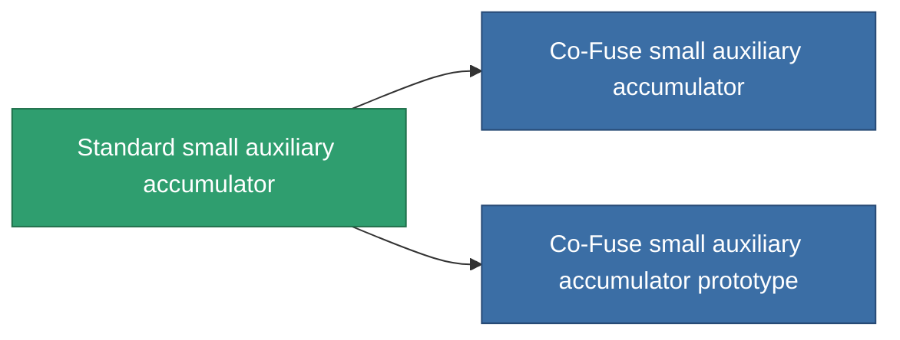

<!-- Generated by tools/generate from the live database (source: entitydefaults definition 645, aggregatevalues via aggregatefields).
     Do not edit by hand; regenerate instead. -->

# Standard small auxiliary accumulator

|  |  |
|---|---|
| Definición | `def_standard_small_core_battery` |
| Nivel | T1 |
| Salud | 100 |
| Volumen | 0.5 |
| Masa | 100 |
| Categoría | Modules / Power |
| Tier line | **Standard small auxiliary accumulator** (T1) → [Co-Fuse small auxiliary accumulator](/es/content/items/named1-small-core-battery/) (T2) → [Ovostec-Ghioc small auxiliary accumulator](/es/content/items/named2-small-core-battery/) (T3) → [Pheter Charge-S small auxiliary accumulator](/es/content/items/named3-small-core-battery/) (T4) |

## Estadísticas

| Campo | Valor |
|---|---|
| core_max | 75 |
| cpu_usage | 35 |
| powergrid_usage | 15 |

<!-- production:generated -->
## Producción

**Producido desde 2 componentes, nivel de investigación 2** — ensambla los componentes para construirlo (lista completa en [Recetas](/es/content/recipes/)):

**Planos:** [Standard small auxiliary accumulator CT](/es/content/items/standard-small-core-battery-cprg/)

<svg class="prod-card-icon" aria-hidden="true"><use href="#mi-grid"/></svg><a class="prod-card-name" href="/es/content/items/axicol/">Cryoperine</a>

requerido: <b>200</b>

<svg class="prod-card-icon" aria-hidden="true"><use href="#mi-grid"/></svg><a class="prod-card-name" href="/es/content/items/titanium/">Titanium</a>

requerido: <b>100</b>

## Usado en producción

**Componente de 2 elementos** — todo lo que lo usa en producción:

