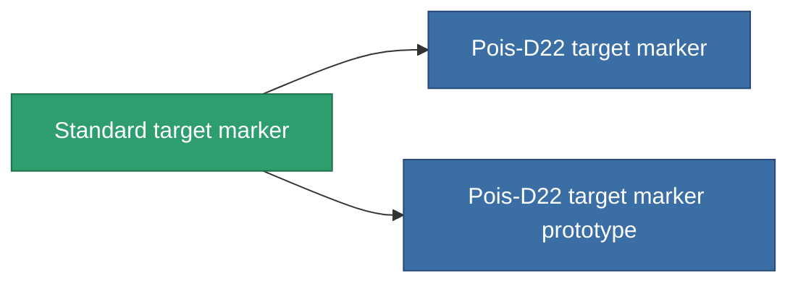

<!-- Generated by tools/generate from the live database (source: entitydefaults definition 2898, aggregatevalues via aggregatefields).
     Do not edit by hand; regenerate instead. -->

# Standard target marker

|  |  |
|---|---|
| Definición | `def_standard_target_painter` |
| Nivel | T1 |
| Salud | 100 |
| Volumen | 0.5 |
| Masa | 500 |
| Categoría | Modules / Enhancements |
| Tier line | **Standard target marker** (T1) → [Pois-D22 target marker](/es/content/items/named1-target-painter/) (T2) → [Colqual target marker](/es/content/items/named2-target-painter/) (T3) → [Pulsus target marker](/es/content/items/named3-target-painter/) (T4) |

## Estadísticas

| Campo | Valor |
|---|---|
| core_usage | 125 |
| cpu_usage | 55 |
| cycle_time | 10k |
| effect_stealth_strength_modifier | -70 |
| optimal_range | 75 |
| powergrid_usage | 20 |

<!-- production:generated -->
## Producción

**Producido desde 3 componentes, nivel de investigación 4** — ensambla los componentes para construirlo (lista completa en [Recetas](/es/content/recipes/)):

**Planos:** [Standard target marker CT](/es/content/items/standard-target-painter-cprg/)

<svg class="prod-card-icon" aria-hidden="true"><use href="#mi-grid"/></svg><a class="prod-card-name" href="/es/content/items/axicol/">Cryoperine</a>

requerido: <b>450</b>

<svg class="prod-card-icon" aria-hidden="true"><use href="#mi-grid"/></svg><a class="prod-card-name" href="/es/content/items/axicoline/">Axicoline</a>

requerido: <b>50</b>

<svg class="prod-card-icon" aria-hidden="true"><use href="#mi-grid"/></svg><a class="prod-card-name" href="/es/content/items/titanium/">Titanium</a>

requerido: <b>200</b>

## Usado en producción

**Componente de 2 elementos** — todo lo que lo usa en producción:

