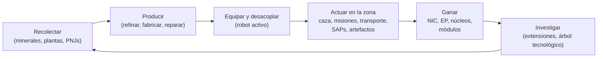

# Qué puedes hacer en el juego

Cada acción del jugador, organizada por sistema. El nombre del comando es el
identificador del lado del servidor; el cliente presenta estas acciones en su propia interfaz. La descripción detallada de cada acción se encuentra en las páginas correspondientes de cada sistema.

El ciclo principal del juego: gana y gasta para ascender en la escala de niveles.

## Sistemas

| Sistema | Página | Qué abarca |
|---|---|---|
| Primeros pasos | [getting-started](/es/features/getting-started/) | creación/selección de personajes, primer robot, conceptos básicos de la cuenta |
| Movimiento | [movement](/es/features/movement/) | zonas, acoplamiento, cola, teletransportes, saltos de spark, puertas |
| Recolección | [gathering](/es/features/gathering/) | escaneo, recolección, obtención de recursos |
| Combate | [combat](/es/features/combat/) | combate, tipos de daño, interferencia, alarmas, informes de bajas, SOS |
| PNJs y caza JcE | [npcs](/es/features/npcs/) | rangos y facciones de PNJs, debilidades, tipos de aparición, TAPs, tácticas |
| Exploración | [exploration](/es/features/exploration/) | artefactos y reliquias |
| Robots y equipamiento | [robots](/es/features/robots/) | selección de robots, módulos, munición, preajustes, tintes |
| Módulos y equipamiento | [modules](/es/features/modules/) | familias de módulos y reglas generales de equipamiento |
| Sparks | [sparks](/es/features/sparks/) | autorización de sparks, cambio, bonificaciones de habilidades |
| Investigación | [research](/es/features/research/) | extensiones (árbol de habilidades), EP, árbol tecnológico |
| Personaje | [character](/es/features/character/) | ventana de personaje: pestaña de extensiones (árbol de habilidades) y sparks |
| Producción | [production](/es/features/production/) | líneas de producción, refinado, reparación, reprocesamiento, prototipos, CPRG |
| Mercado y comercio | [market](/es/features/market/) | órdenes de mercado, intercambios directos, tienda de objetos, créditos |
| Grupos | [groups](/es/features/groups/) | corporaciones, alianzas, bandas (flotas) |
| Estaciones base de energía (PBS) | [pbs](/es/features/pbs/) | estructuras PBS, territorios, conexiones |
| Misiones | [missions](/es/features/missions/) | misiones de campo, agentes, terminales |
| Transporte | [transport](/es/features/transport/) | envío de objetos entre bases |
| Objetos e inventario | [items](/es/features/items/) | contenedores, apilamiento, nombres de objetos, canjeables, paquetes de recompensas |
| Social | [social](/es/features/social/) | correo, canales, amigos, reputaciones, páginas amarillas, noticias, encuestas |
| Intrusión | [intrusion](/es/features/intrusion/) | modo de asalto a instalaciones de PNJs |
| Puestos avanzados y SAP | [outposts](/es/features/outposts/) | propiedad de puestos avanzados, estabilidad, los cuatro tipos de SAP |
| Sondas de proximidad | [probes](/es/features/probes/) | sondas de vigilancia de zona |
| Servidor y referencia | [server](/es/features/server/) | información del servidor, puntuaciones máximas, datos de referencia, compras |
| Preguntas frecuentes (FAQ) | [faq](/es/features/faq/) | tutorial, elección de facción, primeros pasos, terminología |
| Trasfondo (Lore) | [lore](/es/features/lore/) | la ambientación: Nia, los nianos, el Sindicato |
| Configuración de cliente y PC | [client-setup](/es/features/client-setup/) | ejecución del cliente, uso de múltiples cuentas (multi-boxing), escalado de interfaz |

### Referencia

| Página | Qué abarca |
|---|---|
| [Client UI overview](/es/features/ui/) | Interfaz al estilo EVE: barra superior, botón Desplegar/Acoplar, categorías de acciones, panel de estado desacoplado y convenciones utilizadas en esta wiki |

Las tablas de estadísticas de entidades se encuentran en la sección generada [Content](/content/).

## Inventario completo de acciones

### Primeros pasos y cuenta

| Acción | Comando |
|---|---|
| Crear un personaje | `characterCreate` |
| Seleccionar (jugar con) un personaje | `characterSelect` |
| Eliminar un personaje | `characterDelete` |
| Renombrar un personaje | `characterRename` |
| Comprobar disponibilidad de un nombre | `characterCheckNick` |
| Solicitar el robot inicial | `requestStarterRobot` |
| Solicitar la caja inicial | `requestInfiniteBox` |
| Datos de configuración de nuevo personaje | `characterWizardData` |
| Ver mi perfil | `characterGetMyProfile` |
| Ver perfiles de otros personajes | `characterGetProfiles` |
| Buscar personajes | `characterSearch` |
| Listar personajes | `characterList` |
| Obtener/establecer ajustes de personaje | `characterSettingsGet`, `characterSettingsSet` |
| Establecer avatar | `characterSetAvatar` |
| Establecer mensaje de estado | `characterSetMoodmessage` |
| Establecer una nota privada en un personaje | `characterSetNote` / `characterGetNote` |
| Establecer / borrar base de origen | `characterSetHomeBase`, `characterClearHomeBase` |
| Transferir créditos entre personajes propios | `characterTransferCredit` |
| Bloquear/permitir intercambios en un personaje | `characterSetBlockTrades` |
| Cambiar correo / contraseña de la cuenta | `changeSessionEmail`, `changeSessionPassword` |
| Ver historial de EP por actividad | `accountEpForActivityHistory` |
| Ver historial de transacciones de la cuenta | `accountGetTransactionHistory` |
| Cerrar sesión / mantenimiento de conexión | `signOut`, `connectionStart`, `connectionEnd`, `ping`, `quit`, `isOnline`, `transferData`, `welcome` |
| Quién está conectado | `getCharactersOnline`, `getAccountsWithCharacters` |
| Historiales de personaje | `characterNickHistory`, `characterCorporationHistory`, `characterTransactionHistory`, `characterListNpcDeath` |

### Movimiento y zonas

| Acción | Comando |
|---|---|
| Acoplarse en una base / PBS | `dock` |
| Desacoplarse | `undock` |
| Forzar acoplamiento (emergencia) | `forceDock` |
| Consultar cola de entrada a la zona | `zoneGetQueueInfo` |
| Establecer preferencia de longitud de cola | `zoneSetQueueLength` |
| Cancelar espera en la cola | `zoneCancelEnterQueue` |
| Obtener información de la zona | `getZoneInfo` |
| Listar sectores de una zona | `zoneSectorList` |
| Listar edificios de la zona | `zoneGetBuildings` |
| Enviar SOS (pedir ayuda) | `zoneSOS` |
| Listar teletransportes disponibles | `teleportList` |
| Usar un teletransporte | `teleportUse` |
| Teletransportarse a un objeto de la zona | `teleportToZoneObject` |
| Listar canales de teletransporte | `teleportGetChannelList` |
| Consultar canales de teletransporte globales | `teleportQueryWorldChannels` |
| Listar cargas de spark | `sparkList` |
| Cambiar spark activo | `sparkChange` |
| Eliminar un spark | `sparkRemove` |
| Desbloquear un spark | `sparkUnlock` |
| Listar / establecer / usar / eliminar teletransportes de spark | `sparkTeleportList`, `sparkTeleportSet`, `sparkTeleportUse`, `sparkTeleportDelete` |
| Renombrar una puerta | `gateSetName` |
| Información de base / propiedad / instalaciones / mis objetos en la base | `baseGetInfo`, `baseGetOwnershipInfo`, `baseListFacilities`, `baseGetMyItems` |
| Establecer permisos de acoplamiento en la base | `baseSetDockingRights` |

### Recolección y escaneo

| Acción | Comando |
|---|---|
| Escanear la zona (escaneo de mineral/planta/desplegable) | `zoneUploadScanResult` |
| Listar mis resultados de escaneo de minerales | `mineralScanResultList` |
| Crear un objeto a partir de un resultado de escaneo | `mineralScanResultCreateItem` |
| Eliminar un resultado de escaneo | `mineralScanResultDelete` |
| Mover resultados de escaneo entre contenedores | `mineralScanResultMove` |
| Cargar datos de escaneo desde un objeto | `mineralScanResultUploadFromItem` |
| Contar objetos en una zona (comprobación de visibilidad) | `itemCountOnZone`, `itemCount` |
| Quiosco: ver / entregar objetos | `kioskInfo`, `kioskSubmitItem` |
| Usar un objeto (genérico — incl. recolectables) | `useItem` |

### Combate

| Acción | Comando |
|---|---|
| Activar / desactivar alarma de combate | `alarmStart` (el fin de la alarma lo gestiona el servidor) |
| Ver mis informes de bajas | `getMyKillReports` |
| Ver mis puntuaciones máximas | `getMyHighScores` |
| Ver puntuaciones máximas del servidor | `getHighScores` |

### Robots y equipamiento

| Acción | Comando |
|---|---|
| Seleccionar robot activo | `selectActiveRobot` |
| Vaciar un robot (descargar todo) | `robotEmpty` |
| Obtener información del robot | `getRobotInfo` |
| Obtener información de equipamiento del robot | `getRobotFittingInfo` |
| Equipar un módulo | `equipModule` |
| Quitar un módulo | `removeModule` |
| Cambiar módulos | `changeModule` |
| Equipar munición | `equipAmmo` |
| Cambiar munición | `changeAmmo` |
| Desequipar munición | `unEquipAmmo` |
| Establecer tinte del robot | `setRobotTint` |
| Guardar / listar / aplicar / eliminar preajustes de equipamiento | `fittingPresetSave`, `fittingPresetList`, `fittingPresetApply`, `fittingPresetDelete` |

### Investigación (extensiones y árbol tecnológico)

| Acción | Comando |
|---|---|
| Listar categorías de extensiones | `extensionCategoryList` |
| Obtener todas las extensiones | `extensionGetAll` |
| Listar extensiones aprendidas | `extensionLearntList` |
| Listar prerrequisitos | `extensionPrerequireList` |
| Comprar una extensión con puntos | `extensionBuyForPoints` |
| Comprar una mejora de EP | `extensionBuyEpBoost` |
| Obtener puntos disponibles | `extensionGetAvailablePoints` |
| Obtener parámetros de puntos | `extensionGetPointParameters` |
| Historial de extensiones | `extensionHistory` |
| Quitar un nivel de extensión | `extensionRemoveLevel` |
| Restablecer extensiones del personaje | `extensionResetCharacter` |
| Liberar EP bloqueado | `extensionFreeLockedEp` |
| Ver registro diario de EP por actividad | `epForActivityDailyLog` |
| Obtener niveles de investigación | `getResearchLevels` |
| Árbol tecnológico: investigar un nodo | `techTreeResearch` |
| Árbol tecnológico: desbloquear un nodo | `techTreeUnlock` |
| Árbol tecnológico: donar | `techTreeDonate` |
| Árbol tecnológico: información / registros | `techTreeInfo`, `techTreeGetLogs` |

### Producción

| Acción | Comando |
|---|---|
| Listar líneas de producción | `productionLineList` |
| Iniciar una línea | `productionLineStart` |
| Calibrar una línea | `productionLineCalibrate` |
| Establecer ciclos en una línea | `productionLineSetRounds` |
| Eliminar una línea | `productionLineDelete` |
| Consultar próximo ciclo de una línea | `productionQueryLineNextRound` |
| Cancelar producción | `productionCancel` |
| Refinar (consultar + ejecutar) | `productionRefine`, `productionRefineQuery` |
| Reparar (consultar + ejecutar) | `productionRepair`, `productionRepairQuery` |
| Reprocesar (consultar + ejecutar) | `productionReprocess`, `productionReprocessQuery` |
| Investigar componentes (consultar + ejecutar) | `productionResearch`, `productionResearchQuery` |
| Prototipar (iniciar + consultar) | `productionPrototypeStart`, `productionPrototypeQuery` |
| Fusionar kits de investigación (ejecutar + consultar) | `productionMergeResearchKitsMulti`, `productionMergeResearchKitsMultiQuery` |
| Forjar CPRG (ejecutar + consultar) | `productionCPRGForge`, `productionCPRGForgeQuery` |
| Información de CPRG | `productionCPRGInfo` |
| Obtener CPRG de una línea (obtener + consultar) | `productionGetCPRGFromLine`, `productionGetCPRGFromLineQuery` |
| Seguro de producción: comprar / listar / consultar / eliminar | `productionInsuranceBuy`, `productionInsuranceList`, `productionInsuranceQuery`, `productionInsuranceDelete` |
| Listar componentes de producción | `productionComponentsList` |
| Información / descripción de la instalación | `productionFacilityInfo`, `productionFacilityDescription` |
| Qué está en progreso (propio / corporación) | `productionInProgress`, `productionInProgressCorporation` |
| Historial de producción | `productionHistory` |
| Información del servidor de producción | `productionServerInfo` |

### Mercado y comercio

| Acción | Comando |
|---|---|
| Crear una orden de venta | `marketCreateSellOrder` |
| Crear una orden de compra | `marketCreateBuyOrder` |
| Modificar una orden | `marketModifyOrder` |
| Cancelar un objeto / orden | `marketCancelItem` |
| Comprar un objeto directamente | `marketBuyItem` |
| Listar objetos del mercado | `marketItemList` |
| Listar objetos disponibles para mí | `marketAvailableItems` |
| Listar objetos en un rango | `marketItemsInRange` |
| Listar mis objetos en el mercado | `marketGetMyItems` |
| Información del mercado | `marketGetInfo` |
| Precios medios (mercado / definición / global) | `marketGetAveragePrices`, `marketGetDefinitionAveragePrice`, `marketGlobalAveragePrices` |
| Modificar impuesto del mercado / ver registro de impuestos | `marketTaxChange`, `marketTaxLogList` |
| Iniciar un intercambio | `tradeBegin` |
| Establecer / retirar mi oferta | `tradeSetOffer`, `tradeRetractOffer` |
| Aceptar un intercambio | `tradeAccept` |
| Cancelar un intercambio | `tradeCancel` |
| Intercambio finalizado / estado | `tradeFinished`, `tradeState` |
| Tienda de objetos: listar / comprar | `itemShopList`, `itemShopBuy` |
| Transferir créditos a otro personaje | `characterTransferCredit` |

### Grupos (corporaciones, alianzas, bandas)

| Acción | Comando |
|---|---|
| Crear una corporación | `corporationCreate` |
| Solicitar ingreso / invitar a una corporación | `corporationApply`, `corporationCharacterInvite` |
| Aceptar solicitud / listar solicitudes | `corporationAcceptApplication`, `corporationListApplications` |
| Mis solicitudes: listar / eliminar | `corporationListMyApplications`, `corporationDeleteMyApplication` |
| Eliminar una solicitud (oficial) | `corporationDeleteApplication` |
| Responder a una invitación | `corporationInviteReply` |
| Abandonar / cancelar abandono | `corporationLeave`, `corporationCancelLeave` |
| Expulsar a un miembro / asignar rol a un miembro | `corporationRemoveMember`, `corporationSetMemberRole` |
| Renunciar a todos mis roles | `corporationDropRoles` |
| Establecer miembros como neutrales | `corporationSetMembersNeutral` |
| Información de la corporación / mi información / buscar | `corporationInfo`, `corporationGetMyInfo`, `corporationSearch` |
| Relaciones / reputación de la corporación | `corporationGetMyStandings`, `corporationGetReputation` |
| Donar a / retirar fondos de la corporación | `corporationDonate`, `corporationPayOut` |
| Transferir créditos de la corporación | `corporationTransfer` |
| Renombrar / asignar color / editar información | `corporationRename`, `corporationSetColor`, `corporationSetInfo` |
| Obtener delegados | `corporationGetDelegates` |
| Estado de sucesión de CEO / postularse como CEO | `corporationCEOTakeOverStatus`, `corporationVolunteerForCEO` |
| Votaciones de corporación: iniciar / definir tema / listar / votar / eliminar | `corporationVoteStart`, `corporationVoteSetTopic`, `corporationVoteList`, `corporationVoteCast`, `corporationVoteDelete` |
| Tablón de anuncios: iniciar / listar / nuevas entradas / publicar / moderar / eliminar | `corporationBulletinStart`, `corporationBulletinList`, `corporationBulletinNewEntries`, `corporationBulletinEntry`, `corporationBulletinModerate`, `corporationBulletinDelete`, `corporationBulletinEntryDelete`, `corporationBulletinDetails` |
| Hangar: alquilar / pagar alquiler / precio de alquiler / cerrar | `corporationRentHangar`, `corporationHangarPayRent`, `corporationHangarRentPrice`, `corporationHangarClose` |
| Hangar: listar (todos / en base) | `corporationHangarListAll`, `corporationHangarListOnBase` |
| Hangar: carpetas (crear / eliminar) | `corporationHangarFolderCreate`, `corporationHangarFolderDelete` |
| Hangar: asignar acceso / asignar nombre | `corporationHangarSetAccess`, `corporationHangarSetName` |
| Registros del hangar: listar / establecer / vaciar | `corporationHangarLogList`, `corporationHangarLogSet`, `corporationHangarLogClear` |
| Documentos de corporación: configurar / crear / listar / abrir / eliminar / transferir / alquilar / supervisar / dejar de supervisar / actualizar contenido / lista de registros / asignar registro | `corporationDocumentConfig`, `corporationDocumentCreate`, `corporationDocumentList`, `corporationDocumentOpen`, `corporationDocumentDelete`, `corporationDocumentTransfer`, `corporationDocumentRent`, `corporationDocumentMonitor`, `corporationDocumentUnmonitor`, `corporationDocumentUpdateBody`, `corporationDocumentRegisterList`, `corporationDocumentRegisterSet` |
| Historiales: registro / roles de miembros / roles de corporación / roles / nombre / transacciones | `corporationLogHistory`, `corporationMemberRoleHistory`, `corporationRoleHistory`, `corporationNameHistory`, `corporationTransactionHistory` |
| Información de alianza / valores por defecto / historial de roles | `allianceGetMyInfo`, `allianceGetDefaults`, `allianceRoleHistory` |
| Banda (flota): crear / eliminar / información | `gangCreate`, `gangDelete`, `gangInfo` |
| Banda: invitar / responder / expulsar / abandonar | `gangInvite`, `gangInviteReply`, `gangKick`, `gangLeave` |
| Banda: asignar líder / asignar rol | `gangSetLeader`, `gangSetRole` |

### Estaciones base de energía (PBS) y territorios

| Acción | Comando |
|---|---|
| Obtener red PBS | `PBSGetNetwork` |
| Información de nodo PBS | `PBSNodeInfo` |
| Renombrar un nodo PBS | `PBSRenameNode` |
| Establecer / cortar una conexión PBS | `PBSMakeConnection`, `PBSBreakConnection` |
| Establecer peso de conexión | `PBSSetConnectionWeight` |
| Establecer estado en línea de PBS | `PBSSetOnline` |
| Establecer un efecto PBS | `PBSSetEffect` |
| Comprobar despliegue (¿puedo desplegar aquí?) | `PBSCheckDeployment` |
| Listar mis territorios | `PBSGetTerritories` |
| Establecer visibilidad del territorio | `PBSSetTerritoryVisibility` |
| Establecer límite de reputación | `PBSSetStandingLimit` |
| Establecer desfase de refuerzo | `PBSSetReinforceOffset` |
| Obtener / establecer información de reembolso | `PBSGetReimburseInfo`, `PBSSetReimburseInfo` |
| Suministrar objetos a una PBS | `PBSFeedableInfo`, `PBSFeedItems` |
| Establecer desmantelamiento de base | `PBSSetBaseDeconstruct` |
| Registros de PBS | `PBSGetLog` |

### Misiones

| Acción | Comando |
|---|---|
| Iniciar una misión | `missionStart` |
| Iniciar una misión desde una zona | `missionStartFromZone` |
| Cancelar una misión | `missionAbort` |
| Entregar (entrega de misión) | `missionDeliver` |
| Datos de misión / opciones / suministro | `missionData`, `missionGetOptions`, `missionGetSupply` |
| Listar agentes de misiones | `missionListAgents` |
| Listar mis misiones en curso | `missionListRunning` |
| Registro de misiones | `missionLogList` |
| Añadir un participante a una misión | `missionPlayerAddsParticipant` |
| Información de terminal de campo | `fieldTerminalInfo` |

### Transporte (envío de objetos)

| Acción | Comando |
|---|---|
| Crear una orden de transporte | `transportAssignmentSubmit` |
| Aceptar un transporte (como transportista) | `transportAssignmentTake` |
| Listar transportes | `transportAssignmentList` |
| Listar contenido del transporte | `transportAssignmentListContent` |
| Información del contenedor para un transporte | `transportAssignmentContainerInfo` |
| Entregar un transporte | `transportAssignmentDeliver` |
| Recuperar mi transporte | `transportAssignmentRetrieve` |
| Cancelar / renunciar a un transporte | `transportAssignmentCancel`, `transportAssignmentGiveUp` |
| ¿Está un transporte en curso? | `transportAssignmentRunning` |
| Registro de transporte | `transportAssignmentLog` |

### Objetos e inventario

| Acción | Comando |
|---|---|
| Listar contenido de un contenedor | `listContainer` |
| Empaquetar objetos (en una bolsa/caja) | `packItems` |
| Desempaquetar objetos | `unpackItems` |
| Apilar objetos | `stackItems`, `stackTo`, `stackSelection` |
| Desapilar una cantidad | `unStackAmount` |
| Reubicar objetos entre contenedores | `relocateItems` |
| Desechar objetos | `trashItems` |
| Renombrar un objeto | `setItemName` |
| Usar un objeto | `useItem` |
| Usar un objeto de lotería | `useLotteryItem` |
| Canjeables: listar / canjear / activar | `redeemableItemList`, `redeemableItemRedeem`, `redeemableItemActivate` |
| Paquetes de recompensas: listar / canjear | `goodiePackList`, `goodiePackRedeem` |
| Abrir un regalo | `giftOpen` |
| Reembolsar un objeto | `ReimburseItem` |

### Social

| Acción | Comando |
|---|---|
| Correo: listar / abrir / enviar / eliminar / recuento de nuevos / carpetas usadas / mover a carpeta / eliminar carpeta | `mailList`, `mailOpen`, `mailSend`, `mailDelete`, `mailNewCount`, `mailUsedFolders`, `mailMoveToFolder`, `mailDeleteFolder` |
| Correo masivo (corporación): enviar / listar / abrir / eliminar / recuento de nuevos | `massMailSend`, `massMailList`, `massMailOpen`, `massMailDelete`, `massMailNewCount` |
| Amigos: enviar / responder / confirmar / eliminar / bloquear / listar | `socialFriendRequest`, `socialFriendRequestReply`, `socialConfirmPendingFriendRequest`, `socialDeleteFriend`, `socialBlockFriend`, `socialGetMyList` |
| Canales de chat: crear / unirse / salir / hablar | `channelCreate`, `channelJoin`, `channelLeave`, `channelTalk` |
| Canales: listar (todos / míos) | `channelList`, `channelMyList`, `channelListAll` |
| Canales: expulsar / banear / desbanear / roles / silenciar / contraseña / tema / notificación | `channelKick`, `channelBan`, `channelRemoveBan`, `channelModifyMemberRole`, `channelGlobalMute`, `channelGetMutedCharacters`, `channelGetBannedMembers`, `channelSetPassword`, `channelSetTopic`, `channelNotification` |
| Chat directo | `chat` |
| Reputaciones: listar / historial | `standingList`, `standingHistory` |
| Establecer reputación (donde esté permitido) | `setStanding` |
| Reputaciones por defecto (alianzas / corporaciones) | `getStandingForDefaultAlliances`, `getStandingForDefaultCorporations` |
| Páginas amarillas: obtener / publicar / eliminar / buscar | `yellowPagesGet`, `yellowPagesSubmit`, `yellowPagesDelete`, `yellowPagesSearch` |
| Noticias: categorías / listar / recuento de nuevas | `newsCategory`, `getNews`, `freshNewsCount` |
| Encuestas: ver / responder | `pollGet`, `pollAnswer` |

### Intrusión

| Acción | Comando |
|---|---|
| Entregar un objeto de SAP | `intrusionSAPSubmitItem` |
| Obtener información de objeto de SAP | `intrusionSAPGetItemInfo`, `intrusionSAPItemInfo` |
| Establecer umbral de defensa | `intrusionSetDefenseThreshold` |
| Establecer bonificación de efecto de instalación | `intrusionSiteSetEffectBonus` |
| Mejorar una instalación | `intrusionUpgradeFacility` |
| Información de instalación | `getIntrusionSiteInfo` |
| Registros: míos / públicos / mis instalaciones / estabilidad | `getIntrusionLog`, `getIntrusionPublicLog`, `getIntrusionMySitesLog`, `getIntrusionStabilityLog` |
| Umbrales de bonificación de estabilidad | `getStabilityBonusThresholds` |
| Establecer mensaje de la instalación | `setIntrusionSiteMessage` |

### Sondas de proximidad

| Acción | Comando |
|---|---|
| Listar mis sondas | `proximityProbeList` |
| Información de registro de sonda | `proximityProbeGetRegistrationInfo` |
| Establecer registro en una sonda | `proximityProbeRegisterSet` |
| Eliminar un registro de sonda | `proximityProbeRemove` |
| Poner nombre a una sonda | `proximityProbeSetName` |

### Servidor y referencia

| Acción | Comando |
|---|---|
| Información del servidor | `serverInfoGet`, `systemInfo` |
| Puntuaciones máximas (servidor / mías) | `getHighScores`, `getMyHighScores` |
| Lista de grietas (rifts) | `getRifts` |
| Datos de referencia: efectos / enumeraciones / valores por defecto de entidades / campos agregados / configuración de definiciones / distancias | `getEffects`, `getEnums`, `getEntityDefaults`, `getAggregateFields`, `getDefinitionConfigUnits`, `getDistances` |
| Resumen de objetos (datos de referencia del cliente) | `getItemSummary` |
| Listar comandos del servidor (referencia del lado del cliente) | `getCommands` |
| Tienda: listar productos / iniciar / finalizar transacción | `steamGetProducts`, `steamStartTransaction`, `steamFinishTransaction` |