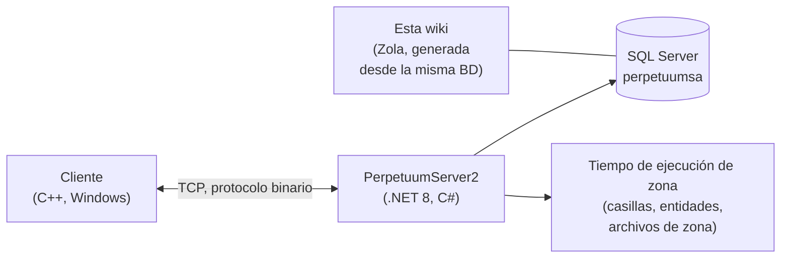

# Inicio para desarrolladores

Un mapa de alto nivel sobre el funcionamiento del juego desde el punto de vista del desarrollador/devops.
Próximamente habrá páginas dedicadas con mayor nivel de detalle; por ahora, esta es la orientación general.

## Las piezas

- **Cliente** — el cliente de juego de Perpetuum (Windows; consulta [Configuración de PC y cliente](/es/features/client-setup/)
  para ejecutarlo, incluido Linux). Se comunica con el servidor a través de un protocolo binario TCP;
  cada acción del jugador es un *comando* con nombre (los mismos nombres que utiliza esta wiki en el
  [inventario de acciones](/es/features/#complete-action-inventory)).
- **Servidor (PerpetuumServer2)** — un código base en C#/.NET 8. Un único proceso ejecuta
  todo el servidor: la capa de conexión, la lógica del juego (robots, zonas, misiones,
  mercado, producción, investigación) y el tiempo de ejecución de zonas que procesa el
  mundo de casillas de cada zona (terreno, entidades, teletransportes).
- **Base de datos** — SQL Server, base de datos `perpetuumsa`. Contenido estático del juego (valores por defecto de
  entidades, recetas, extensiones, árbol tecnológico, tienda, descripciones de teletransporte) y todo
  el estado dinámico (personajes, robots, contenedores, mercado, estado de zonas).
- **Archivos de zona** — las zonas son cuadrículas de casillas (capas de altitud y control, 2 bytes/
  casilla) distribuidas en archivos `.gbf` y editables por zona; consulta el
  [formato de archivos de zona](/es/formats/zone-files/).
- **Datos de referencia** — el cliente descarga tablas de estadísticas del servidor al
  iniciar (consulta [Servidor y referencia](/es/features/server/)).

## Ejecución

- El servidor se ejecuta en Docker Compose junto a SQL Server
  (el proyecto `perpetuumserver2`); el contenedor de base de datos es lo que lee el
  generador de esta wiki.
- El contenido estático se valida contra los archivos de reglas **plantrules**; el generador en C#
  de la wiki (`make generate`) se ejecuta en el mismo ecosistema y lee la misma
  base de datos, por lo que cada tabla generada en este sitio refleja datos del servidor en vivo.
- Los mapas de teletransporte de zonas de esta wiki se renderizan a partir de las mismas capas de
  altitud que utiliza el propio juego.

## Dónde ir después

- **[Formatos](/es/formats/)** — referencia de campos para desarrolladores: cómo se almacena cada campo
  de estadísticas (columna de base de datos, clave de archivo de reglas, byte de capa binaria) y cómo se
  consume, con ejemplos prácticos.
- **[Servidor y referencia](/es/features/server/)** — los metasistemas: información del servidor,
  puntuaciones más altas, los datos de referencia que descarga el cliente y la tienda del juego.

> Están previstas más páginas para desarrolladores (protocolo, ciclo de vida de zonas, despliegue);
> esta página es el punto de inicio para ellas.
