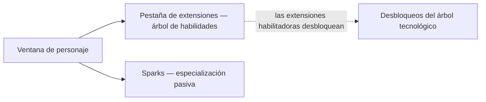

# Personaje

La **ventana de personaje** (barra superior → **Personaje**, arriba a la izquierda) es donde reside la progresión
de tu personaje: perfil, créditos, las **extensiones** (habilidades) y la configuración.
Todo en esta página es por personaje — las cuentas pueden albergar varios, cada uno con su
propio árbol. Las ubicaciones de la interfaz siguen el [resumen de la interfaz del cliente](/es/features/ui/).

## Extensiones

La **pestaña de extensiones** es el árbol de habilidades del personaje: niveles de habilidad por personaje
que desbloquean mecánicas de juego y ajustan atributos — especialmente las **extensiones
habilitadoras** requeridas para pilotar una clase de robot. El nivel 1 cuesta créditos; cada nivel
posterior cuesta Puntos de Extensión (EP), y los prerrequisitos marcan el camino.

- [Categorías principales](/es/content/extensions/#categories) — las 15 categorías de un vistazo:
  qué categorías abren paso a cuáles (haz clic en un recuadro para ir a sus fichas)
- [Extensiones por categoría](/es/content/extensions/#table) — cada extensión: rango,
  precio, bonificación, prerrequisitos
- Cómo funcionan los EP y el árbol tecnológico: [Investigación](/es/features/research/)

## Sparks

Tu **spark** es la especialización de nanobots instalada en el personaje — mientras esté
activo, sus bonificaciones se aplican a cada robot que pilotes. Cambiar de spark tiene un coste;
la autorización regula las líneas superiores. Detalles en [Sparks](/es/features/sparks/).
