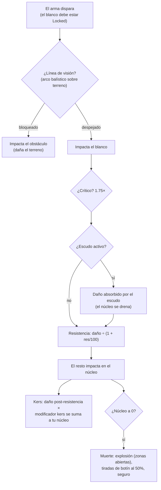

# Combate

El combate tiene lugar **en zonas**, con tu robot activo. Luchas contra otros jugadores (PvP),
NPCs y estructuras hostiles. Esta página cubre las mecánicas confirmadas en el lado
del servidor; las interacciones detalladas de daño/equipamiento residen en [robots y equipamiento](/es/features/robots/).

> Las ubicaciones de la interfaz siguen el [resumen de la interfaz del cliente](/es/features/ui/): el **escudo/blindaje/casco y
> energía** de tu robot se muestran en el panel de estado desacoplado. Los controles de fijación de objetivos
> y armas en combate se detallan a continuación.

## Entrar en combate

- Solo puedes luchar mientras estás **desacoplado** — tú eres tu robot activo.
- Disparar un arma ofensiva a otro jugador en una zona abierta (PvP) activa la
  **marca (flag) de PvP** en el atacante. Responder al fuego, o usar un módulo de apoyo sobre un
  jugador ya marcado, también te marca a ti. La marca dura **5 minutos**
  (la definición `effect_pvp`, 300 000 ms) y se renueva con cada nuevo acto
  de agresión.
- Mientras la marca está activa:
  - **no puedes usar teletransportes** (incluidos los móviles), y
  - **no puedes acoplarte con normalidad** — la única salida es el **acoplamiento forzado (force dock)**, el cual
    no está bloqueado por la marca deliberadamente.

## Qué puedes combatir

- **Robots de otros jugadores** (PvP).
- **NPCs** — los NPCs de zona se organizan en **manadas (flocks)** (grupos con comportamiento compartido).
- **Estructuras hostiles / desplegables** en la zona.

## Cuando tu robot es destruido

Tu robot es **destruido** y aparece un **contenedor de botín** donde cayó. El botín se
determina por objeto, con una tirada del 50% para cada uno:

| Qué | Destino |
|---|---|
| Cada **módulo** equipado | 50% de probabilidad de caer **dañado** (reparable); de lo contrario se destruye |
| La **munición** cargada de cada módulo | 50% de probabilidad de caer (solo si cayó el módulo) |
| **Carga** (paquetes/cajas) | el contenido cae como botín, el envoltorio se destruye |
| Otros **objetos apilables** en bodega | 50% de probabilidad de caer, con una cantidad reducida al azar (el resto se destruye) |
| Tu **pintura/tinte** | 50% de probabilidad de caer como objeto de pintura |
| El **propio robot** | destruido — salvo que tuviera un **seguro** activo, en cuyo caso la indemnización se te paga en créditos (el robot se pierde igualmente) |

El **seguro** (contratado en la instalación de seguros de una base, acoplado — ver
[producción → seguro](/es/features/production/)) cubre un robot durante **15 días** (más
días de bonificación por extensiones). Cada robot tiene una **tasa** y una **indemnización** definidas
por el contenido (la tabla `insuranceprices` — 67 definiciones de robots); la tasa se puede reducir mediante una
extensión y pagar desde la cartera corporativa. Los robots novatos no se pueden asegurar. Puedes mantener
seguro en 1 + (bonificación de extensión) robots.

Tras ser destruido te quedas **sin robot activo**. Para volver a la acción puedes:

- **seleccionar otro robot** de tu propiedad que tenga las extensiones habilitadoras necesarias, o
- **solicitar un robot inicial** mientras estás acoplado — pero hay un breve bloqueo tras ser abatido:
  **3 minutos si te abatió un jugador, 1 minuto si fue un NPC**. Si te abatió un **NPC**, la
  base también te entrega un **robot inicial gratis** automáticamente al volver.

## Escapar

Cuando una batalla se tuerce:

- **Forzar acoplamiento (force dock)** — la salida de emergencia. Te saca de la zona y te atraca en
  la base principal (TMA) de inmediato, incluso en pleno combate.
- **SOS** — una salida alternativa: te acopla en la base actual tras el retardo normal
  de desacoplamiento (7 segundos).

Ambos son tus salvavidas; forzar acoplamiento es el botón de "estoy a punto de morir".

## Fijación de objetivo, alcance e impacto

- **Fijar primero.** Las armas solo disparan a blancos *fijados (locked)* — y solo una vez que
  la fijación se ha completado. Fijar un blanco requiere el **tiempo de fijación** de tu robot (una estadística en ms);
  disparar mientras aún está en progreso es rechazado. Puedes mantener varios blancos fijados a la
  vez (limitado por la estadística de **máximo de blancos fijados**), pero solo uno es el *primario*, y
  algunas armas solo disparan al objetivo primario.
- **Alcance óptimo + caída (falloff).** Dentro del **alcance óptimo** de un arma infliges daño
  completo. Más allá de este, el daño disminuye suavemente a lo largo de la distancia de **caída** —
  aproximadamente la mitad de daño en el punto medio de la caída, y cero en su límite exterior. Más allá del
  alcance óptimo + caída no infliges daño en absoluto.
- **Tamaño de dispersión vs. tamaño del objetivo.** Las armas de fuego convencionales no "fallan": la estadística
  de **precisión** de un cañón actúa como un radio de dispersión, y un blanco cuya **firma** sea menor que este
  recibe proporcionalmente menos daño. Los misiles *sí* pueden fallar completamente (la probabilidad de fallo
  depende de la precisión de misiles del robot), pero al impactar detonan con su **radio de explosión** — y,
  al igual que con las armas de fuego, un blanco pequeño recibe menos impacto de la deflagración.
- **Impactos críticos.** Cada disparo comprueba tu **probabilidad de impacto crítico**; un crítico
  multiplica todo el impacto por 1.75×, y cada disparo varía además aleatoriamente en un ±10%.
- **Línea de visión.** Los disparos viajan en línea recta y el terreno, los obstáculos y las
  plantas los bloquean. Los misiles describen un arco y pueden superar coberturas bajas — pero el arco es
  limitado, por lo que las elevaciones altas siguen bloqueando.
- **Tu propio escudo bloquea tus propias armas.** Mientras tu escudo está activo, tus
  armas no pueden disparar.

### Tipos de daño

La munición transporta el daño: cada munición tiene valores para uno o más tipos de daño —
generalmente un tipo dominante más un secundario menor (la munición de misiles es explosiva
más cinética o química; los cristales láser, térmicos más químicos; los proyectiles de cañón de riel,
cinéticos más térmicos). Los tipos:

| Tipo | Notas |
|---|---|
| **Químico** | El componente habitual de la munición de cañones y láseres |
| **Cinético** | Munición de cañones de riel, proyectiles y misiles |
| **Térmico** | Láseres, algunas municiones de proyectiles |
| **Explosivo** | Misiles |
| **Tóxico** | Cierta munición de cañones; solo daña plantas y terreno |
| **Eléctrico** | Efectos especiales (p. ej., el scorcher) — **penetra escudos** |

El daño recibido se reduce por tipo mediante la **resistencia** del objetivo a ese tipo:
una resistencia del 50% reduce el daño en 50/(50+100) ≈ 33%. Las resistencias solo se aplican a lo que
logra *traspasar* el escudo — el escudo absorbe primero, a expensas de la energía
del núcleo del escudo: cuanto más duro es el impacto, más energía cuesta. Los módulos **Kers**
permiten que una parte de un tipo de daño recargue la energía del núcleo directamente incluso después de
la resistencia. La [aleación adaptativa](/es/features/modules/#the-module-families)
redistribuye tus resistencias hacia el tipo de daño que realmente te está impactando.

## Detección, enmascaramiento y velocidad

- **Detección vs. enmascaramiento.** Puedes ver una unidad dentro de un rango que aumenta con
  tu atributo de **detección** y disminuye con el atributo de **enmascaramiento (masking)** del objetivo —
  aproximadamente 100 m × detección ÷ enmascaramiento. Una unidad que te ha fijado como objetivo es siempre
  visible para ti, independientemente de su enmascaramiento. Los módulos de sigilo aumentan temporalmente
  tu propio enmascaramiento (ver [módulos](/es/features/modules/)); las minas utilizan un rango de detección
  específico en su lugar.
- **Campo de masa (Blob).** Algunas unidades y estructuras emiten un campo *blob*. Mientras estés dentro del
  radio de un emisor, el nivel de blob en tu unidad aumenta; entre tus dos umbrales de blob
  **aumenta tu tiempo de fijación** (hasta 6× el valor base) y **reduce tu alcance de fijación y potencia de sensores**
  (hasta la mitad).
- **Velocidad.** La velocidad punta disminuye con la masa: velocidad = base × (masa de diseño ÷ masa
  real) — cada tonelada de módulos adicionales, blindaje y carga que lleves te hace más lento.
- **Desmovilización ("demob").** El efecto ralentizador (webber) reduce la velocidad punta del blanco.
  La intensidad de la reducción escala con la **masividad (massiveness)** del blanco — las unidades más pesadas
  se ven más ralentizadas, por lo que los objetivos grandes y lentos son los que más lo sufren.

## Alarmas

Una **alarma** se activa en una zona mediante un **interruptor de alarma** (una estructura vinculada
a misiones). Cuando se inicia:

- Se ejecuta durante un **periodo de alarma** fijo (definido por la misión; corto por defecto).
- Debes **permanecer dentro del alcance del interruptor** durante todo el periodo — se comprueba
  cada dos segundos, y alejarse cancela la alarma.
- Solo puedes tener **una alarma activa al mismo tiempo**.

Las alarmas están vinculadas al contenido de misiones — consulta [misiones](/es/features/missions/).

## Informes de bajas (kill reports)

Tu historial de combate está disponible en forma de **informes de bajas**:

- Filtrar por **ventana temporal**.
- Filtrar por **rol**: como **víctima**, **atacante** o **ejecutor**.

Úsalos para revisar cómo caíste o a quién destruiste.

## Puntuaciones más altas

- **Puntuaciones del servidor** — los mejores registros de todo el servidor.
- **Mis puntuaciones** — tus marcas personales.

## Notas prácticas

- **No mueras por descuido** — un robot destruido supone tiempo de inactividad mientras te reequipas o
  solicitas uno nuevo.
- **Forzar acoplamiento es instantáneo** — si estás en inferioridad, ve a TMA ya; podrás rearmarte después.
- **El PvP bloquea teletransportes** — planifica tus escapes; no puedes saltar fuera de un combate.
- **Las alarmas son una señal** — una alarma activa significa que hay un evento de misión en marcha en esa zona.

<!-- Developer notes: combat mechanics, locking, damage calculation, resistances, detection, alarms. -->
