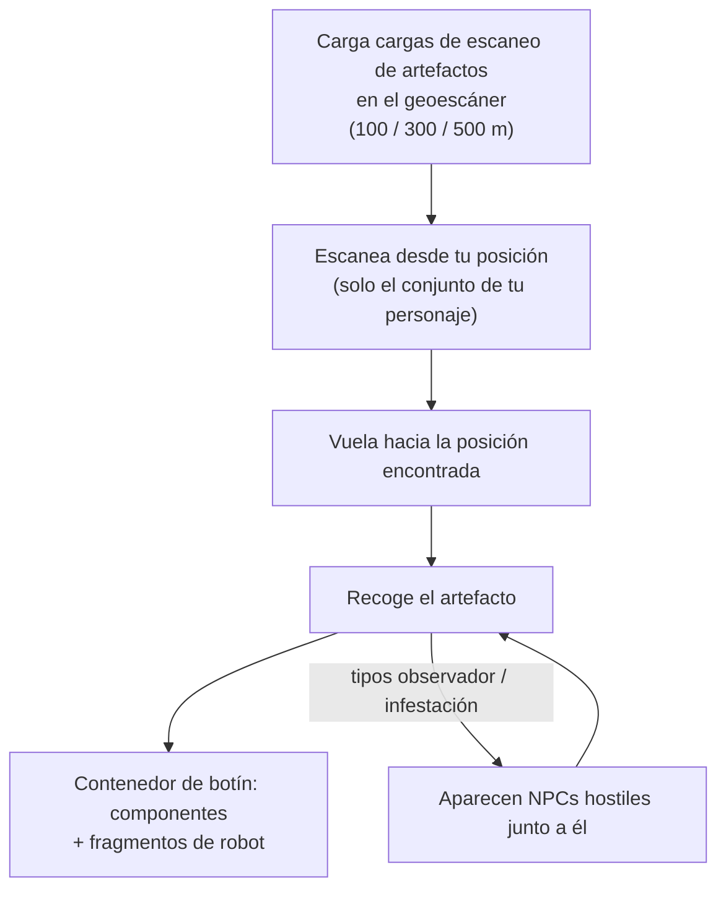

# Exploración (artefactos y reliquias)

La exploración consiste en encontrar valor oculto en el terreno — una excelente actividad en solitario
a cualquier nivel. Se presenta en dos modalidades: **artefactos**, que son personales y están ocultos,
y **reliquias**, que son abiertas y disputadas.

## Exploración de artefactos

Los artefactos son puntos que existen **por personaje**: el servidor mantiene un conjunto
separado de artefactos para cada personaje en cada isla, por lo que lo que encuentras es tuyo
exclusivamente. Son invisibles hasta que los escaneas.

1. Carga **cargas de escaneo de artefactos** en un módulo geoescáner. Hay tres
   grados de cargas con diferentes alcances de escaneo (100 / 300 / 500 m).
2. Escanea desde la posición de tu robot — el escáner devuelve las posiciones de los artefactos
   dentro del alcance (el atributo de precisión del geoescáner reduce el margen de error de la posición indicada).
3. Vuela hacia la posición encontrada y recoge el artefacto; este genera un **contenedor
   de botín** en el lugar.

Dos factores convierten la exploración de artefactos en una actividad tanto de combate como de recolección:

- Algunos tipos de artefactos **generan NPCs junto a ti** — las variantes "observador" e
  "infestación" atraen hostiles en el momento en que se encuentra el artefacto, así que
  pilota algo que pueda combatir.
- El botín es aleatorio por tipo de artefacto: componentes de módulos (placas de blindaje, endurecedores,
  generadores, reparadores…) y **fragmentos de robot** — los ingredientes de investigación/producción
  específicos de cada facción, lo que convierte la búsqueda de artefactos en una carrera
  industrial fundamental.

Los tipos de artefactos se dividen en niveles (niveles 1–3, más botín en niveles superiores) y existen en
variantes neutrales y específicas de cada facción.

## Caza de reliquias

Las reliquias son de **mundo abierto**: la zona las genera en posiciones aleatorias (en un
ciclo de reaparición de aproximadamente 90 minutos con dispersión aleatoria), son objetos visibles
con un haz luminoso, y quien recoja una primero se lleva el botín. El botín es una tirada de
NIC más **fragmentos de robot**, escalado según el nivel de la reliquia y el nivel de valor de la isla
— los mismos fragmentos que produce la exploración de artefactos.

Los tipos de reliquias se dividen en niveles por isla (niveles 1–3, con diferentes valores de EP según el
nivel) y vienen en variantes neutrales, por facción e industriales. Algunas reliquias
están vinculadas a [puestos de avanzada](/es/features/outposts/) — la actividad SAP genera sus propias
reliquias, que duran hasta 12 horas — y en islas de PvP abierto los puntos de aparición
se encuentran en terreno disputado, por lo que es de esperar encontrarse con otros cazadores.

## Las misiones también pagan por ello

Las [misiones](/es/features/missions/) también pueden encomendarte tareas de artefactos,
donde se te paga directamente y las mercancías van al empleador en lugar de a tu
inventario.

<!--
Written from scratch against the server backend, 2026-09-27:
Zones/Artifacts/Repositories/ZoneArtifactRepository.cs (per-character artifact
rows), Zones/Scanning/Scanners/Scanner.Artifact.cs (scan range + accuracy),
Zones/Artifacts/Generators/Loot/ (random loot per type),
Services/Relics/RelicManagers/ZoneRelicManager.cs (~1.5 h respawn + random
window) and SAPRelic.cs (12 h lifespan),
artifacttypes/artifactloot/relictypes/relicloot tables,
ammo_artifact_scan_a/b/c (scan ranges 100/300/500).
An earlier version of this page was adapted from the Open Perpetuum
community wiki (perpetuum.miraheze.org) and has been fully rewritten from
backend sources; no text was reused.
-->
