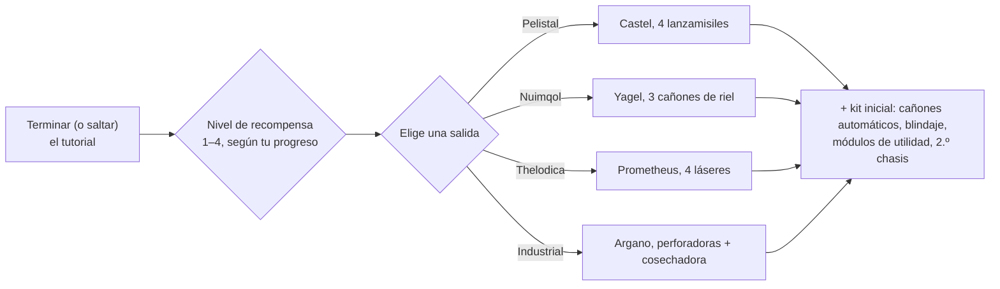

# Preguntas frecuentes

## ¿Puedo saltarme el tutorial?

Puedes salir de la zona de entrenamiento antes de tiempo, pero renunciarás a la recompensa que
se obtiene al completarlo. Cuando un personaje sale del tutorial, el servidor:

- paga el **NIC inicial** más una bonificación **por nivel de recompensa** que hayas obtenido en el
  tutorial (hay cuatro niveles de recompensa),
- te traslada a la **corporación por defecto** de la raza y escuela que elegiste,
- te concede tus **extensiones iniciales** (habilidades) y tu **spark**,
- crea tu **robot inicial**, te atraca en la base de acoplamiento de New Virginia y
  la establece como tu **base de origen** — el lugar donde reapareces cuando tu robot es
  destruido,
- deposita tus **objetos de recompensa** en un contenedor público de esa base de acoplamiento y
  te envía un correo de bienvenida.

## ¿Cómo completo el tutorial?

Avanza a través de los objetivos en orden; la lista de objetivos **Rookie Checklist** del cliente (menú Ayuda
en la barra superior) realiza el seguimiento y puede anclarse a la barra inferior. Lo lejos que
llegues determina tu nivel de recompensa, lo que decide qué niveles de recompensa
recibes al salir — una salida de nivel 1 solo obtiene el primer nivel; una finalización completa
obtiene los cuatro.

## ¿Qué me proporciona cada salida?

Tu elección determina tres cosas: el **robot inicial** que pilotas, los **objetos de recompensa**
que recibes, y la **corporación por defecto y habilidades iniciales** que obtienes.
Todo lo demás — cualquier habilidad, cualquier robot, el equipo de cualquier facción — se puede entrenar y
comprar más adelante con EP y NIC, por lo que la elección es un kit de inicio, no un bloqueo permanente.

| Salida | Robot inicial (equipado) | Temática de recompensa |
|---|---|---|
| **Pelistal** | Castel — cuatro lanzamisiles | misiles + cañones automáticos |
| **Nuimqol** | Yagel — tres cañones de riel | munición de cañón de riel + cañones automáticos |
| **Thelodica** | Prometheus — cuatro láseres | cristales láser + cañones automáticos |
| **Industrial** | Argano — dos perforadoras, una cosechadora, una sonda minera | munición de minería, recolección y escaneo de artefactos |

Cada salida incluye también un conjunto de cañones automáticos pequeños con proyectiles, módulos de blindaje
y utilidad (reparador de blindaje, potenciador de sensores o reductor de masa, recargador de
núcleo, modificadores de daño), un segundo chasis (vacío) y una cápsula de bomba de muro en
los niveles de recompensa superiores.

## ¿Qué hago una vez que salgo?

Casi cualquier actividad otorga EP para habilidades y NIC para equipo:

- Mina, cosecha, busca artefactos — y vende el botín en los [mercados](/es/features/market/).
- Destruye NPCs y vende el [botín](/es/features/npcs/).
- Recolecta o compra materiales y [construye](/es/features/production/) cosas.
- Realiza [misiones](/es/features/missions/) — todo lo que se ofrece en una terminal o
  puesto de avanzada puede ser completado por ti solo en el mundo.

¿Nuevo en el PvP de mundo abierto? Lee primero las [notas de supervivencia en Primeros pasos](/es/features/getting-started/#survival).

## ¿Puedo volver a visitar la zona de entrenamiento?

No. La zona de entrenamiento es para personajes nuevos y no se puede volver a entrar una vez que
la has abandonado. La lista Rookie Checklist sigue estando disponible en el menú Ayuda si deseas
volver a leer los objetivos, y siempre puedes crear otro personaje y dejarlo
en el tutorial como entorno de pruebas.

## Abreviaturas

Acrónimos y términos habituales en el chat, listados de mercado y equipamientos. La mayoría de los términos
tienen su propia página (enlazada cuando resulta útil); los nombres de los objetos se resuelven en el buscador del sitio.

| Término | Significado |
|---|---|
| **EP** | [Puntos de Extensión](/es/features/research/#ep-sources) — la divisa de habilidades a nivel de cuenta utilizada para mejorar [extensiones](/es/features/character/#extensions) (las reglas de obtención están en la [página de investigación](/es/features/research/#ep-sources)). |
| **NIC** | Crédito Niano (Nian Credit) — la divisa del juego (el saldo de `credit` de tu personaje). |
| **CT** | [CPRG — Programa de Calibración](/es/features/production/#cprg-calibration-programs) — el programa con el que se calibra una línea de fabricación antes de producir (uno por objeto, con eficiencias de material/tiempo). |
| **Proto** | Un objeto prototipo — la variante de alto nivel de un módulo/robot, fabricada en la [instalación de prototipos](/es/features/production/#the-item-lifecycle-the-circular-process) (consume un espécimen del nivel anterior; ver [progresión de niveles](/es/features/production/#tier-progression)). |
| **LWF** | Chasis ligero (Lightweight frame) — un módulo de blindaje que reduce la masa (el cliente los nombra "… lightweight frame", p. ej., *Niani lightweight frame*). Hace que el robot sea más ligero, a costa de blindaje. |
| **TP / tele** | [Teletransporte](/es/features/movement/) — viaje rápido entre puntos fijos, o hacia un dispositivo de teletransporte móvil desplegado. |
| **SAP** | Punto de Acceso de Servicio (Service Access Point) — la actividad de [estabilidad](/es/features/outposts/) de puestos de avanzada. |
| **Stab** | Estabilizador de armas (Weapon Stabilizer) — aumenta la precisión de impacto de un arma. |
| **Demob** | Desmovilizador (Demobilizer) — un módulo que ralentiza a otro robot (y sus módulos). |
| **EWar** | Módulos de Guerra Electrónica (Electronic Warfare: interferencia, supresión de sensores, sigilo). |
| **EnWar** | Módulos de Guerra de Energía (Energy Warfare: inyectores de núcleo, drenadores, neutralizadores, transferencias). |
| **Tuning** | El término del cliente para los módulos de ajuste que mejoran otros módulos — modificadores de daño para armas, *ajuste industrial* para perforadoras y cosechadoras, ajuste de reparación de blindaje, etc. |
| **MK2** | Una variante mejorada de un robot (chasis `_mk2`) — mayores capacidades, su propia línea de investigación. |

Las clases de robots siguen las agrupaciones dentro del cliente — consulta la nota en
[Clases de robots](/es/content/robots/#robot-classes).

<!--
Written from scratch against the server backend, 2026-09-27:
Zones/Teleporting/Strategies/TrainingExitStrategy.cs (exit rewards, NIC,
corporation, extensions, spark, starter robot, home base, reward items),
Zones/Training/Reward/TrainingReward*.cs + trainingrewards/robottemplates
(reward levels 1-4, per-race starter packs and items),
Robots/Robot.Properties.cs (race ids 1=Pelistal, 2=Nuimqol, 3=Thelodica, 5=industrial).
An earlier version of this page was adapted from the Open Perpetuum
community wiki (perpetuum.miraheze.org) and has been fully rewritten from
backend sources; no text was reused.
-->
