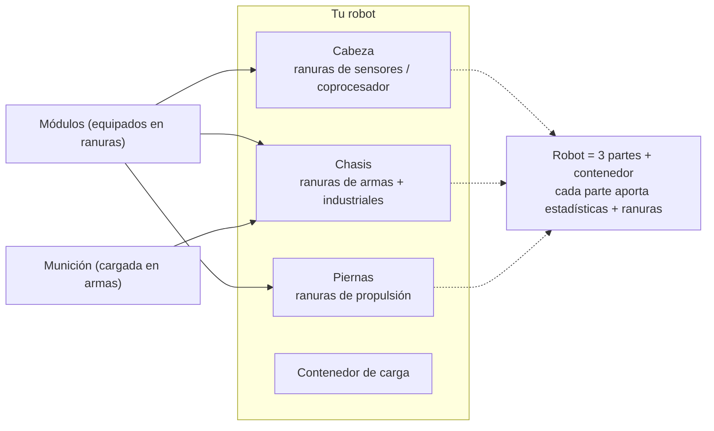

# Equipamiento

Equipar significa cargar **módulos** en las ranuras de componentes del robot y **munición** en tus
armas. Todo el equipamiento se realiza **únicamente acoplado** — no puedes equipar en una zona.

> Las ubicaciones de la interfaz siguen el [resumen de la interfaz del cliente](/es/features/ui/) (la categoría **Equipar** en
> la barra superior). Las mecánicas siguientes han sido confirmadas contra el servidor.

## Equipar módulos

Un robot tiene varios **componentes** (arma, escudo, blindaje, propulsión, sensor, etc.), cada uno
con un conjunto de **ranuras**.

- **Equipar un módulo** — toma un módulo de un contenedor y cárgalo en una ranura de componente
  específica. El tipo de módulo debe ser válido para esa ranura en esa clase de robot.
  Si la ranura está ocupada, el módulo existente se devuelve al contenedor.
- **Intercambiar módulos** — mueve un módulo entre dos ranuras del mismo componente.
- **Quitar un módulo** — saca un módulo de una ranura y devuélvelo al contenedor.

El servidor recalcula las estadísticas del robot después de cada cambio (los módulos afectan a los valores
mostrados en el panel de estado desacoplado — ver [combate](/es/features/combat/)).

## Equipar munición

- **Equipar munición** — carga un objeto de munición compatible en un módulo activo (arma). El módulo
  debe **aceptar ese tipo de munición**, y se carga hasta la **capacidad de munición** del módulo.
  Cualquier munición cargada previamente se devuelve primero al contenedor.
- **Cambiar munición** — sustituye la munición cargada por otro tipo compatible diferente.
- **Desequipar munición** — devuelve la munición cargada a un contenedor.

## Preajustes de equipamiento

Un **preajuste** es una configuración guardada que puedes volver a aplicar rápidamente:

- **Guardar** — almacena el equipamiento actual de un robot bajo un nombre.
- **Listar** — visualiza tus preajustes guardados.
- **Aplicar** — carga un preajuste en un robot (diferente) desde un contenedor.
- **Eliminar** — borra un preajuste guardado.

Los preajustes son prácticos para reequipar tras una batalla o al alternar entre roles.

## Notas prácticas

- **No puedes equipar en una zona** — todo aquí requiere estar acoplado.
- **Extensión habilitadora primero** — si no has investigado la clase de robot, no puedes seleccionarlo ni pilotarlo.
- **La munición debe coincidir con el arma** — una definición de munición incompatible será rechazada.
- **Los robots reempaquetados no se pueden usar** — desempaqueta un robot antes de seleccionarlo o equiparlo.
- **Usa preajustes para reequipar rápido** — guarda una configuración probada y aplícala tras sufrir pérdidas.

## Categorías de ranuras

Los componentes de un robot (cabeza, chasis, piernas) proporcionan **ranuras**, y cada ranura posee un conjunto
de flags de categoría. Un módulo encaja en una ranura solo si los flags del propio módulo son un **subconjunto** de
los flags de la ranura. Las categorías de flags son:

`small`, `medium`, `large`, `turret`, `missile`, `melee`, `industrial`,
`ew_and_engineering`, `specialized` (una ranura especializada solo acepta módulos
especializados), además de las ranuras estructurales de `head` / `chassis` / `leg`.

Los módulos también pueden estar restringidos a robots específicos, y algunos llevan un flag **unique** por lo que
solo se puede equipar uno de ese tipo a la vez. Los efectos de estadísticas por módulo residen en la
[tabla de robots](/es/content/robots/) generada.
