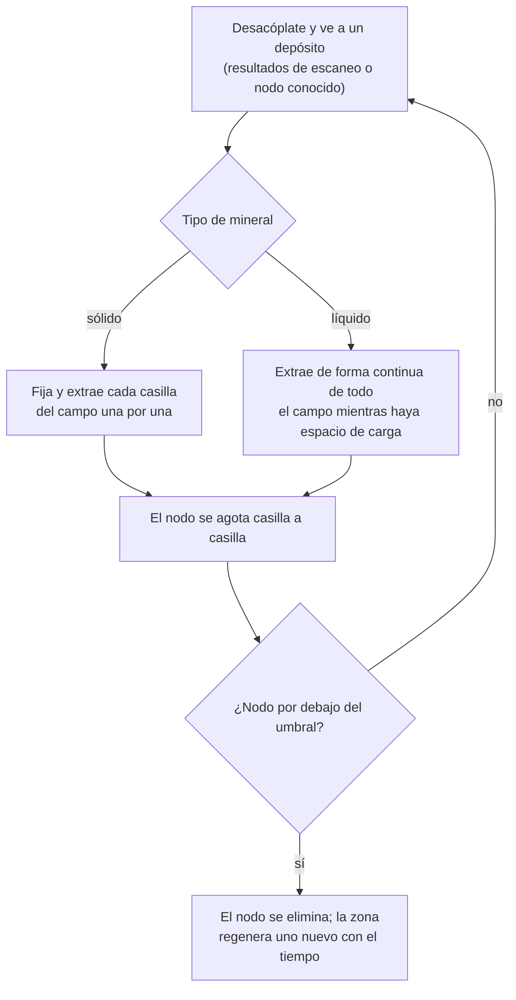
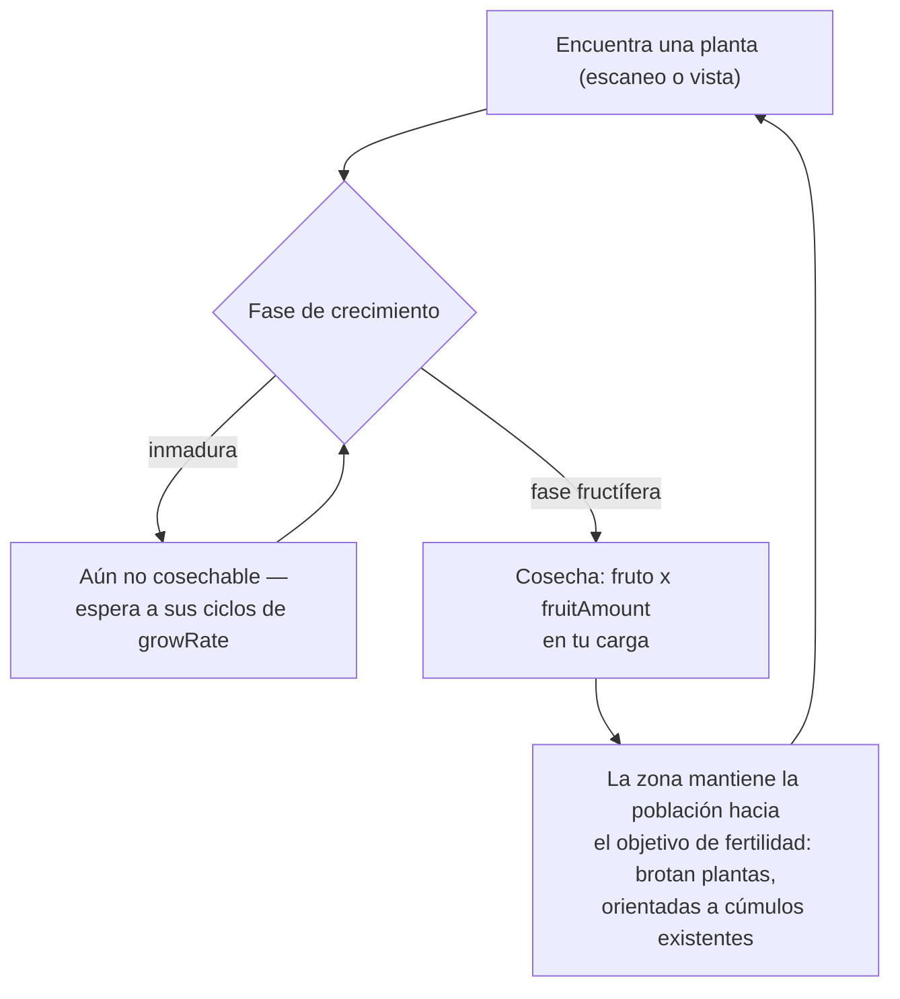
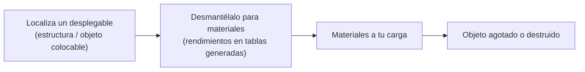

# Recolección y escaneo

Los recursos del juego provienen de tres fuentes dentro de una zona: **depósitos de mineral**, **plantas**
y **desplegables**. Esta página explica cómo funciona cada uno y cómo se desarrolla el ciclo de recolección.

> Las ubicaciones de la interfaz siguen el [resumen de la interfaz del cliente](/es/features/ui/): las acciones de escaneo y cosecha se encuentran en
> la lista de **acciones desacoplado** (arriba a la derecha mientras estás en una zona). Las cifras de rendimiento por tipo
> de recurso están en las tablas generadas: [Contenido → Minerales](/es/content/ores/) y
> [Contenido → Plantas](/es/content/plants/). Las mecánicas siguientes han sido confirmadas contra la implementación
> del servidor.

## El ciclo básico

1. **Desacóplate** y entra en una zona (ver [movimiento](/es/features/movement/)).
2. **Escanea** el área con el módulo de escáner de tu robot.
3. **Recolecta** — extrae mineral, cosecha frutos de plantas o desmantela desplegables.
4. **Acóplate** y deposita tu carga en el contenedor de una base.

## Depósitos de mineral

- El mineral existe en el subsuelo como **depósitos (nodos)** dispersos por toda la zona.
- Para encontrarlos y registrarlos necesitas un **módulo geoescáner** equipado en tu robot activo.
  Un escaneo genera un **resultado de escaneo**; a continuación lo **subes**, lo cual lo almacena en tu
  lista personal de escaneos de minerales.
- Tus resultados de escaneo guardados se pueden **listar, mover, eliminar o convertir en objetos**
  (los objetos de "escaneo de mineral" usados para procesamiento/producción).

- Los depósitos son **finitos**: cada nodo contiene una cantidad total limitada. Cuando un nodo se
  extrae por debajo de su umbral, se elimina y la zona **regenera nuevos nodos** con el
  tiempo hasta alcanzar su máximo configurado. Cómo se posicionan los nodos y cómo se mantienen
  las poblaciones de plantas — con zonas reales como ejemplos prácticos — se detalla en
  [Zonas → Generación](/zones/generation/).
- **Minerales sólidos vs líquidos.** Los minerales sólidos se agotan casilla por casilla — fijas y extraes
  cada casilla del campo hasta vaciarla. Los minerales líquidos se extraen de todo el campo a la vez, por lo que
  tu perforadora puede operar de forma continua mientras tengas espacio de carga. Esa facilidad es exactamente por lo que
  los minerales líquidos suelen valer menos: requieren menos habilidad y atención para su extracción.

### Estadísticas de plantas y minerales de un vistazo

El comportamiento de minerales y plantas está regido por datos de reglas por tipo. Los campos que importan al
jugador:

| Campo | Qué significa en el juego |
|---|---|
| `fertility` | Cuán común es el tipo — valor más alto = la zona intenta mantener más ejemplares |
| `growRate` | Cuántos ciclos de crecimiento debe permanecer una planta en cada fase antes de avanzar (mayor = más lento) |
| `spreading` | Si el tipo crece en cúmulos (grupos) o disperso |
| `killDistance` | Espaciado mínimo entre dos plantas del mismo tipo |
| `slope` / `minSlope` | La inclinación del terreno en la que puede crecer la planta |
| `allowedAltitudeLow/High` | El rango de elevación donde puede crecer la planta |
| `allowedWaterLevelLow/High` | Rango de distancia a la orilla (crea vegetación costera) |
| `fruitingState` | Qué fase de crecimiento debe alcanzar la planta antes de producir (ser cosechable) |
| `fruitDefinition` / `fruitAmount` | Qué fruto produce la planta y la cantidad base |
| `maxAmount` | Límite de cuántos ejemplares de este tipo existen en un área de procesamiento |
| `health` | Puntos de vida por fase de crecimiento (las fases superiores pueden ser más resistentes) |
| `damageScale` | Resistencia al daño de la planta |
| `playerSeeded` | La planta solo existe donde la haya plantado un jugador |
| `onlyOnUnprotectedZone` | Solo crece en zonas desprotegidas (clase beta/gamma) |

La referencia campo por campo completa (tipos, valores por defecto, almacenamiento y cómo los utiliza el tick
de la zona) se encuentra en [Formatos → Campos de plantas](/es/formats/plant-fields/).

## Plantas

- Las plantas **crecen con el tiempo** a través de una secuencia de fases. Cada fase requiere un número de
  ciclos de crecimiento (`growRate`) antes de que la planta avance aleatoriamente.
- Una planta solo **produce frutos cuando alcanza su fase de fructificación** — las plantas inmaduras
  no se pueden cosechar.
- La zona mantiene las poblaciones de plantas hacia un **objetivo de fertilidad**: si una extensión de
  terreno tiene menos plantas de las que corresponden a su nivel de fertilidad, brotan nuevas plantas; el tipo seleccionado
  pondera la `fertility` de cada especie, y `spreading` orienta el nuevo crecimiento hacia los cúmulos existentes.

- Algunas plantas son **sembradas por jugadores** (solo existen en huertos de jugadores) y algunas son
  **exclusivas de zonas desprotegidas**.
- Las plantas pueden ser **dañadas y destruidas**; su `health` y `damageScale` determinan cuán
  difícil resulta.

## Desplegables

Los desplegables son objetos colocados en una zona (ver [Estaciones base (PBS)](/es/features/pbs/) para la
parte de estructuras). Algunos pueden ser **desmantelados** para obtener materiales. Las reglas de desmantelamiento y los
rendimientos por tipo figuran en las tablas generadas: [Contenido → Minerales](/es/content/ores/) y [Contenido → Plantas](/es/content/plants/).

## Quioscos

Un **quiosco** es una estructura vinculada a misiones: **entregas objetos** en él (dentro de su rango) como
parte de una misión. No es una fuente de recolección por sí mismo — consulta [misiones](/es/features/missions/).

## Notas prácticas

- **Escanear requiere el módulo** — sin un geoescáner equipado, no hay resultados de escaneo.
- **Los resultados de escaneo son tuyos** — existen por personaje y no se comparten.
- **Los nodos de mineral reaparecen, pero despacio** — si un área está vacía, el depósito se ha agotado, no está
  oculto. La regeneración repone el recuento de nodos, pero no al instante.
- **Cosecha lo que esté maduro** — las plantas en fase de fructificación otorgan el rendimiento completo; las fases jóvenes
  no dan nada.

<!-- Developer notes: Zone/ZoneUploadScanResult.cs (GeoScannerModule required);
     MineralScanResult*.cs (per-character repository);
     Zones/Terrains/Materials/Plants/PlantRule.cs (all plant rule fields);
     Zones/Terrains/NatureCube.cs (GrowPlants, fertility/spreading/killDistance logic);
     Zones/Terrains/Materials/Minerals/MineralLayer.cs (ore node lifecycle);
     Zone/UseItem.cs + UseItemVisitor.cs (IUsableItem harvest path);
     Zone/KioskSubmitItem.cs (mission item submission, range-limited). -->
