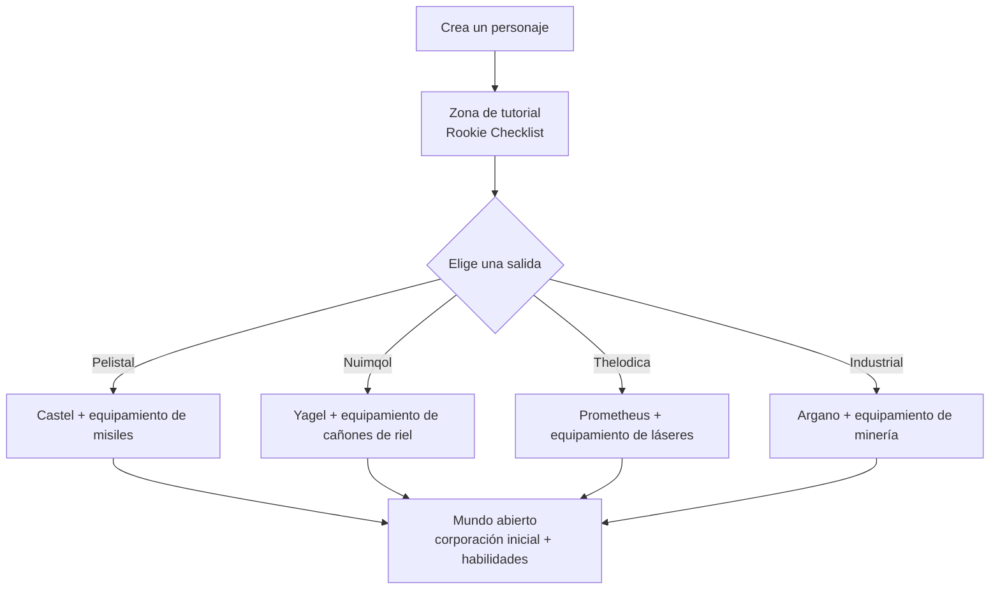

# Primeros pasos

Esta página cubre los primeros pasos: crear un personaje, conseguir tu primer robot
y los ajustes a nivel de personaje que tocarás al principio.

> Las ubicaciones de la interfaz siguen el [resumen de la interfaz del cliente](/es/features/ui/). Las mecánicas siguientes han sido confirmadas
> contra la implementación del servidor.

## Consigue el juego

Perpetuum es gratis en [Steam](https://store.steampowered.com/app/223410/Perpetuum/).

  <a class="steam-card-link" href="https://store.steampowered.com/app/223410/Perpetuum/" target="_blank" rel="noopener">
    
    Perpetuum en Steam — gratis para jugar
  </a>

## Mira esto primero

Guías del Proyecto Open Perpetuum. Haz clic en una ficha para reproducirla aquí.

  

    
    &#9654;
    
Perpetuum Online Tutorial Walkthrough. + Extension Advice and lots more.

  

  

    
    &#9654;
    
Syndicate Careers Help — Artifacting

  

  

    
    &#9654;
    
Open Perpetuum Tutorial — How to run multiple clients

  

## Creación de un personaje

- Puedes **comprobar si un nombre está libre** antes de crearlo (`characterCheckNick`).
- **Crea el personaje** — queda vinculado a tu cuenta. Una cuenta puede albergar varios
  personajes; juegas con uno a la vez.
- **Selecciona un personaje** para jugar con él. Cambiar de personaje deselecciona el actual.
- Puedes **renombrar** un personaje más adelante (el nombre debe estar disponible).
- Puedes **eliminar** un personaje que ya no utilices.

## Tu primer robot

- Mientras estás **acoplado en una base**, puedes **solicitar el robot inicial** (instalaciones de base —
  consulta el [resumen de la interfaz del cliente](/es/features/ui/) para ver dónde residen las acciones de base).
  - La base debe tener aún robots iniciales en stock — en bases populares pueden agotarse,
    en cuyo caso la solicitud fallará.
  - Hay un **enfriamiento de 5 minutos** entre solicitudes de robot inicial por personaje.
  - El nuevo robot se entrega en el contenedor público de la base.

- Mientras estás acoplado también puedes **solicitar una "caja infinita"**: un contenedor especial añadido a
  tu inventario por una **tasa de 5 000 créditos**. Este es un contenedor de conveniencia, no una
  fuente de recursos gratuitos.

## Configuración del personaje

- **Avatar** — el aspecto visual de tu personaje.
- **Mensaje de estado (mood message)** — una breve frase visible para otros jugadores.
- **Nota privada** — una nota que solo tú puedes ver en uno de tus propios personajes.
- **Base de origen** — define o borra tu base de origen; es tu punto de acoplamiento predeterminado cuando el juego
  necesita situarte en un lugar seguro.
- **Ajustes** — preferencias por personaje (obtener/establecer).
- **Bloquear intercambios** — activa o desactiva el comercio para un personaje.
- **Créditos** — transfiere créditos entre tus propios personajes; consulta el historial de
  transacciones.
- **Nivel de cuenta** — cambia el correo/contraseña de la sesión, consulta el historial de transacciones
  de la cuenta y el historial de EP por actividad.

## Salir / volver a entrar

- **Cerrar sesión** finaliza la sesión; **seleccionar personaje** la inicia de nuevo.
- Si el servidor te expulsa (p. ej., retorno forzado a la base), reapareces acoplado — ver [movimiento](/es/features/movement/).

## El tutorial

Los personajes nuevos comienzan en la zona de entrenamiento con una lista **Rookie Checklist** — complétala:
cubre los aspectos básicos y otorga varios robots con módulos y munición. Puedes
saltártela (desacoplar y caminar hasta la salida de una facción), pero perderás las recompensas y
no podrás regresar a la zona de entrenamiento más adelante. Lo que te ofrece cada una de las cuatro salidas
figura en las [Preguntas frecuentes](/es/features/faq/#what-does-each-exit-give-me).

## Supervivencia

Perpetuum es un entorno sandbox de riesgo y recompensa, y cuando tu robot es destruido lo pierdes —
estés acoplado o no, derribado por un jugador o por un NPC — y reapareces en tu [base de origen](#configuracion-del-personaje)
(allí puedes solicitar un robot inicial gratuito si llegas con las manos vacías). Algunas
reglas que hacen asumibles las pérdidas:

- **Arriesga solo lo que puedas reemplazar.** Desacoplar es una apuesta: si el robot cae,
  él y sus módulos equipados se pierden (o pasan a ser botín). Antes de despegar, asegúrate
  de que puedes asumir esa pérdida.
- **Conoce las zonas.** Las islas protegidas (PvE) son seguras frente a otros jugadores; las
  islas de PvP abierto son de combate libre sin sistema de delitos/castigos. Consulta
  [zonas](/zones/) para ver el mapa.
- **Conoce a los NPCs.** Los marcadores naranjas solo atacan si se les provoca; los marcadores rojos
  atacan al acercarte. Huye y rompe la línea de visión para perder su hostilidad. Consulta
  [NPCs y caza PvE](/es/features/npcs/).
- **Mitiga el riesgo, no te limites a aceptarlo.** Ir a una isla de PvP abierto en tu mejor
  mech equipado con T4 es la forma más rápida de perderlo. Un equipo más barato y reemplazable que se amortice
  en unos pocos viajes supera al bot caro que necesita veinte.
- **Construye un ciclo sostenible.** Hagas lo que hagas — misiones, recolección, caza,
  producción, transporte — alguien pagará NIC por ello. Mantén reservas de respaldo para que un mal día
  no deje tus ingresos a cero.

## Qué hacer a continuación

1. Selecciona tu robot inicial y aprende a usar la pantalla de [hangar y equipamiento](/es/features/robots/).
2. Desacóplate y entra en la zona — ver [movimiento](/es/features/movement/).
3. Escanea el terreno y empieza a recolectar recursos — ver [recolección](/es/features/gathering/).
4. Investiga tus primeras extensiones — ver [investigación](/es/features/research/).
5. Elige una profesión — las [Preguntas frecuentes](/es/features/faq/#what-do-i-do-once-i-m-out) tienen el menú.

<!-- Developer notes: Perpetuum.RequestHandlers.Characters/* (CharacterCreate,
     CharacterSelect, CharacterRename, CharacterSetHomeBase, ...);
     RequestStarterRobot (5-minute cooldown, base stock), RequestInfiniteBox
     (5000 credits, docked-only). -->
