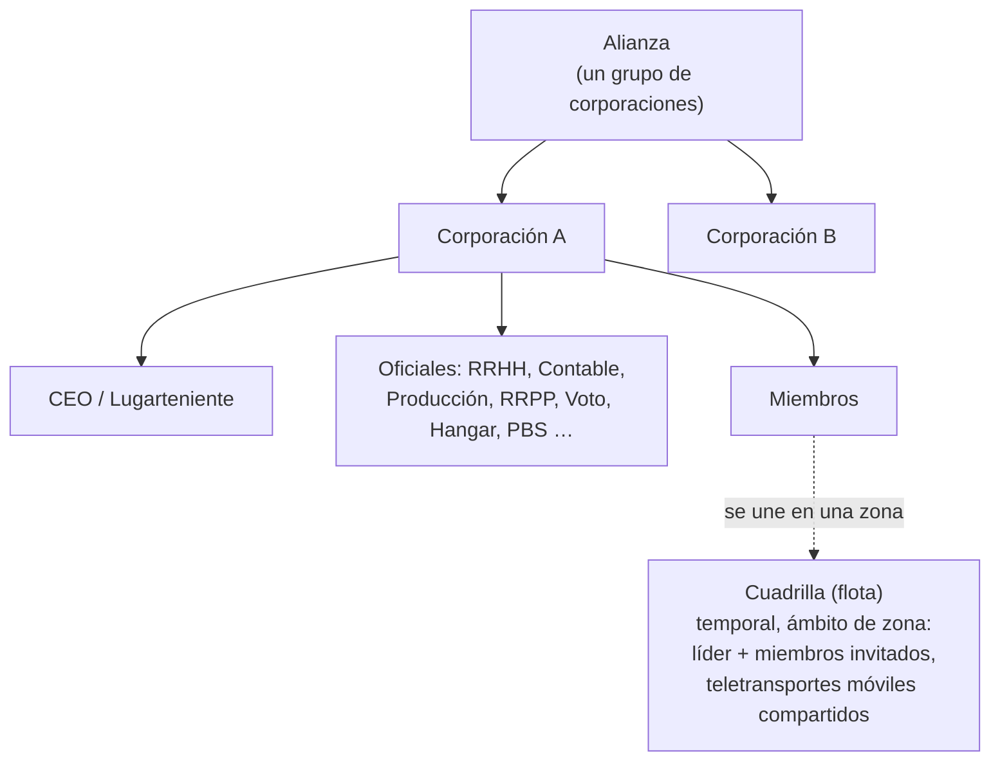

# Grupos

Existen tres tipos de agrupaciones: **corporaciones** (tu organización principal), **alianzas** (grupos de
corporaciones) y **cuadrillas (gangs)** (flotas temporales para operar en zonas).

> Las ubicaciones de la interfaz siguen el [resumen de la interfaz del cliente](/es/features/ui/) (el botón **Corporación** arriba a la izquierda;
> la categoría **Almacén corporativo**; las cuadrillas disponen de su propia ventana). Las mecánicas siguientes
> han sido confirmadas contra el servidor.

## Corporaciones

### Entrada y salida
- **Crear** una corporación — requiere la extensión básica de gestión corporativa
  (nivel 1) y una tasa de fundación de **250 000 NIC**. Eliges el nombre oficial,
  un **ID corto** (máx. 6 caracteres, visible sobre el terreno para identificar a tus miembros)
  y la **tasa de impuestos** — un porcentaje de los ingresos de los miembros (especialmente recompensas de misiones) que
  va automáticamente a la cuenta de la corporación.
- **Solicitar ingreso** a una, o **invitar** a un personaje.
- **Aceptar una solicitud** / **listar solicitudes** (oficiales).
- **Responder** a una invitación recibida.
- **Abandonar**, o **cancelar** una salida pendiente.
- **Expulsar a un miembro**, **asignar el rol de un miembro**, **renunciar a tus propios roles** o marcar miembros
  como neutrales.

### Roles
Las corporaciones tienen una jerarquía de roles. Los roles restringen lo que puedes hacer — p. ej., desbloquear
nodos del árbol tecnológico corporativo, gestionar el hangar o editar el PBS (ver
[PBS](/es/features/pbs/)). Los roles definidos por el servidor (`CorporationRole`):

- **CEO** — control total.
- **Deputy CEO (Lugarteniente)** — segundo al mando.
- **HR Manager (Director de RRHH)** — gestión de miembros (solicitar/invitar/expulsar).
- **Corporation Delegate / Alliance Delegate (Delegado)** — actuar en nombre de la organización.
- **Accountant (Contable)** — fondos de la corporación.
- **Production Manager (Director de Producción)** — producción corporativa.
- **Vote Admin (Administrador de Votaciones)** — votaciones.
- **PR Manager (Director de RRPP)** — relaciones públicas / tablón de anuncios.
- **Acceso al hangar (low / medium / high / secure)** — permisos de hangar por niveles, con
  niveles correspondientes de **retirada de hangar** y un rol de **operador de hangar**.
- **view PBS / edit PBS** — ver o modificar las estructuras PBS de la corporación.
- **Tech tree list / unlock** — ver o desbloquear el árbol tecnológico de la corporación.

Restricciones típicas: las acciones de membresía (solicitar/invitar/expulsar, asignar roles) requieren
**CEO / lugarteniente / director de RRHH**; el tablón y RRPP requieren **CEO / lugarteniente / director de RRPP**;
el dinero corporativo y mejoras de instalaciones requieren **CEO / lugarteniente / contable** (la producción añade al
**director de producción**); el despliegue de PBS requiere **CEO / lugarteniente / editor de PBS**.

Puedes consultar el **historial de roles** propio y de los miembros. El espacio de hangar se alquila (configuración
por defecto del servidor: 50 000 créditos por periodo de 7 días).

### Información y búsqueda
- **Información de corporación / mi información** — detalles y tu membresía.
- **Buscar** corporaciones.
- **Relaciones / reputación** — la relación y reputación de tu corporación.
- **Delegados** — personajes que actúan en nombre de la corporación.

### Fondos
- **Donar** a la cartera corporativa.
- **Pagar** desde ella.
- **Transferir** entre carteras.

### Aspecto y perfil
- **Renombrar**, **establecer color**, **establecer información** (perfil público).
- **Logotipo** — hasta 5 símbolos de un conjunto fijo, cada uno editable (tamaño, transparencia,
  capas); solo los miembros con permisos pueden crearlo o modificarlo.
- **Historial de nombres** — nombres anteriores.

### Director General (CEO)
- **Presentarse voluntario para CEO**, o comprobar el **estado de sucesión de CEO**.
- **Sucesión en la práctica**: cuando un CEO ha estado desconectado durante **30 días**, un lugarteniente
  puede iniciar una sucesión — comienza una **cuenta atrás de 48 horas**, anunciada en la ventana
  de la corporación. El CEO o cualquier otro lugarteniente puede **vetarla** al instante (un veto no
  impide el siguiente intento si el CEO sigue sin iniciar sesión). Si la cuenta atrás llega
  a cero, el lugarteniente se convierte en CEO con plenos privilegios.

### Votaciones
Las corporaciones pueden celebrar **votaciones**:
- **Iniciar** una votación, **fijar su tema**, **listar** votaciones, **emitir** un voto, **eliminar** una votación.

## El tablón de anuncios
Un tablón de avisos gestionado por la corporación:
- **Iniciar**, **listar** entradas, ver **entradas nuevas**, **publicar** una entrada, **moderar**
  (editar/eliminar entradas de otros) y ver **detalles**.

## Hangar corporativo (almacenamiento)
Un área de almacenamiento compartida de la corporación en las bases:
- **Alquilar** una sección de hangar, **pagar alquiler**, consultar **precio de alquiler**, **cerrarla**.
- **Listar** contenidos (todos, o en una base específica).
- **Carpetas** — crear/eliminar subcarpetas.
- **Establecer acceso** (quién puede usarlo) y **asignar nombre**.
- **Registros** — ver, configurar y limpiar el registro de acceso del hangar.

Nota: **no puedes seleccionar un robot del hangar corporativo** como tu robot activo
(ver [robots](/es/features/robots/)).

## Documentos corporativos
Un sistema de documentos de texto compartidos y con control de versiones para la corporación. Hay dos
tipos de documentos:

- **Plan PBS** — un plano/esquema para la red PBS de la corporación.
- **Proyecto de terraformación** — un registro de proyecto de modificación de terreno.

Operaciones: **crear**, **listar**, **abrir**, **actualizar cuerpo** (con versiones), **eliminar**,
**transferir** propiedad, **alquilar** (ampliar el periodo de validez), **monitorizar** / **dejar de monitorizar**
(recibir notificaciones de cambios) y una **lista de registro** (hasta 25 miembros) que controla quién
puede trabajar en el documento.

## Alianzas

Una alianza agrupa corporaciones:
- **Información de mi alianza**, **alianzas por defecto** e **historial de roles de alianza**.
- Las relaciones pueden tener como objetivo alianzas (ver [social](/es/features/social/)).

## Cuadrillas (flotas / gangs)

Una **cuadrilla** es un grupo temporal para operar en zonas (p. ej., para compartir un teletransporte móvil o combatir
juntos):
- **Crear**, **eliminar**, **información**.
- **Invitar**, **responder** a una invitación, **expulsar**, **abandonar**.
- **Asignar líder**, **asignar rol**.

La pertenencia a una cuadrilla es fundamental para los **teletransportes móviles** — solo el propietario o un miembro de la cuadrilla
puede utilizarlos (ver [movimiento](/es/features/movement/)).

## Notas prácticas

- **Los roles regulan el poder** — la mayoría de las acciones de oficiales (solicitudes, hangar, PBS, votaciones) requieren
  el rol adecuado.
- **La tecnología corporativa es compartida** — desbloquear para la corporación utiliza puntos compartidos y un
  multiplicador (ver [investigación](/es/features/research/)).
- **El hangar es almacenamiento, no una plataforma de lanzamiento** — no puedes desacoplar directamente en un robot desde él.
- **Las cuadrillas son efímeras** — úsalas para una sesión en zona, no como una organización permanente.
- **Las relaciones siguen a tu corporación** — la relación de tu corporación afecta a cómo te trata el
  universo (ver [social](/es/features/social/)).

<!-- Developer notes: Corporations/* (apply/invite/accept, roles, leave, info, money,
     votes, bulletin, hangar, documents, histories, CEO); AllianceGetMyInfo.cs /
     AllianceGetDefaults.cs / AllianceRoleHistory.cs; Gangs/* (create/invite/kick/leave,
     leader/role). SelectActiveRobot.cs forbids corp-hangar robots. -->
