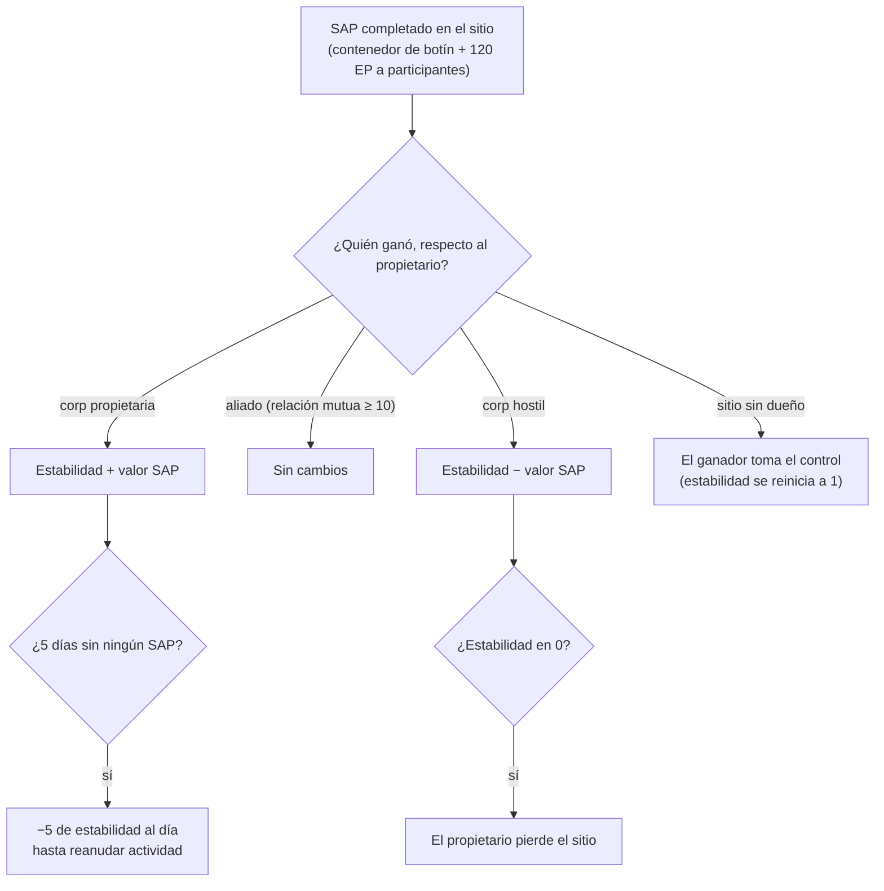

# Intrusión

La **intrusión** es un modo construido en torno a **sitios de NPCs** — sitios gestionados por jugadores o disputables con
**estabilidad**, **defensa** e **instalaciones**. Inviertes objetos, aumentas las defensas y
mejoras las instalaciones para controlar y obtener beneficios de un sitio.

> El término exacto del cliente para "intrusión" debe confirmarse. Las ubicaciones de la interfaz siguen el
> [resumen de la interfaz del cliente](/es/features/ui/). Las mecánicas siguientes han sido confirmadas contra el servidor.

## Sitios y estabilidad

- **Información del sitio** — detalles de un sitio de intrusión.
- **Estabilidad** — la estadística principal del sitio, un valor de **0 a 150**. Un nuevo propietario comienza en
  **1**. La estabilidad lo impulsa todo:
  - **Umbrales de bonificación** (contenido, `intrusionsitestabilitythreshold`): las bonificaciones de instalaciones
    se desbloquean con una estabilidad de **20 / 60 / 80**; un conjunto acumulable de efectos de aura (núcleo de intrusión,
    detección, geoescaneo, cosechadora, industrial, enmascaramiento, minería, reparación, señales — cada uno
    de nivel 1–3, además de efectos combinados de nivel 4) se desbloquea por fases a **10, 20, 40, 50, 70, 80 y
    100**; los **derechos de acoplamiento** se desbloquean a **50**; el límite de nodos de defensa aumenta a **40**.
  - **Puntos de producción** = `estabilidad / 10` (máx. 15) — la divisa para mejorar
    las instalaciones (un punto por nivel).
  - **Degradación**: si no se realiza ningún SAP con éxito durante **5 días**, el sitio comienza a perder
    **5 de estabilidad al día** hasta que se vuelva a actuar.
  - **Pérdida**: si la estabilidad llega a **0**, el propietario pierde el sitio (pasa a no tener
    dueño).
- **Registro de estabilidad** — revisa los cambios en la estabilidad de un sitio.

### Quién mueve la estabilidad

Los cambios de estabilidad provienen de los **SAPs** completados (abajo) y de la degradación del sistema. El efecto
depende de *quién* gane el SAP respecto al propietario actual:

- **Gana el propietario** → la estabilidad **gana** el valor del SAP.
- **Gana un aliado** (relación mutua ≥ 10) → **sin cambios**.
- **Gana una corporación hostil** → la estabilidad **pierde** el valor del SAP.
- **Sitio sin dueño** → la primera corporación de jugadores vencedora **toma posesión** (la estabilidad
  se reinicia en 1).

## SAPs (puntos de ataque al sitio)

Un **SAP** es un objetivo temporal que aparece en un sitio. Al completarlo, suelta un **contenedor
de botín** en la posición del SAP, modifica la estabilidad y otorga **120 EP** a cada
personaje participante. **Los cultistas NPCs también disputan los SAPs** — si completan la puntuación
primero, el SAP contará en contra de tu bando. Hay cuatro tipos de SAP:

| SAP | Cómo completarlo | Valor de estabilidad |
|---|---|---|
| **Hackeo activo** | utiliza un módulo de hackeo en el SAP (hasta 120 usos de módulo) | +15 |
| **Hackeo pasivo** | permanece dentro de un rango de 5 del SAP durante **8 minutos** | +10 |
| **Destrucción** | inflige daño al SAP hasta destruirlo (el daño de NPCs también cuenta) | +15 |
| **Procesamiento de especímenes** | entrega **5–6 especímenes SAP** (en lotes de 2–3, enfriamiento de 1.5 min, rango 7) | +15 |

- **Entregar un objeto SAP** — en una zona, entrega un espécimen a un SAP de procesamiento de especímenes.
- **Información de objetos SAP** — consulta los datos de los objetos SAP (los tuyos y generales).

Los especímenes SAP son los consumibles de este modo; además, albergan un gran valor energético de núcleo, por lo
que también sirven como [combustible de reactor PBS](/es/features/pbs/).

## Defensa y efectos

- **Establecer umbral de defensa** — configura el umbral de defensa del sitio (cuándo entra en acción
  la defensa automatizada del sitio).
- **Establecer bonificación de efecto** — configura las bonificaciones de aura/efecto en un sitio (del conjunto
  de auras desbloqueadas por estabilidad).
- **Mejorar una instalación** — mejora una instalación del sitio: cuesta **1 punto de producción**
  (es decir, 10 de estabilidad), solo para director general (CEO) / lugarteniente / contable, limitado a un nivel máximo.
- **Establecer mensaje del sitio** — fija un mensaje público para el sitio.

## Registros

- **Mi registro de intrusión** — tu actividad de intrusión.
- **Registro público** — el canal público de intrusión.
- **Registro de mis sitios** — actividad en tus sitios.
- **Registro de estabilidad** — cambios de estabilidad (ver arriba).

## Notas prácticas

- **La estabilidad es la estadística fundamental** — desbloquea los niveles de bonificación, genera la
  divisa de mejora y es lo que los SAPs hostiles arrebatan.
- **Los SAPs son disputados** — los cultistas NPCs compiten contigo; un SAP perdido te cuesta estabilidad.
- **No dejes un sitio inactivo** — 5 días sin un SAP con éxito activa la degradación diaria.
- **Los registros narran los acontecimientos** — utiliza los registros personales/públicos/de estabilidad para seguir lo que ocurre
  en todos tus sitios.

<!-- Developer notes: Intrusion/IntrusionSAPSubmitItem.cs (SpecimenProcessingSAP,
     zone submit), IntrusionSAPGetItemInfo.cs / IntrusionSapItemInfo.cs,
     IntrusionSetDefenseThreshold.cs, IntrusionSiteSetEffectBonus.cs,
     IntrusionUpgradeFacility.cs, SetIntrusionSiteMessage.cs; GetIntrusionSiteInfo.cs,
     GetIntrusionLog.cs / GetIntrusionPublicLog.cs / GetIntrusionMySitesLog.cs /
     GetIntrusionStabilityLog.cs, GetStabilityBonusThresholds.cs;
     EventProcessors/AffectOutpostStability.cs; Zones/Intrusion/Outpost.cs,
     OutpostDecay.cs, SAP.cs + *SAP.cs subclasses. -->
