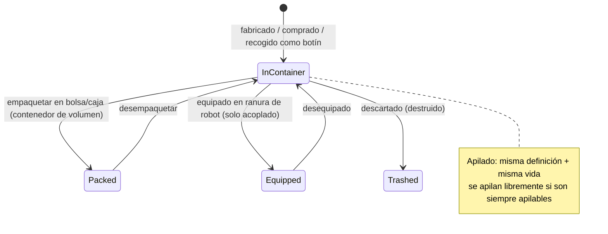

# Objetos e inventario

Tu **inventario** es un conjunto de **contenedores** (el contenedor público de la base, el
contenedor de tu robot, bolsas/cajas, etc.). Esta página cubre la manipulación de objetos dentro de ellos.

> Las ubicaciones de la interfaz siguen el [resumen de la interfaz del cliente](/es/features/ui/). Las mecánicas siguientes han sido confirmadas contra
> el servidor.

## Contenedores

- **Listar un contenedor** — ver su contenido.
- **Reubicar objetos** — mover objetos entre contenedores a los que tienes acceso.

Se aplican reglas de acceso: algunos contenedores (hangar corporativo, inventario del robot, contenedores del sistema) están
restringidos — consulta [robots](/es/features/robots/) y [grupos](/es/features/groups/).

## Empaquetar y desempaquetar

- **Empaquetar objetos** — guardar objetos en una bolsa/caja (un contenedor "envoltorio de volumen") para transportarlos
  de forma compacta.
- **Desempaquetar objetos** — volver a sacar los objetos de la bolsa/caja.

El empaquetado es también la forma en que se compacta un **robot** para su almacenamiento o transporte: el servidor elimina su
estado dinámico y componentes y lo marca como *reempaquetado (repacked)*. Un robot solo se puede empaquetar mientras esté
**sin daños**, **no seleccionado**, **sin asegurar** y con el **inventario vacío**.
Al desempaquetarlo, se reconstruye el robot y se repara. Solo los objetos marcados como *repackable* en el contenido
pueden empaquetarse; un robot reempaquetado no se puede seleccionar ni equipar hasta ser desempaquetado
(consulta [robots](/es/features/robots/)).

## Apilado

Muchos objetos se pueden apilar. Operaciones de apilado:

- **Apilar objetos** / **apilar en** / **apilar selección** — combina objetos del mismo tipo
  en una pila (o mueve una pila sobre otra).
- **Desapilar una cantidad** — separa una cantidad específica de una pila.

El servidor solo fusiona objetos que compartan la **misma definición y la misma durabilidad (vida)**.
Los objetos marcados como *always stackable* (minerales, munición, la mayoría de materias primas) se apilan libremente; los objetos
marcados como *non-stackable* nunca se apilan; todo lo demás se puede apilar **únicamente mientras esté reempaquetado**
(empaquetado) — por lo que el equipo desempaquetado y dañado permanece individual.

## Asignar nombre y uso

- **Renombrar un objeto** — asigna un nombre personalizado a un objeto.
- **Usar un objeto** — activa un objeto utilizable (según el contexto; en una zona esto también puede
  interactuar con objetos de zona — ver [recolección](/es/features/gathering/)).
- **Usar un objeto de lotería** — abre/activa un objeto de tipo lotería.

## Destrucción y reembolsos

- **Destruir objetos** — descarta objetos (los elimina de forma permanente).
- **Reembolsar un objeto** — flujo de reembolso de administradores/personal: crea el objeto y se lo
  entrega a un personaje, registrándolo en el registro de transacciones. Los jugadores no invocan esto directamente.

## Objetos especiales

- **Canjeables** — listar, **canjear** o **activar** objetos canjeables (códigos/concesiones).
- **Paquetes de regalo (Goodie packs)** — listar y **canjear** paquetes de regalo (lotes de objetos).
- **Abrir un regalo** — un regalo contiene un objeto **aleatorio** extraído de un fondo de botín común
  a todo el servidor (munición, minerales brutos, plasma, kits de investigación, módulos, cápsulas, pintura, potenciadores —
  221 definiciones posibles, cada una con su propio rango de cantidad).

## Notas prácticas

- **El acceso es por contenedor** — solo puedes interactuar con contenedores de tu propiedad o autorizados.
- **Empaqueta para transportar más** — las bolsas/cajas te permiten mover objetos a granel de forma compacta.
- **Las pilas ahorran espacio** — combina objetos idénticos; desapila para extraer exactamente lo que necesitas.
- **Destruir es permanente** — los objetos eliminados desaparecen para siempre.
- **Los canjeables y paquetes de regalo son de un solo uso** — canjearlos consume el código/objeto.
- **Los robots empaquetados son inertes** — desempaquétalos antes de seleccionarlos o equiparlos.
- **Solo los objetos empaquetados se apilan** — si objetos similares no se combinan, empaquétalos (o repáralos) primero.

<!-- Developer notes: ListContainer.cs; RelocateItems.cs; PackItems.cs / UnpackItems.cs;
     StackTo.cs / StackSelection.cs / UnstackAmount.cs; SetItemName.cs; UseItem.cs /
     UseLotteryItem.cs; TrashItems.cs; ReimburseItem.cs (PbsReimburseRequestHander.cs);
     RedeemableItemList.cs / RedeemableItemRedeem.cs / RedeemableItemActivate.cs;
     GoodiePackList.cs / GoodiePackRedeem.cs; GiftOpen.cs. Container access:
     ContainerAccess / ContainerAccessChecker.cs. -->
