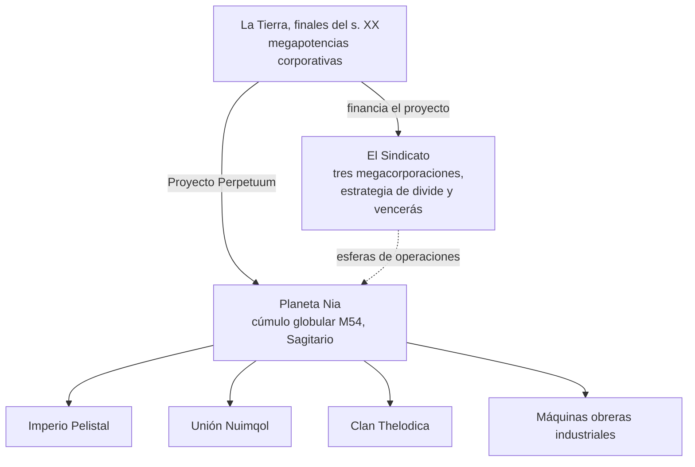

# Historia y trasfondo

## El descubrimiento de Nia

El auge tecnológico de finales del siglo XX en la Tierra — internet, la fusión médica e informática, la investigación
espacial — derribó las antiguas fronteras físicas y mentales. La comunicación y el
comercio se volvieron más rápidos y baratos, y las grandes corporaciones se transformaron en los gobiernos
de facto de sus respectivas regiones.

En ese contexto surgió el descubrimiento del **planeta Nia**, en el cúmulo globular M54
de Sagitario (el origen del logotipo del proyecto). Nia orbita una de un par de
estrellas — siendo el cuarto planeta de dicho par — y es sorprendentemente similar a la Tierra: temperatura
media en superficie de unos 19 °C y una densidad atmosférica cercana a la terrestre. Dos
peculiaridades lo distinguen. Sus océanos son barreras infranqueables para cualquier cosa
impulsada por electricidad — el denso núcleo del planeta y su rápida rotación los mantienen cargados —
y solo alrededor del 17% de la superficie es tierra firme, la cual una rápida tectónica de placas no deja de
fragmentar en islas. En esa tierra firme, la vida prospera.

## Los nianos

Los habitantes de Nia rompen el significado habitual de "forma de vida": una especie sintética,
no muy diferente a nuestros robots en apariencia, pero organizada en **sociedades** tecnológicamente
avanzadas e independientes — cada una con su propia industria, ejército y cultura. El
logro que más importa a una Tierra necesitada de energía es su **tecnología de producción energética**.

Tres razas alienígenas luchan por la victoria final a través de las cadenas de islas de sus
dominios — el **Imperio Pelistal**, la **Unión Nuimqol** y el **Clan Thelodica** — con una población
dispersa de máquinas obreras **industriales** en medio (estos son los mismos cuatro grupos que encuentras
como [NPCs](/es/features/npcs/)).

## El Sindicato

El principal inversor del Proyecto Perpetuum es el **Sindicato** — una alianza de
las tres megacorporaciones terranas más poderosas, cada una gestionando su propia esfera de
operaciones en la superficie:

| Corporación | Dominio |
|---|---|
| **Truhold-Markson** | Gigante norteamericano de la industria de consumo; avanzando sobre el decadente dominio **Pelistal**. |
| **ICS — Institute of Corporate Security** | Asociación ruso-europea; operando en el territorio rebelde de los **Nuimqol**. |
| **Asintec** | Hegemón industrial asiático con sus vecinos de alta tecnología; librando una ofensiva total contra el **Clan Thelodica**. |

La estrategia es el viejo *divide y vencerás*: mantener las tres esferas
equilibradas entre sí logra que las potencias alienígenas luchen unas contra otras en lugar
de unirse. Los "Agentes" humanos trabajan en la superficie — cosechando los recursos energéticos
de los nianos, estudiando su tecnología y vigilando la paz que el Sindicato
desea.

Ahí es donde entras tú.

<!--
Developer notes: rewritten 2026 in original prose from the canonical setting.
An earlier version was adapted from the Open Perpetuum community wiki
(perpetuum.miraheze.org: Discovery of Nia, Nia, Syndicate); that text was
fully replaced, not reused.
Consistency with backend: the three alien races + Industrial match the NPC
races (see /features/npcs/); the corporation names match the zone abbreviations
(zone_ICS, zone_ASI, zone_TM — the beta-tier zones in /zones/ are named after
their megacorporations).
-->
