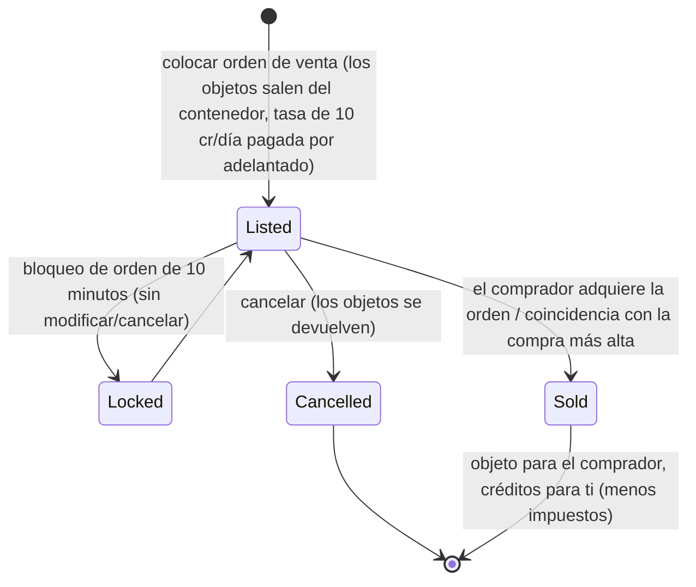

# Mercado y comercio

El **mercado** es donde compras y vendes objetos en una base. Todas las acciones de mercado se realizan
**únicamente acoplado** (comercies en la base en la que estás acoplado).

> Las ubicaciones de la interfaz siguen el [resumen de la interfaz del cliente](/es/features/ui/) (la categoría **Mercado** en la
> barra superior). Las mecánicas siguientes han sido confirmadas contra el servidor.

## Órdenes de mercado

Puedes colocar dos tipos de órdenes en el mercado de tu base actual:

### Órdenes de venta
Poner objetos a la venta.
- Elige el **objeto**, la **cantidad**, el **precio por unidad** y la **duración** en días
  (mínimo 1).
- El objeto se extrae de tu contenedor (se desapila si vendes parte de una pila).
- **Tasa de publicación** — pagas `10 créditos × duración` por adelantado (reducible mediante la
  extensión de *tasa de transacción de mercado*); la tasa va al banco central de la base (fondo de
  beneficios de la zona).
- **Protección de precio** — cuando está habilitada, tu precio debe situarse dentro de un **±30%** del
  **precio medio a 14 días** del objeto; los precios fuera de ese rango se rechazan. *(Esta protección está
  actualmente **desactivada** en este servidor).*
- **Bloqueo de orden** — una orden no se puede modificar ni cancelar durante los **10 minutos** posteriores
  a su publicación.
- **Límite de órdenes** — puedes mantener abiertas 1 + (extensión de *experto en órdenes de venta de mercado*)
  órdenes de venta (las órdenes de compra tienen su propio contador).
- **Para mi corporación** — puedes restringir una orden de venta a los miembros de tu propia corporación
  (solo para corporaciones privadas / no por defecto).
- Paga desde tu cartera **personal** o de **corporación** según corresponda.

### Órdenes de compra
Colocar una orden permanente para comprar un objeto a un precio determinado.
- El mercado la ejecuta automáticamente cuando aparece una venta coincidente.

### Gestión de órdenes
- **Modificar una orden** — cambiar precio/cantidad/duración.
- **Cancelar un objeto / orden** — retirarla (el objeto vuelve a tu contenedor).
- **Mis objetos** — ver tus órdenes abiertas.
- **Coincidencia con compra más alta** — una venta puede dirigirse a una orden de compra existente.

## Compra directa

- **Comprar un objeto** — adquiere al instante un objeto que esté en el mercado (sin orden permanente).

## Explorar el mercado

- **Lista de objetos / objetos disponibles / objetos en rango** — explora lo que está a la venta.
- **Información del mercado** — detalles sobre el mercado de la base.
- **Precios medios** — media del mercado, media por definición y media **global**.
  En estos se basa la protección de precios.

## Impuestos de mercado

- **Cambiar impuesto de mercado** — establece la tasa de impuestos del mercado. Solo los **mercados de
  bases PBS** están controlados por jugadores; en todos los demás lugares se aplica el valor fijo predeterminado.
- **Registro de impuestos** — revisa los cambios de impuestos.

El impuesto se deduce de lo que el **vendedor** recibe en una venta de mercado. La tasa por defecto es del
**12%** (el vendedor recibe el 88% del precio de venta); la tasa se puede reducir mediante la extensión de *impuesto de
transacción de mercado* y, en mercados controlados por jugadores, mediante una tasa personalizada fijada por el propietario del PBS.

## Intercambios directos entre jugadores

Un **intercambio (trade)** es una transacción directa entre dos personajes acoplados:

- **Iniciar un intercambio** — comienza una sesión con otro jugador.
- **Establecer / retirar mi oferta** — pon objetos/créditos de tu lado.
- **Aceptar** — ambas partes aceptan para completar el intercambio de forma atómica.
- **Cancelar** — aborta el intercambio.
- **Intercambio finalizado / estado** — confirmación y estado actual.

Un personaje puede **bloquear intercambios** sobre sí mismo (ver [primeros pasos](/es/features/getting-started/)).

## La tienda de objetos

La **tienda de objetos** es un comerciante a precio fijo en una base (no impulsado por jugadores). El catálogo
completo (cada objeto, cantidad, precio por divisa, requisito de relación) se genera en
[Tienda de objetos](/es/content/shop/).

- **Listar** — ver qué vende la tienda.
- **Comprar** — adquiere un objeto a cambio de créditos.

## Transferencia de créditos

- **Transferir créditos** entre tus propios personajes (ver [primeros pasos](/es/features/getting-started/)).

## Notas prácticas

- **Todo es únicamente acoplado** — no puedes comerciar en una zona.
- **Ten en cuenta el 12% de impuestos en tus precios** — los vendedores reciben el 88% del precio indicado
  por defecto (menos en mercados PBS con impuestos altos).
- **La tasa de publicación se paga por adelantado** — una publicación de larga duración cuesta más incluso si se vende
  el primer día.
- **Las órdenes exclusivas de corporación** son una forma de mover bienes dentro de tu corporación sin exposición pública.
- **Los intercambios son atómicos** — ambas partes deben aceptar, o no se transfiere nada.
- **Los impuestos modifican el coste efectivo** — calcula el impuesto de mercado en tus márgenes.

<!-- Developer notes: Markets/MarketCreateSellOrder.cs (docked, price guard vs average
     price, corp-only, unstack, corp wallet), MarketCreateBuyOrder.cs,
     MarketModifyOrder.cs, MarketCancelItem.cs, MarketBuyItem.cs, MarketItemList.cs,
     MarketAvailableItems.cs, MarketItemsInRange.cs, MarketGetMyItems.cs,
     MarketGetAveragePrices.cs / MarketGetDefinitionAveragePrice.cs /
     MarketGlobalAveragePrices.cs, MarketTaxChange.cs / MarketTaxLogList.cs;
     Trade*.cs (begin/offer/accept/cancel, atomic); ItemShopList.cs / ItemShopBuy.cs;
     CharacterTransferCredit.cs. -->
