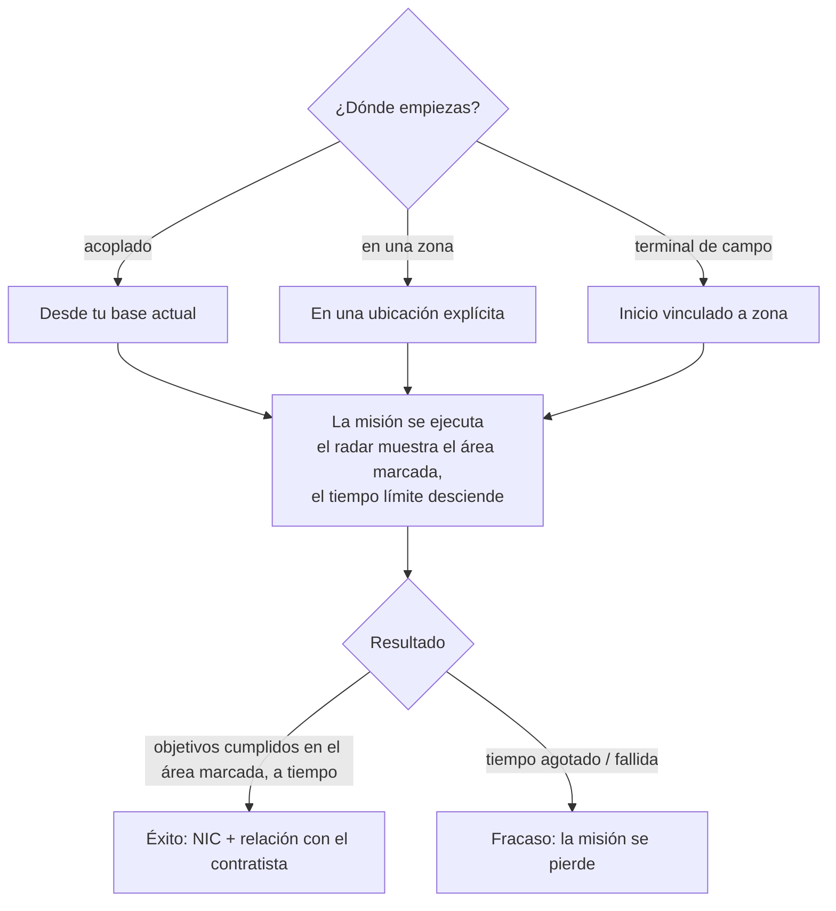

# Misiones

Las **misiones** son objetivos estructurados que aceptas en una zona — entregar objetos, abatir objetivos,
utilizar estructuras. Son la forma en que progresas, ganas recompensas e impulsas gran parte del contenido de las zonas
(alarmas, quioscos y algunos mecanismos de PBS/transporte están vinculados a misiones).

> Las ubicaciones de la interfaz siguen el [resumen de la interfaz del cliente](/es/features/ui/). Las mecánicas siguientes han sido confirmadas contra
> el servidor.

## Iniciar una misión

Inicias una misión eligiendo una **categoría** y un **nivel** (los niveles se ajustan a un
rango válido), en una **ubicación**:

- Si estás **acoplado**, la misión comienza desde la ubicación de tu base actual.
- Si estás **en una zona**, especificas la ubicación de forma explícita.
- Las misiones también pueden comenzar **desde una zona** directamente (inicio vinculado a la zona) o **desde una
  terminal de campo**.

No todas las categorías/niveles están disponibles en todas partes — la disponibilidad depende del contenido. La
lista completa de misiones (tipo, categoría, nivel, duración, tasa de recompensa y objetos de recompensa)
se genera en [Misiones](/es/content/missions/).

## Para qué sirven las misiones

Las misiones cumplen dos propósitos simultáneos: pagan NIC y mejoran tu **relación**
con la corporación emisora (contratista). Una mejor relación es un factor clave para
obtener una **mayor proporción de instalaciones (facility ratio)** en las terminales de esa corporación — la producción y
otros procesos de instalaciones se vuelven más baratos y rápidos para ti. Las relaciones también pueden *disminuir*: algunas
misiones entran en conflicto con los intereses de otra corporación, y las instrucciones detallan cuándo te
costará relación.

- **Misiones de entrenamiento** — fáciles, destacadas para novatos; hazlas todas, las recompensas
  son una inyección excelente para los inicios.
- **Las misiones regulares** vienen en tres modalidades:
  - *Combate* — reconocimiento (escanear robots enemigos), caza de recompensas (destruir objetivos en un círculo
    marcado), destruir y recuperar (destruir + recuperar + entregar), reconocimiento y recuperación, recompensas
    especiales (objetivos difíciles de alcanzar).
  - *Industria* — geología (escanear en busca de un mineral con la carga adecuada), cosecha, explotación de minerales,
    explotación especializada (sitios de excavación custodiados — lleva ayuda armada).
  - *Logística* — transporte (entregar un paquete entre terminales) y recuperación
    (un paquete grande a través de territorio peligroso — escolta requerida).
- No existe tal cosa como una **misión segura**: si ves enemigos en la ruta y
  careces del equipo para defenderte, pide ayuda antes de perderlo todo por el camino.
- **Los objetivos solo cuentan en el área marcada** — el mapa de la misión la señala con un
  círculo rojo en el radar; las bajas y escaneos fuera de él no cuentan para nada. Si se agota el plazo,
  la misión fracasa al instante.
- **Contratos privados de transporte** — un sistema gestionado por el Sindicato (segunda pestaña de la ventana
  de misiones) donde los jugadores publican contenedores para que otros jugadores los transporten entre terminales,
  con una recompensa fijada y un **aval (fianza)** que aporta el transportista (reembolsado con éxito, perdido si
  el contenedor es destruido; abortar a mitad de camino reembolsa solo la mitad). Mantén los contenedores
  lo bastante pequeños para que alguien pueda transportarlos realmente.

## Datos y opciones de misiones

- **Datos de misión** — detalles de una misión.
- **Opciones de misión** — las opciones/variantes disponibles para una misión.
- **Suministros de misión** — los suministros que involucra una misión.
- **Objetos iniciales** — los objetos con los que comienza una misión.

## Ejecución de una misión

- **Listar misiones en curso** — lo que estás realizando actualmente.
- **Abortar** — cancela una misión que estás ejecutando.
- **Añadir un participante** — incorpora a otro personaje a la misión (misiones multijugador).
- **Registro de misión** — el registro de eventos de una misión.

## Entrega

- **Entregar** — completa un objetivo de entrega. Esto se puede realizar **acoplado** (en una base) o
  **en una zona** (en una ubicación/eid específica), dependiendo de la misión.

## Agentes

- **Listar agentes** — los agentes de misiones disponibles (NPCs/facciones que asignan misiones).

## Terminales de campo

- **Información de terminal de campo** — inspecciona una terminal de campo en una zona (una estructura que puede iniciar
  o gestionar misiones).

## Notas prácticas

- **Las misiones son el tejido conectivo** — alarmas, quioscos y algunas estructuras son
  objetos de misión (ver [recolección](/es/features/gathering/) y [combate](/es/features/combat/)).
- **Multijugador** — puedes añadir participantes para cooperar en una misión.
- **El contexto de entrega importa** — algunas entregas requieren estar acoplado, otras requieren estar en
  una ubicación de la zona.
- **El nivel se ajusta** — solicitar un nivel fuera de rango se corrige automáticamente, no genera un error.
- **Abortar es tu salida** — si una misión se complica, abórtala.

## Estructuras de misiones

Las misiones se anclan en las zonas mediante **estructuras**. El servidor implementa los siguientes tipos:

| Estructura | Qué hace |
|---|---|
| **Interruptor simple** | interacción instantánea — acércate y el objetivo de la misión se completa |
| **Interruptor de alarma** | una tarea temporizada — permanece dentro del alcance durante un periodo (según las opciones de la misión), comprobado cada 2 s |
| **Suministro de objetos** | temporizado como un interruptor de alarma, luego **genera objetos en el contenedor de tu robot** |
| **Quiosco** | un punto de **entrega de objetos** — entrega a la misión los objetos requeridos |

<!-- Developer notes: Missions/MissionStart.cs (category, level clamp, docked vs zone
     location), Missions/MissionDeliver.cs (docked vs zone delivery), MissionAbort.cs,
     MissionData.cs / MissionGetOptions.cs / MissionGetSupply.cs / MissionStartItems.cs,
     MissionListRunning.cs / MissionListAgents.cs / MissionLogList.cs,
     MissionPlayerAddsParticipant.cs, FieldTerminalInfo.cs, MissionStartFromZone.cs;
     Services/MissionEngine/* (MissionProcessor, mission structures incl. AlarmSwitch,
     Kiosk). -->
