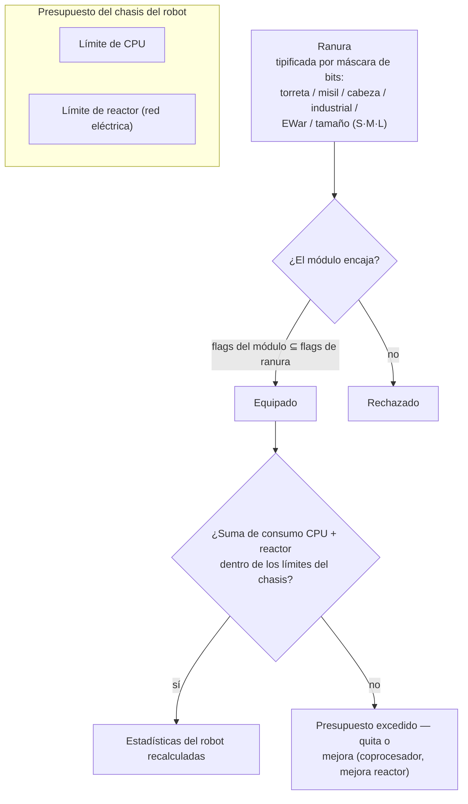

# Módulos y equipamiento

"Comprar un robot solo te da el chasis." Equiparlo con módulos es donde el robot
se convierte en lo que necesitas. *Equipar (fitting)* se refiere tanto a la configuración de módulos
("pásame tu build") como al presupuesto de CPU/reactor que consume.

## Ranuras y recursos

El chasis de un robot tiene un conjunto fijo de **ranuras**, definidas por su estructura. Cada ranura
está tipificada por una máscara de bits — torreta, lanzamisiles, cabeza, industrial, EWar/ingeniería,
tamaño (pequeño / mediano / grande) — y un módulo solo encaja en una ranura cuando su propia máscara
de tipo es un subconjunto de la de la ranura. Así, una ranura de torreta en un chasis acepta módulos de torreta
pequeños, medianos *o* grandes, pero ningún lanzamisiles podrá entrar en una ranura de torreta. Los módulos
de cabeza (coprocesadores, módulos de ajuste) y de chasis/piernas (placas, bastidores) ocupan sus propias
ranuras dedicadas.

Cada módulo consume **CPU** y **reactor** (red eléctrica) del chasis — la suma de todo lo
equipado debe permanecer dentro de ambos límites, y algunos módulos también consumen **acumulador**
(núcleo) por ciclo. La capacidad sobrante es la *salida disponible* mostrada en la ventana de
equipamiento. Escala aproximada de chasis (ejemplos T1/T2/T3):

| Clase de chasis | CPU | Reactor | Ejemplo |
|---|---:|---:|---|
| Oruga pequeña | ~250 | ~140 | Castel |
| Mech ligero | ~480 | ~300 | Waspish |
| Mech pesado | ~1 100 | ~1 000 | Tyrannos |
| Caminante | ~3 200+ | ~1 100+ | Gropho |

Cuando te falte capacidad: **CPU** — módulos coprocesadores (p. ej., el coprocesador T3 otorga +20% de CPU)
o variantes de módulos T2 (menor consumo). **Reactor** — mejoras de reactor (p. ej., T3 da +20% de salida
del reactor) o sellado del reactor (reduce la radiación, lo que también te protege de EnWar — ver más abajo).

## Las familias de módulos

Los valores específicos por modelo residen en el [catálogo de objetos](/es/content/) y en la
[referencia de formatos](/es/formats/); este es el mapa general de familias.

### Armas y munición

Cuatro tecnologías de armas, cada una con su propia munición y curva de distancia:

| Arma | Munición | Perfil de distancia | Notas |
|---|---|---|---|
| **Armas de fuego** | Proyectiles | Óptimo corto, caída enorme | Proyectiles que *nunca fallan* — pero su "precisión" actúa como un radio de dispersión, por lo que los blancos pequeños reciben daño reducido ante dispersiones amplias. |
| **Magnéticas (cañones de riel)** | Balas pesadas (slugs) | Alcance medio, caída pronunciada | Gran velocidad de impacto; alto consumo energético. |
| **Láseres** | Células de energía | Largo alcance | Mayor consumo de energía; haces concentrados. |
| **Misiles** | Misiles | Largo alcance | El acierto o fallo se decide por la probabilidad de impacto del *robot*, no por la distancia. El daño escala según el tamaño del blanco relativo al radio de explosión — misiles grandes sobre blancos pequeños impactan por mucho menos. |

El daño disminuye con la distancia según una curva cosinusoidal suave: daño completo al alcance óptimo,
cero al óptimo + caída (ver [caída de daño](/es/features/combat/#damage-types)).

La munición es donde ajustas el daño: los tipos primarios + secundarios te permiten afinar contra
un objetivo específico (ver [tipos de daño](/es/features/combat/#damage-types)) — a costa de un poco
menos de daño total en comparación con la munición puramente primaria.

Las torretas vienen en tamaños pequeño/mediano/grande; **ajusta el tamaño al robot** (los bots
pequeños usan módulos pequeños, los mechs y pesados usan medianos/grandes).

### Defensa

- **Placas de blindaje** — la reserva principal de puntos de vida; cuando el blindaje llega a cero, el robot
  explota. Las placas **LWF** (chasis ligero) intercambian resistencia por velocidad: una placa LWF T2
  multiplica el blindaje por ~0.73 pero otorga +19% de velocidad, −0.2 de firma y −0.2 de masa.
- **Generador de escudo** — una barrera alimentada por acumulador que absorbe daño antes del
  blindaje. El escudo consume *tu propio núcleo* para absorber: un impacto que infligiría 100 de daño
  en un escudo de absorción 2× consume 50 de núcleo en lugar de 100 de blindaje. Mientras el escudo está
  activo, tus propias armas no pueden disparar. La calidad de absorción escala con el radio del escudo
  respecto a tu firma — los escudos grandes en chasis pequeños funcionan mejor.
- **Reparación de blindaje** — módulos activos de reparación (pequeños/medianos/grandes); la **reparación
  remota de blindaje** alcanza a un objetivo fijado (aliados o una PBS) pero tiene un alcance corto y un
  ciclo más largo.
- **Endurecedores de blindaje** — puntos pasivos de resistencia por tipo de daño (variantes químicas /
  cinéticas / térmicas / explosivas).
- **Aleación adaptativa** — un módulo pasivo que *aprende* de la mezcla de daño que recibe y
  redistribuye una reserva fija de puntos de resistencia hacia el tipo de daño que más te ha impactado.
- **Evasión / maniobra** — los módulos de reducción de firma y los NEXUS (abajo) hacen que el blanco
  sea más pequeño: menos daño por efectos de área y una fijación más difícil.

### Energía

- **Reactor** — el límite de potencia sostenida; las mejoras de reactor lo aumentan, el sellado de reactor
  reduce la radiación (menos daño de EnWar recibido, a costa de un pequeño consumo de reactor).
- **Acumulador (núcleo)** — la reserva de energía por impulsos que alimenta los ciclos de los módulos. Se
  recarga con el tiempo (el `core_recharge_time` del chasis, ~120 ms en una oruga T1); los **recargadores
  de acumulador** aceleran la recarga.
- **Inyectores de energía (potenciadores de núcleo)** — consumen una carga para rellenar al instante
  el acumulador.
- **Transferidores de energía** — transmiten núcleo desde tu robot hacia un aliado fijado (los jugadores
  no pueden transferir energía a NPCs).

### Electrónica

- **Potenciador de sensor** — pasivo, propio: acorta tu tiempo de fijación y amplía tu
  alcance de fijación.
- **Potenciador de sensor remoto** — activo, sobre objetivo: aplica la misma mejora a un aliado fijado
  durante ~10.5 s.
- **Coprocesadores** — aumentan el límite de CPU del chasis (T1 +10% … T3 +20%).
- **Estabilizadores de armas** — mejoran la precisión del arma (menor radio efectivo de área)
  y reducen un poco de masa.
- **Módulos de ajuste (ranuras de cabeza)** — bonificaciones fijas a familias específicas: modificadores
  de daño (+25% de daño por familia de armas en T3), mejoras de minería (+10% de minería y
  cosecha en T3), mejoras de reparación de blindaje (+16% de reparación, −8% de ciclo en T3).

### Guerra Electrónica (EWar)

Ciega y ensordece al enemigo:

- **Atenuador de sensor (sensor dampener)** — perjuicio a distancia: alarga el tiempo de fijación del
  blanco y recorta su alcance de fijación durante ~5.5 s. Solo tiene éxito si tu potencia de ECM supera la
  fuerza de sensor (aleatorizada) del objetivo.
- **Inhibidor de sensor (sensor jammer)** — instantáneo: reinicia *todas* las fijaciones del blanco si
  supera la comprobación de ECM.
- **ECCM** — mejora sobre uno mismo durante 20 s: eleva la fuerza del sensor y la resistencia a fijaciones,
  y *elimina* perjuicios vulnerables a ECM (atenuadores, redes ralentizadoras).
- **Neutralizador neural** — reinicia las fijaciones de **todos** los jugadores en un radio de ~1.65 km. Un botón
  del pánico.

Contramedidas: fuerza de sensores (chasis), ECCM y mantener la distancia.

### Sigilo y detección

- **Módulo de sigilo** — ~10.5 s de sigilo; el consumo escala con tu radio de firma
  (chasis más grande, drenaje de núcleo más rápido).
- **Marcador de blancos (target painter)** — perjuicio de ~10.5 s que reduce la fuerza de sigilo del blanco.
- **Módulo de detección** — aumento pasivo a tu fuerza de detección.

La fuerza de detección vs. la fuerza de sigilo decide si puedes ver (y fijar) a un blanco camuflado
en absoluto — consulta [detección y enmascaramiento](/es/features/combat/#detection-masking-and-speed).

### Guerra de Energía (EnWar)

Drena o anula la energía del enemigo:

- **Drenadores (vampiros de energía)** — extraen núcleo de un blanco fijado y lo suman a tu
  propio acumulador.
- **Neutralizadores** — lo mismo, pero el núcleo drenado se destruye.
- Ambos se ven debilitados por la **radiación del reactor** del objetivo — el sellado de reactor es una
  defensa efectiva.
- **Desmovilizadores (redes / webs)** — reducción de velocidad de ~5.5 s sobre el blanco; el efecto
  escala con la masa del objetivo (los chasis pesados sufren menor reducción porcentual) y falla contra blancos
  fuera del alcance óptimo del módulo.
- **Scorcher** — un arma eléctrica que *salta* hasta a 5 blancos, dañando escudos
  y blindajes con daño penetrante.

### Industrial

- **Perforadoras** (pequeñas / grandes) y **cosechadoras** (pequeñas / grandes) — los módulos de
  recolección; el rendimiento, el tiempo de ciclo y el uso de acumulador son las estadísticas clave.
  La minería otorga EP (con un límite diario y penalización para líquidos).
- **Geoescáner** — escanea el campo mineral a tu alrededor con la precisión de la sonda;
  el resultado es un mapa de lo que hay bajo el suelo (ver [recolección](/es/features/gathering/)).
- **Excavadora** — módulo de aura: mejora el rendimiento de minería/cosecha de unidades cercanas
  (T3: +50%) a expensas de sigilo.
- **Terraformación** (zonas gamma) — herramientas de bloqueo de terreno que elevan, bajan o nivelan
  el terreno (radio máx. 5 m) y cultivan plantas de muro; consulta la [sección de zonas](/zones/zone-gamma-z106/).
- **Controladores remotos** — torretas y drones a distancia: cada módulo controlador dispone de un ancho
  de banda (cuántos), un alcance operativo y una vida útil de drones (5–10 min según el nivel). Variantes:
  tácticos (daño/ciclo), asalto (daño), apoyo (reparación remota), industriales (drones de minería/cosecha),
  cazador. Un módulo **traductor de comando remoto** amplifica el daño, blindaje, rendimiento minero y
  reparación de los drones (T3: +7.5% cada uno) y puede ampliar el ancho de banda del controlador.

### NEXUS

Sistemas de Utilización de Extensiones en Red (NEXUS): **mejoras de escuadrón**. Un módulo NEXUS emite un
aura alrededor del propio robot que mejora a los **miembros de la cuadrilla** (y sus torretas/drones)
dentro del radio del aura — por defecto 10 m, renovable cada 10 s. Reglas:

- un robot puede albergar como máximo **3 auras NEXUS**, y como máximo **una de cada tipo**;
- el aura solo alcanza a las unidades de tu **cuadrilla**, no a aliados aleatorios.

La lista de tipos T3 (13): velocidad, blindaje, escudo, farlock (alcance de fijación), potenciador de fijación
(tiempo de fijación), golpe crítico, asalto (ciclo de arma), EW (alcance EWar), evasión (firma), reparación,
industrial (consumo de acumulador al recolectar), extractor rápido (ciclo de recolección), recargador (recarga de núcleo).
Cada módulo T3 otorga aproximadamente un +7.5% de su estadística; p. ej., el NEXUS de velocidad multiplica la velocidad
máxima por 1.075 para cada compañero de cuadrilla situado a menos de 10 m.

### NOX

Herramientas de grado cultista: módulos **negadores** que *desactivan* módulos enemigos dentro de
su radio — un **negador de escudo** (reduce la absorción de escudo en ~90%), un **negador de reparación**
(reduce la reparación) y un **negador de teletransporte** (bloquea el teletransporte). Cada activación
**consume plasma** de tu carga, y usar uno en una zona abierta (no de entrenamiento) **marca a tu personaje para PvP**.

### Propósito especial

- **Módulo de hackeo de asedio** — la herramienta de SAP activo: ciclo de 5 s, alcance de 3 m (ver
  [puestos de avanzada](/es/features/outposts/)).
- **Autodestrucción** — activa una cuenta atrás de 8 segundos; el haz es visible a 600 m. Último recurso.
- **Detector de minas** — amplía el rango de detección de minas del chasis.
- **Emisores de blob** — despliegan un emisor que propaga un campo blob; el módulo modulador de emisión
  ajusta el campo (ver [combate](/es/features/combat/)).
- **Construcción PBS** — el módulo utilizado para colocar estructuras PBS en zonas gamma.

## Reglas generales

1. **No mezcles tus armas.** Armas magnéticas + láser + misiles en un mismo bot suele
   rendir peor que centrarse en una; mezclar corto y largo alcance rara vez sale bien.
2. **Cuidado con la masa.** Cada placa y módulo de escudo añade masa y firma —
   a veces la velocidad importa más que la defensa.
3. **No intentes hacerlo todo.** Un bot que mina, escanea y dispara no hace nada de ello
   tan bien como un especialista.
4. **Adapta el tamaño de tus módulos** al robot, y deja un margen de CPU/reactor para los módulos
   de ajuste que hacen que una configuración realmente funcione.
5. …y sí, algunas configuraciones de nicho rompen todas las reglas anteriores y aun así funcionan. Solo
   diseña con cabeza.

<!-- Developer notes: modules, weapons, ammo, defenses, EWar, EnWar, NEXUS, NOX. -->
