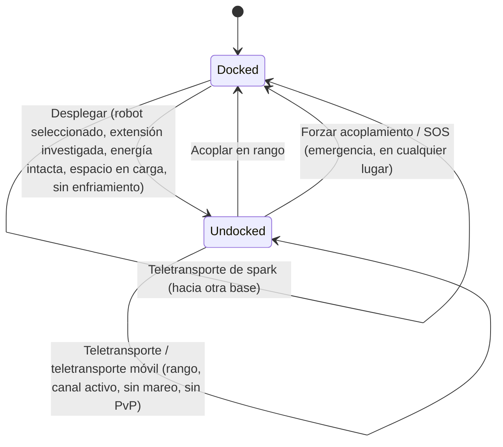

# Movimiento y zonas

Siempre te encuentras en uno de dos estados: **acoplado** en una base o **desacoplado** en una zona
pilotando tu robot activo de forma remota. Todo en esta página trata sobre cómo desplazarse entre esos estados
y entre zonas.

> Las ubicaciones de la interfaz siguen el [resumen de la interfaz del cliente](/es/features/ui/): el **botón Desplegar/Acoplar** es el
> interruptor central de la barra superior. Las mecánicas siguientes han sido confirmadas contra el servidor.

## Acoplado vs. desacoplado

- **Acoplado** — estás en una base. Tus robots y objetos están en contenedores. No puedes
  pilotar un robot, usar teletransportes ni escanear, pero puedes fabricar, comerciar, investigar y usar las
  instalaciones de la base.
- **Desacoplado** — estás en una zona, pilotando tu robot activo. Puedes moverte, escanear,
  luchar e
  interactuar con objetos de la zona, pero la mayoría de las actividades exclusivas de base están bloqueadas.

## Desacoplarse

Pulsa **Desplegar** (en el centro de la barra superior). El servidor comprobará entonces todo lo siguiente:

1. Tienes un **robot activo seleccionado**.
2. La clase de ese robot tiene investigada la **extensión habilitadora** requerida en tu
   personaje (ver [investigación](/es/features/research/)).
3. El **sistema de energía** del robot está intacto.
4. El **contenedor del robot tiene capacidad libre**.
5. No estás dentro de un **enfriamiento de desacoplamiento** (un temporizador corto tras ciertos eventos).

Si falla alguna comprobación, el desacoplamiento será rechazado.

## Volver a acoplarse

- **Acoplar** en una base cuando estés dentro de su rango de acoplamiento.
- **Forzar acoplamiento** es la acción de emergencia: te saca de la zona y te atraca en
  la base principal (TMA) de inmediato, incluso durante el combate. Úsalo si estás perdiendo una batalla.
- **SOS** — una acción de auxilio en la zona que te acopla en la base actual y registra el incidente.

## La cola de entrada a la zona

Algunas zonas están muy concurridas y utilizan una **cola de entrada** cuando sales / entras:

- Comprobar el estado de la cola (`zoneGetQueueInfo`).
- Ajustar tu longitud de cola preferida (`zoneSetQueueLength`).
- Cancelar la espera si cambias de opinión (`zoneCancelEnterQueue`).

## Teletransportes

Los **teletransportes** son estructuras situadas dentro de una zona. Para usar uno:

- Debes estar **dentro del rango del teletransporte**.
- El **canal** (destino) debe estar **activo** y ser válido.
- No debes sufrir **mareo de teletransporte** — un breve enfriamiento tras cualquier teletransporte,
  durante el cual no puedes volver a teletransportarte.
- Ciertos efectos (p. ej., la anulación de *Nox*) o estar **en combate PvP** pueden bloquear los teletransportes.

Los canales de teletransporte son de tres tipos:

| Tipo | Efecto |
|---|---|
| **Dentro de la zona** | Te traslada a un punto aleatorio en la misma zona |
| **Otra zona** | Te traslada a un punto aleatorio en una zona diferente |
| **Salida de entrenamiento** | Sale de una zona de entrenamiento (con opción de nivel de recompensa) |

Los **teletransportes móviles** son objetos de teletransporte *en propiedad* (p. ej., teletransportadores móviles de fortaleza/mundo).
Se aplican reglas adicionales:

- Solo el **propietario o un miembro de la cuadrilla del propietario** puede usarlo.
- **No se pueden usar mientras estés en PvP**.
- Cada uso aplica un **enfriamiento** a ese teletransporte.

Puedes listar los teletransportes y sus canales, así como consultar canales de alcance mundial.

## Teletransportes de spark

Los **teletransportes de spark** son un sistema de viaje rápido entre bases:

- **Fijas** un destino de spark en una base y luego lo **usas** (mientras estás acoplado) para saltar a
  otra base al instante.
- Puedes **listar, fijar, usar y eliminar** tus teletransportes de spark.
- La base de destino debe **permitirte el acoplamiento**.
- Al llegar, el servidor selecciona un robot adecuado para ti (uno cuyas extensiones habilitadoras
  tengas investigadas).
- El **número de teletransportes de spark que puedes tener** está limitado por una extensión
  (ver [investigación](/es/features/research/)); superarlo será rechazado.

## Puertas

Las **puertas** son estructuras de zona que se pueden utilizar desde cualquier lugar (no están limitadas por rango como
los teletransportes). El propietario de una base puede **renombrar** sus puertas.

## Información de la base

Puedes inspeccionar cualquier base:

- **Información** — qué es y dónde está.
- **Propiedad** — a quién pertenece.
- **Instalaciones** — qué ofrece (producción, mercado, tienda, …).
- **Mis objetos** — tus objetos almacenados en esa base.
- **Derechos de acoplamiento** — el propietario de una base puede definir quién tiene permiso para acoplarse allí.

## Qué puede fallar

| Síntoma | Causa probable |
|---|---|
| Desacoplamiento rechazado | Sin robot activo, falta extensión habilitadora, sistema de energía dañado, contenedor del robot lleno o enfriamiento de desacoplamiento |
| Teletransporte rechazado | Fuera de rango, canal inactivo, mareo de teletransporte, efecto Nox o en combate PvP |
| Teletransporte móvil rechazado | No eres propietario/miembro de cuadrilla, o estás en combate PvP |
| Teletransporte de spark rechazado | La base de destino prohíbe el acoplamiento, no hay robot válido seleccionable o límite de teletransportes de spark alcanzado |
| Atascado en entrada a zona | Cola de zona — comprueba el estado de la cola o cancela |

<!-- Developer notes: Dock.cs / Undock.cs / ForceDock.cs (TMA = baseEid 561) /
     ZoneSOS.cs; Zone/TeleportUse.cs (TeleportPlayerValidator, three
     TeleportDescriptionType strategies, mobile-teleport gang/PVP rules);
     Sparks/SparkTeleportUse.cs (docked-only, extension-count limit);
     Zone/ZoneCancelEnterQueue.cs + ZoneEnterQueueService; GateSetName.cs. -->
