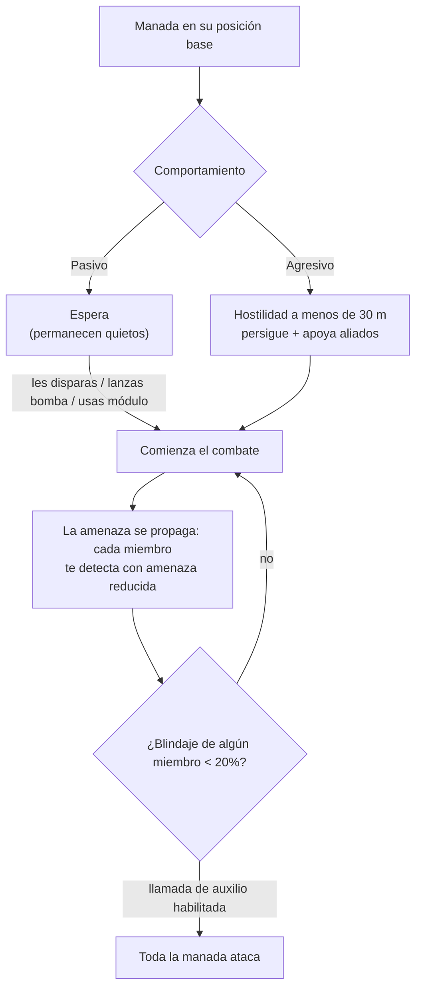

# NPCs y caza PvE

Los NPCs son la principal fuente del juego de [plasma de reactor](/es/content/ores/),
[núcleos de datos (kernels)](/es/features/research/) y módulos, y una forma fiable de ganar puntos de extensión
a cualquier nivel. Existen en **manadas (flocks)**: grupos que comparten una posición de
origen, un radio de patrulla, un tiempo de reaparición y un comportamiento.

## Quién está ahí fuera

Los NPCs se dividen en cuatro razas — **Nuimqol, Pelistal, Thelodica e Industrial** —
cada una con varias clases de robots (corredores, orugas, mechs, mechs pesados) y
rangos 1–5 que escalan en estadísticas y botín. Más allá de los rangos habituales:

- **Goblins** — guardias de guerra electrónica en las islas protegidas. Frágiles, pero sus
  modificadores de fijación son extremos (te fijan ~5× más rápido de lo normal, desde
  ~2× más lejos): un campamento goblin hace muy difícil combatir o minar cerca.
- **Élites** — variantes raras de los NPCs con rango que prácticamente duplican
  las estadísticas base y aportan mejor botín.
- **Observadores** — NPCs agresivos y errantes (Arbalest, Baphomet, Waspish,
  Tyrannos, Artemis, Kain, Gropho, Sequer, Seth, Mesmer…). Patrullan amplias
  zonas de la isla y son considerablemente más difíciles que los NPCs con rango de su
  misma clase — los *grandes* observadores en islas protegidas y sus variantes de islas
  abiertas son los cazadores regulares más duros que existen.
- **Jefes (Bosses)** — NPCs raros y configurados individualmente. Nunca huyen, pueden
  anunciarse a todo el servidor y algunos están vinculados a puestos de avanzada (destruirlos
  modifica la [estabilidad del puesto de avanzada](/es/features/outposts/)) o generan fisuras de reliquias al
  morir. Los jefes más débiles se pueden derrotar en solitario en islas protegidas; los más
  fuertes necesitan un grupo especializado.
- **Apariciones del Sindicato** — una facción especial (el Sindicato, con sus propios
  NPCs con nombre) que opera sus propias zonas estáticas de farmeo, generalmente en islas
  protegidas y abiertas poco profundas.

## Pasivo vs agresivo

- **Las manadas pasivas** nunca atacan por iniciativa propia — debes dispararles, bombardearlas o
  usar un módulo activo sobre ellas primero. La mayoría de los puntos de farmeo estáticos clásicos son pasivos.
- **Las manadas agresivas** atacan solas en cuanto te acercas a menos de **30 m**,
  te persiguen y apoyan a los aliados que estén combatiendo. Todos los observadores, la mayoría de apariciones
  errantes y los guardianes/invasores de puestos de avanzada son agresivos.

Cuando comienza un combate, **la amenaza se propaga por toda la manada**: cada miembro te
fija con un nivel de amenaza reducido, y si el blindaje de algún miembro cae por debajo del **20%**, el
grupo entero se abalanza sobre ti (en manadas con llamada de auxilio habilitada). Da por hecho que estás
luchando contra toda la aparición desde el momento en que dispara el primer robot.

## Apariciones y reaparición

- **Las apariciones estáticas** residen en una posición fija con un radio de acción; los miembros
  reaparecen **individualmente** con su propio temporizador. Una manada que ha sido farmeada
  con intensidad reaparece más rápido; una nueva reaparece más lentamente.
- **Las apariciones errantes** se desplazan por la isla — son los observadores y
  las manadas de tipo convoy, y normalmente son agresivas.
- **Refuerzos en zonas mineras** — los NPCs industriales que trabajan en un nodo de recursos
  tienen oleadas de refuerzos preconfiguradas: a medida que el combate se alarga, llegan más
  oleadas al nodo. Los jefes también solicitan refuerzos cuando reciben daño.
  Por lo tanto, lo que parecía un farmeo de "un solo robot" puede convertirse en una batalla campal; inspecciona el área antes
  de atacar.

## Qué sueltan

El botín está configurado por tipo de NPC: **plasma de reactor de la raza de la isla**,
**núcleos de datos (kernels)** (comunes, de alta tecnología, industriales y específicos de raza), componentes de módulos
y, con menor frecuencia, módulos empaquetados. Los rangos superiores y tipos especiales sueltan más.

Cada baja también otorga **puntos de extensión**, configurados por tipo de NPC — y
duplicados en islas abiertas (nivel beta).

## Ventajas por nivel de zona

Las islas se dividen en tres niveles — protegidas (alfa), PvE abierto (beta) y PvP
abierto (gamma). La caza se vuelve más peligrosa, pero también más rentable, a medida que profundizas:

- **Explosiones al morir** — en islas protegidas, la muerte de un robot *no*
  explota. En islas abiertas (beta y gamma), cada robot destruido — jugador
  o NPC — detona e inflige daño de área. Las reacciones en cadena agilizan el farmeo
  y hacen que los puntos de emboscada sean letales.
- **EP duplicado** — la recompensa base de EP de cualquier actividad se duplica en islas
  de nivel beta.
- **Mejores misiones** — los niveles superiores de misiones se encuentran en las islas abiertas,
  y su EP de misión también está duplicado.
- **Monedas de misión de facción** — las misiones en islas abiertas pagan con la moneda de misión
  de esa raza (moneda Nuimqol / Pelistal / Thelodica) en lugar de la moneda
  universal. Las monedas de facción también se venden directamente en terminales de islas abiertas,
  y la moneda universal se puede comprar donde no se aceptan las de facción.

## Notas prácticas

- **Comprueba la manada antes de atacar** — cuenta los miembros, fíjate en los rangos y
  en si la aparición es agresiva; una zona pasiva a la que te acerques puede ocultar
  cinco robots listos para actuar.
- **Supera su alcance** — las apariciones estáticas no salen de su radio de acción; posicionarse para
  disparos despejados a larga distancia suele ser la forma más económica de ganar.
- **Los sitios de recursos son trampas** — los refuerzos de zonas mineras hacen que cuanto más tiempo
  luches, más enemigos aparezcan.
- **Cuidado con los observadores errantes** — si estás explorando, buscando artefactos o haciendo una ruta
  larga, un observador agresivo en tu camino supondrá un combate o un desvío obligatorio.

<!--
Written from scratch against the server backend, 2026-09-27:
Zones/NpcSystem/Flocks/ (Flock.cs, NormalFlock.cs — group respawns, adaptive
respawn multiplier), AI/Behaviors/ (Passive vs Aggressive; threat spread at
50%, call-for-help at 20% armor in SmartCreature.cs), AI/BodyPullThreatHelper.cs
(30 m aggro range, aggressive-only body-pull), Reinforcements/ + npcreinforcements
(mining-site and boss waves at HP thresholds), NpcSpecialType + npcbossinfo
(boss respawn noise, outpost stability links, server-wide announce),
entitydefaults (rank1-5 + dps/interceptor/scout/miniboss/elite variants, 30
elite definitions with ~2x modifiers; 13 def_npc_roaming_* observers; goblin
lancer/shark with 5x lock-time / 2x lock-range modifiers),
npcloot (26k rows: race plasma, common/hitech/industrial/race kernels,
modules), NpcEp.cs + GetNpcKillEp (EP per NPC, x2 on beta),
Unit.DoExplosion (death AoE suppressed on protected zones, active on
beta/gamma; radius from signature, damage from remaining core),
MissionLocation.cs (race-specific mission coins; universal coin on protected
zones), ZoneConfiguration (IsAlpha/IsBeta/IsGamma).
An earlier version of this page was adapted from the Open Perpetuum
community wiki (perpetuum.miraheze.org) and has been fully rewritten from
backend sources; no text was reused.
The ingested "TAP" section was dropped: no teleport-attractor concept exists
in this backend (no definition, code or table).
-->
