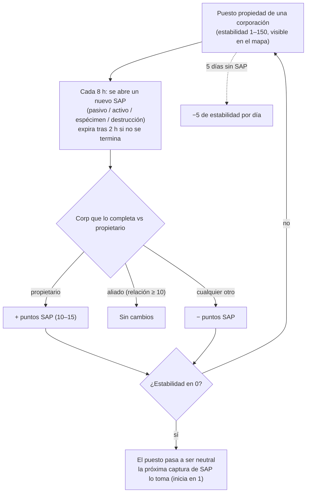

# Puestos de avanzada y SAP

En las islas de PvP abierto, **los puestos de avanzada pueden ser propiedad de corporaciones de jugadores**.
El control se mide mediante un indicador de **estabilidad** (0–150) mostrado sobre el puesto de avanzada
en la vista del mapa. El sistema **SAP** (Punto de Acceso de Servicio) es la forma en que se mueve
ese indicador — y cómo los puestos de avanzada cambian de manos.

## Las reglas

- Cuando la corporación **propietaria** completa un SAP, la estabilidad **sube** en
  el valor de puntos del SAP.
- Cuando una **corporación aliada al propietario** (relación mutua en +10 o superior)
  completa uno, la estabilidad **no se mueve**.
- Cuando **cualquier otra corporación** completa uno, la estabilidad **baja** en la misma
  cantidad.
- Al llegar a **cero**, el puesto de avanzada pierde la propiedad y pasa a ser neutral. Completar
  cualquier SAP en un puesto neutral lo **captura** (la corporación que lo completa
  se convierte en la propietaria, comenzando con estabilidad 1).
- **Degradación**: si no se completa ningún SAP durante **5 días**, el puesto comienza a perder
  **5 de estabilidad al día** hasta que se complete uno (o hasta que se pierda el puesto).

## Los cuatro tipos de SAP

Cada 8 horas, un puesto de avanzada activa un nuevo SAP — de uno de cuatro tipos. Cada tipo tiene
su propio valor de puntos y su propio método de finalización:

| Tipo | Cómo se realiza | Puntos | Recompensas características |
|---|---|---|---|
| **Pasivo** | Permanece dentro del haz del SAP durante **8 minutos**. El progreso es individual (el tiempo continuo de cada jugador en el haz); el jugador con mayor progreso personal se lo adjudica. | +10 | Plasma de facción (escala con la estabilidad), kits de investigación, potenciadores de EP. |
| **Activo** | Selecciona el SAP como objetivo y mantén activo un **módulo de hackeo de asedio (SAP)** — unos 120 ciclos de módulo (5 s cada uno), es decir, ~10 minutos. El progreso persiste si te detienes o te vas; individual. | +15 | Plasma, núcleos de datos (kernels), kits de investigación y **núcleos de reactor** (producción de robots). |
| **Espécimen** | Lleva **objetos de espécimen** al SAP (a menos de 7 m) y entrega los 5–6 que solicite. Cada entrega tiene un enfriamiento de 90 segundos; el progreso es individual. | +15 | Plasma, kernels, kits de investigación. |
| **Destrucción** | Destrúyelo a disparos: **30 000 de blindaje** y **150 de resistencia a los cuatro tipos de daño** (60% de reducción), **firma de 6 m** — las armas pequeñas le impactan mejor. El progreso de daño es **corporativo, no individual**, por lo que flotas enteras pueden atacarlo a la vez; la corporación con mayor daño causado al morir aplica el resultado. | ±15 | **Munición PvP** de facción, plasma, kernels. |

Los cuatro tipos de SAP **retransmiten los máximos anotadores actuales** (los 10 mejores) a todos los jugadores
cercanos, y **expiran tras 2 horas** si no se han completado.

### Negarle el objetivo al enemigo

Debido a que el progreso de destrucción es corporativo y el sentido del cambio de estabilidad
depende de quién gane, una táctica habitual es **infligir suficiente daño para liderar la
clasificación, pero no el suficiente para destruir el SAP**: si el propio equipo del propietario lo
remata, *tu* corporación seguirá siendo la vencedora y el cambio de estabilidad
perjudicará al propietario.

## Observación y predicción

- La **carga de escáner de intrusión** en un geoescáner, activada cerca del
  puesto de avanzada, informa del **tiempo hasta el próximo SAP** para los puestos dentro del alcance
  (en islas de PvP abierto la misma carga informa del estado de refuerzos de NPCs
  en su lugar).
- Los SAPs se anuncian a los jugadores cercanos poco antes de abrirse.
- La retransmisión de los mejores anotadores del SAP permite **observar un SAP disputado en
  tiempo real** y decidir si merece la pena disputarlo.

## Otras formas en que varía la estabilidad

- **Reliquias SAP** — objetos de reliquia que aparecen a 90–350 m del puesto de avanzada (reaparición cada
  4 horas, duración de hasta 12 horas). Recoger una aplica **±1 de estabilidad al instante**
  (para tu corporación), te marca con estado PvP y otorga EP junto a un contenedor de plasma.
- **Guardianes e invasores** — los jefes NPC del puesto de avanzada:
  - Los NPCs **Guardianes** permanecen cerca del puesto de avanzada (~35 m). Destruir uno **siempre
    reduce** la estabilidad en 3, sin importar quién lo destruya; reaparecen en ~6 horas.
  - Los NPCs **Invasores** patrullan hasta ~300 m. Destruir uno **aumenta** la estabilidad en
    2 para la corporación que lo destruye; reaparición en ~6 horas.

## Por qué importan los puestos de avanzada

Poseer un puesto de avanzada otorga a la corporación sus bonificaciones (producción, instalaciones
de defensa, efectos) y constituye la base del juego territorial de PvP abierto — consulta
[PBS](/es/features/pbs/) para conocer las estructuras que convierten un puesto de avanzada en una base de
operaciones real.

<!--
Written from scratch against the server backend, 2026-09-27:
Zones/Intrusion/Outpost.cs (stability 0-150, capture at 1, ally threshold
+10, EP to participants), OutpostDecay.cs (5-day grace, -5/day), SAP.cs +
PassiveHackingSAP.cs / ActiveHackingSAP.cs / SpecimenProcessingSAP.cs /
DestructionSAP.cs (8-min passive, 120x5s active, 5-6 specimen items with 90s
cooldown, corporate destruction score, 2h expiry, top-10 broadcast),
entitydefaults options (#increase=n10/n15), siegeitems (def_specimen_sap_item
2-3 x 5-6), def_sap_destruction stats (30k armor, 150 res all types, 6m
signature), def_siege_hack_module (5s cycle), intrusionsitestabilitythreshold
+ intrusionsaps, intrusionloot (plasma/kernels/research kits/cores/PvP ammo
by stability tier), npcbossinfo + npcflock (guard -3 @ ~35m, invader +2 @
~300m, 6h respawn), OutpostRelicManager.cs + SAPRelic.cs (90-350m spawn,
4h respawn, 12h lifespan, +1 stability, PvP flag), Scanner.Intrusion.cs
(next-SAP-time scan), EntitiesModule.cs (8h SAP interval).
An earlier version of this page was adapted from the Open Perpetuum
community wiki (perpetuum.miraheze.org) and has been fully rewritten from
backend sources; no text was reused.
Note: the ingested text had several numbers this server contradicts (3-day
decay vs 5-day, 10-min passive vs 8-min, "no resistances" vs 150 all types,
3 km invader range vs 300 m).
-->
