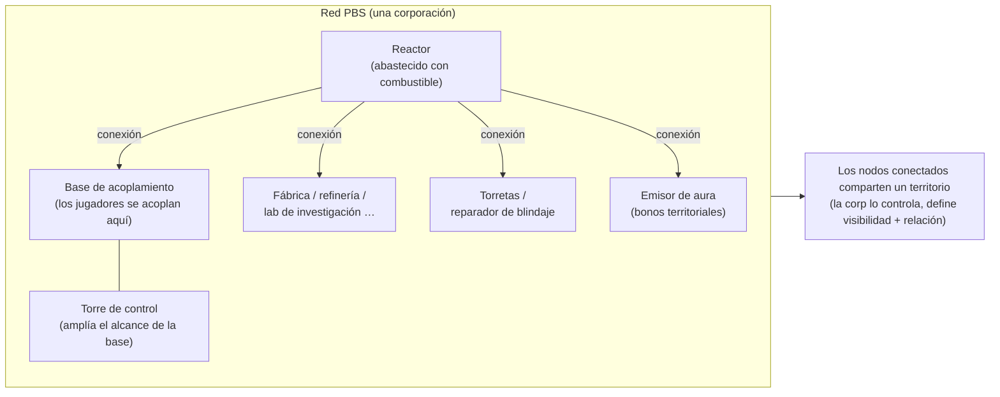
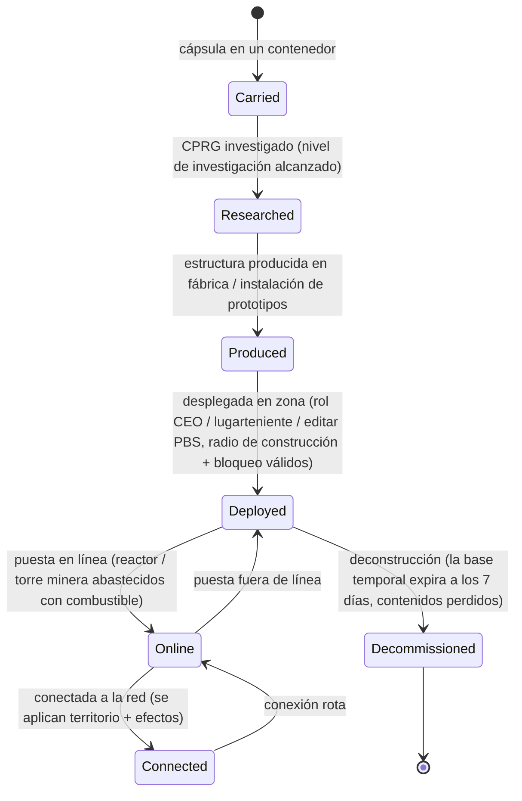

# Estaciones base (PBS)

Una **PBS** (Power Base Station o Estación Base de Energía) es una estructura colocable en una zona. Los objetos PBS pueden
**conectarse** en una **red**, lo que define **territorios** y habilita **efectos**.
Esta es una actividad de corporación/estructuras — la mayoría de las acciones requieren el rol
corporativo adecuado.

> Las ubicaciones de la interfaz siguen el [resumen de la interfaz del cliente](/es/features/ui/). El término exacto del cliente para "PBS" debe
> confirmarse. Las mecánicas siguientes han sido confirmadas contra el servidor.

## Qué hace una PBS

- Es un **nodo** en una **red** PBS.
- Los nodos conectados forman un **territorio** compartido que controla la corporación propietaria.
- Una red puede proyectar **efectos** (mejoras/controles) sobre su territorio.
- Algunas estructuras PBS pueden ser **abastecidas** con objetos (combustible) para funcionar.

## Familias de estructuras

Cada estructura PBS se presenta en niveles **pequeño / mediano / grande (S / M / L)**. Llevas la
**cápsula**, investigas el objeto (CPRG) y **despliegas** el objeto — el despliegue requiere
privilegios de rol (ver abajo). Las familias:

| Familia | Estructuras | Rol |
|---|---|---|
| Energía | reactor, pozo de energía, batería de núcleo, transmisor de núcleo | generan, almacenan y distribuyen la **energía de núcleo** con la que funciona todo |
| Acoplamiento | base de acoplamiento, base de acoplamiento con expiración, torre de control | donde se acoplan los jugadores; la torre de control amplía el alcance de la base |
| Producción | fábrica (mill), refinería, reprocesador, reparación, prototipador, laboratorio de investigación, forja de calibración (CPRG), forja de kits de investigación, mejora de producción | las instalaciones de [producción](/es/features/production/), en la zona en lugar de en una base de origen |
| Defensa | torretas (láser / riel / misiles / guerra electrónica), reparador de blindaje | defensa automatizada del territorio |
| Efectos | emisor de aura, proveedor de efectos, torre de enmascaramiento, torre minera | proyectan las bonificaciones de efectos del territorio; la torre minera extrae mineral automáticamente |
| Transporte | nodo de autopista | se conecta a la **autopista (highway)** de la zona (líneas de viaje rápido) |
| Construcción | módulo de construcción | el constructor que coloca las demás estructuras |

### Efectos del emisor de aura

El emisor de aura es la principal mejora territorial. Cada nivel proyecta una de tres
**bonificaciones base escaladas por nivel**:

- **pequeño (small)** — sensores nivel 1 / ingeniería nivel 1 / industria nivel 1
- **mediano (medium)** — los mismos tres en nivel 2
- **grande (large)** — los mismos tres en nivel 3

Los sensores amplían el alcance de escaneo/reconocimiento, la ingeniería acelera la construcción y la industria agiliza
la producción.

### La base de acoplamiento con expiración

Una base PBS especial con una **vida útil fija de 7 días** (168 h en el contenido). **No se puede
deconstruir** — o bien **expira o es destruida**. El tiempo de vida restante lo
anuncia un locutor en el juego (tema del canal de la base, correo y MOTD); cuando se agota,
la base es destruida y sus contenidos se pierden. Este es el modelo de "alquiler" para el
acoplamiento PBS: no pagas alquiler, recibes una ventana de tiempo fija.

## Despliegue

- **Comprobar despliegue** — antes de colocarla, verifica que una PBS puede desplegarse en una posición
  (comprobaciones de pendiente, bloqueo y privilegios). Esto requiere un rol corporativo
  (**CEO / lugarteniente / editar PBS**).
- El despliegue utiliza el **radio de construcción** y el **radio de bloqueo** de la estructura.

## Red y conexiones

- **Obtener red** — visualiza la red PBS de la que formas parte.
- **Información del nodo** — detalles de un nodo PBS.
- **Renombrar un nodo**.
- **Crear una conexión** — vincula dos nodos PBS. (Conectar a una red que ya dispone de
  una base de acoplamiento activa un proceso de transferencia de propiedad específico).
- **Romper una conexión** — desvincula dos nodos.
- **Establecer peso de conexión** — ajusta la fuerza/prioridad de una conexión.

## Control y estado

- **Poner en línea / fuera de línea** — activa o desactiva un nodo.
- **Establecer un efecto** — configura el efecto que proyecta un nodo.
- **Establecer deconstrucción de base** — marca una base para su desmantelamiento.

## Territorio

- **Obtener territorios** — lista los territorios que controla tu red.
- **Establecer visibilidad del territorio** — define si el territorio es visible para otros.
- **Establecer límite de relación (standing)** — restringe el acceso según la relación diplomática.
- **Establecer compensación de refuerzos** — ajusta el comportamiento de los refuerzos.

## Abastecimiento de combustible

- **Información de abastecimiento** — qué necesita una PBS y su estado de abastecimiento actual.
- **Abastecer objetos** — entrega objetos para alimentar/operar la PBS.

Las estructuras que admiten abastecimiento son el **reactor** y la **torre minera**. El abastecimiento convierte
objetos con valor energético (las calorías de núcleo `corecalories` por pieza) en la reserva de energía
del núcleo del nodo, hasta su máximo — cualquier jugador en rango puede abastecer un nodo. Qué puedes quemar:

| Combustible | Núcleo por unidad |
|---|---|
| Potenciador de reactor clase C | 8 000 000 |
| Potenciador de reactor clase B | 4 000 000 |
| Potenciador de reactor clase A | 2 000 000 |
| Espécimen SAP (intrusión) | 600 000 (variante flux: 28 000) |
| Bloque de energía gamma | 2 000 |
| Munición potenciadora de núcleo | 1 000 |
| Mineral bruto (espitium) | 400 |
| Mineral bruto (vitricyl / prilumium / chollonin) | 300 |
| Mineral bruto (axicol) | 40 |

Los potenciadores son el combustible más eficiente; el mineral bruto es la alternativa económica.

## Reembolso

- **Obtener / establecer información de reembolso** — configura el reembolso para los costes vinculados a la PBS.

## Registros

- **Registros PBS** — revisa la actividad de la PBS (conexiones, despliegues, etc.).

## Notas prácticas

- **Esta es una actividad de oficiales** — el despliegue y la mayoría de los controles requieren un rol corporativo.
- **Las conexiones definen el territorio** — la red que construyes es lo que controlas.
- **Comprueba el despliegue primero** — te indicará por qué fallaría una colocación (pendiente, bloqueo,
  privilegios) antes de comprometer materiales.
- **El abastecimiento la mantiene en funcionamiento** — los reactores y torres mineras queman combustible (potenciadores
  o mineral bruto) para sostener su reserva de núcleo.
- **La base con expiración es tu ventana fija** — 7 días, sin deconstrucción; planifica con antelación.
- **La visibilidad del territorio y la relación** te permiten abrir o cerrar tu zona a terceros.

## Torretas de defensa

No son controlables directamente por el jugador — se despliegan como estructuras defensivas PBS. Las torretas se ensamblan a partir de
piezas al igual que cualquier otro robot, pero están ancladas a una plataforma PBS y no se pueden pilotar.

| Torreta | Rol |
|---|---|
| Torreta PBS | Defensa PBS genérica |
| Torreta EW PBS | Guerra electrónica (disrupción de escudo/blindaje) |
| Torreta láser PBS | Defensa de armas de haz |
| Torreta de misiles PBS | Defensa de misiles |
| Torreta de riel PBS | Defensa de proyectiles (EM) |
| Torre de guardia policial | Defensa policial de NPCs de la zona |

Consulta la [referencia de robots](/es/content/robots/) para conocer detalles a nivel de piezas.

<!-- Developer notes: Zone/PBS/PBSCheckDeployment.cs (construction/blocking radius,
     CEO/deputy/editPBS role), PBSMakeConnection.cs / PBSBreakConnection.cs,
     PBSSetConnectionWeight.cs, PBSSetOnline.cs, PBSSetEffect.cs, PBSSetBaseDeconstruct.cs,
     PBSGetNetwork.cs, PBSNodeInfo.cs, PBSRenameNode.cs, PBSGetTerritories.cs,
     PBSSetTerritoryVisibility.cs, PBSSetStandingLimit.cs, PBSSetReinforceOffset.cs,
     PBSFeedableInfo.cs / PBSFeedItemsHander.cs, PBSGetReimburseInfo.cs /
     PBSSetReimburseInfo.cs, PbsGetLog.cs; Zones/PBS/* (IPBSObject, ConnectionHandler). -->
