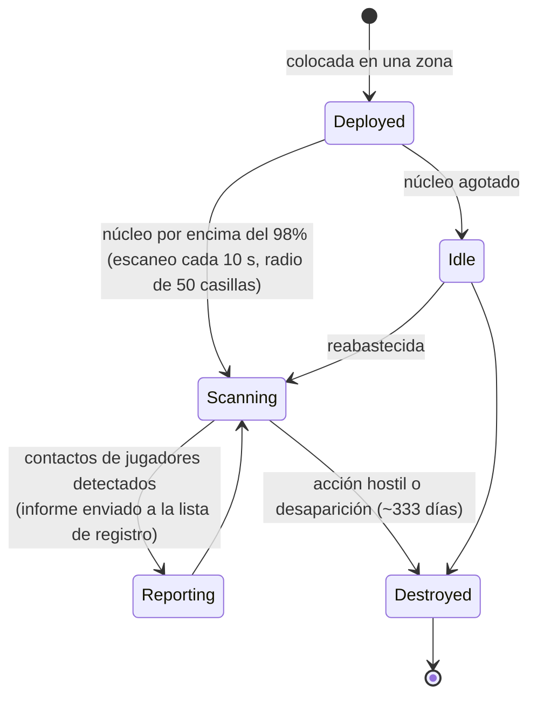

# Sondas de proximidad

Las sondas se dividen en dos familias:

- **Sondas de visibilidad (proximidad)** — pequeños dispositivos que despliegas en una zona para **vigilar un
  área**. Mientras tienen energía, escanean las unidades de jugadores a su alrededor y envían informes a los
  personajes que hayas registrado. Es una herramienta de vigilancia y reconocimiento.
- **Sondas de minería** — un **módulo** equipado en tu robot (niveles desde *noob* hasta
  *standard*, *industrial*, *named*, *elite* y *artifact*) más **munición de sonda por mineral**
  (variantes de casilla / dirección / área para cada mineral). Dispararla produce un resultado de escaneo
  para ese mineral en el área, almacenado por personaje (ver
  [recolección → escaneo](/es/features/gathering/)).

> Las ubicaciones de la interfaz siguen el [resumen de la interfaz del cliente](/es/features/ui/). Las mecánicas siguientes han sido confirmadas contra
> el servidor.

## Gestión de tus sondas

- **Listar** tus sondas — visualiza las sondas que posees.
- **Información de registro** — el estado/información de registro de una sonda.
- **Establecer registro** — vincula personajes a la lista de informes de la sonda.
- **Asignar un nombre** — ponle una etiqueta a una sonda.
- **Eliminar** el registro de una sonda (en una zona) — deja de vigilar / límpiala.

### Cómo funciona una sonda de visibilidad

- Funciona con **energía de núcleo**: solo escanea mientras su núcleo está prácticamente lleno (por encima del 98% de
  `core_max`); una sonda vacía permanece inactiva.
- Mientras está activa, escanea **cada 10 segundos** en busca de robots de jugadores dentro de su **radio de
  detección (50 casillas)** y envía un informe (el ID de personaje y la posición de cada contacto) a
  todos los integrantes de la lista de registro.
- El **registro** es una actividad corporativa: solo puedes registrar a **miembros de tu
  propia corporación**, y el **director general (CEO) y el lugarteniente siempre están en la lista** de forma automática.
  La lista tiene un tamaño máximo.
- **Tiempo de vida**: una sonda desplegada desaparece después de su `despawn_time` definido por contenido
  (la sonda de visibilidad está configurada en ~333 días) o cuando es destruida.

## Eventos del ciclo de vida

El servidor informa de los eventos del ciclo de vida de la sonda a medida que ocurren:
- **creada**, **actualizada**, **muerta** — una sonda se despliega, informa o es destruida.

Estos llegan como notificaciones automáticas (pushes); no los envías tú, sino que reaccionas a ellos.

## Notas prácticas

- **Regístrate antes de leer** — una sonda solo informa a sus personajes registrados.
- **Las sondas pueden morir** — una acción hostil o la expiración pueden destruir una sonda; vigila los
  eventos del ciclo de vida.
- **Nómbralas** — con varias sondas en el campo, las etiquetas te mantendrán organizado.
- **Reconocimiento, no combate** — las sondas recopilan información; no luchan.

<!-- Developer notes: ProximityProbeList.cs / ProximityProbeGetRegistrationInfo.cs /
     ProximityProbeRegisterSet.cs / ProximityProbeSetName.cs; Zone/ProximityProbeRemove.cs;
     Zones/ProximityProbes/ProximityProbe.cs + ProximityProbeDeployer.cs +
     ProximityDevice.cs; Zones/Blobs/* (blob emission/stealth); lifecycle events via
     ProximityProbeCreated/Update/Dead/Info commands. -->
