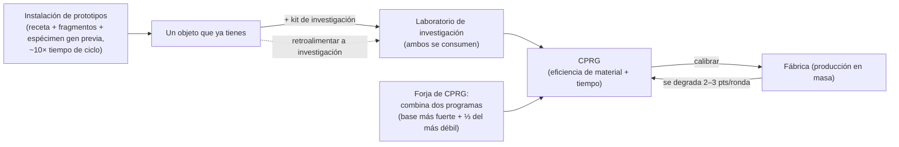

# Producción

La producción es la forma en que transformas recursos brutos y componentes en objetos útiles. Se lleva a cabo en
una **instalación de producción** (una fábrica o "mill") en tu base de acoplamiento. Todo aquí se realiza **únicamente acoplado**.

> Las ubicaciones de la interfaz siguen el [resumen de la interfaz del cliente](/es/features/ui/) (las categorías **Refinería / Reciclaje / Reparación /
> Seguro** en la barra superior). Las mecánicas siguientes han sido confirmadas contra el servidor.

## Líneas de producción

Una **línea de producción** es una receta guardada: define qué produces y a partir de qué. La
lista completa de componentes para cada objeto fabricable (con niveles de investigación) se genera en
[Recetas](/es/content/recipes/). Ejecutas una línea durante un número determinado de **rondas**.

- **Listar líneas** — consulta tus líneas disponibles.
- **Iniciar una línea** — ejecútala en una instalación durante un número elegido de rondas (mínimo 1).
  - Puedes pagar desde tu **cartera personal** o la **cartera de la corporación**.
  - Los componentes de origen se pueden buscar en tu **inventario** o en tus **robots**.
- **Calibrar una línea** — ajusta la configuración de una línea.
- **Establecer rondas** — elige cuántas rondas ejecutar.
- **Consultar siguiente ronda** — previsualiza lo que consumirá y producirá la siguiente ronda.
- **Cancelar** — detén una producción en curso.
- **Eliminar una línea** — suprime una línea guardada.

Ejecutar una línea consume componentes (y créditos) y genera el objeto objetivo a lo largo de las
rondas.

## Operaciones puntuales

Son acciones individuales en lugar de líneas de múltiples rondas. Cada una dispone de una variante de **Consulta**
que previsualiza el coste/resultado antes de comprometer los recursos.

- **Refinar** — materias primas → producto básico, utilizando la receta del objeto (ver [Recetas](/es/content/recipes/)).
  Eliges cuántas unidades del objeto objetivo deseas fabricar; los insumos nominales de la receta se escalan
  mediante un multiplicador de materiales de `1 + 50/(bonus + 100)` donde *bonus* es tu habilidad de refinado
  (extensiones + puntos de instalación + puntos de relación diplomática). Sin ninguna bonificación consumes el **150%** de
  la receta nominal; con la bonificación máxima se reduce hacia el **100%**.
- **Reciclar / reprocesar** — descompone un objeto nuevamente en los componentes de su receta (la receta
  inversa). El rendimiento es `nominal × (1 − 75/(bonus + 100)) × proporción de vida del objeto` —
  sin bonificación de habilidad la base es del **25%**, mejorando hacia el 100%, y un **objeto dañado
  rinde proporcionalmente menos** (repáralo primero si tiene valor). Solo se reciclan "lotes" completos
  (cantidades predeterminadas completas); el resto permanece intacto. Los objetos de misión se eliminan,
  no se reciclan.
- **Reparar** — restaura un objeto/robot dañado a su vida máxima. El precio es
  `(porcentaje de vida que falta) × valor material del objeto × 75/(bonus + 100)`. El "valor
  material" se calcula recursivamente: la receta del objeto se descompone en materias primas y
  se valora según las **medias del mercado mundial**, por lo que el coste de reparación fluctúa con el mercado. El
  multiplicador de habilidad comienza en el **75%** sin bonificación y tiende a 0 con la máxima bonificación.
- **Investigar componentes** — produce componentes de investigación (consulta + ejecución).

## El ciclo de vida del objeto (el proceso circular)

La creación de objetos es un bucle que conecta tres instalaciones:

1. **Investigación (ingeniería inversa)** — entrega una unidad del objeto que deseas
   producir, junto a un **kit de investigación** cuyo nivel cumpla con el nivel de investigación del objeto
   (los kits van del nivel 0 al 10), en el laboratorio de investigación. Ambos insumos son **consumidos**,
   y el trabajo genera un **CPRG** para ese objeto. Las eficiencias del programa resultante
   parten de la base individual del objeto (la mayoría de objetos 50, munición más alta,
   torretas hasta 90) y aumentan mediante *nivel del kit por encima del requerido × 5*
   más tu bonificación de habilidad de investigación (hasta +50 adicionales). Por lo tanto, un kit un par de niveles
   por encima del objeto — y extensiones de producción decentes — es lo que transforma un programa básico
   de 50/50 en uno competitivo. Así es como entran nuevos objetos en tu
   repertorio de producción.
2. **La fábrica (producción en masa)** — producción en masa a partir del programa. Cada ronda
   **degrada** las eficiencias de la línea (2–3 puntos por ronda, según la categoría del objeto;
   ver [CPRG](#cprg-programas-de-calibracion)) — cuando el desperdicio sube demasiado, calibra
   un nuevo programa en la línea. Los objetos prototipo también requieren un **espécimen de la
   generación anterior** como componente (un módulo estándar para hacer un prototipo
   T2, un T2 para hacer un T3), que se consume en el proceso.
3. **La instalación de prototipos** — produce un **prototipo** de un objeto directamente:
   los materiales de la receta más fragmentos de robot *y* el espécimen de la
   generación previa, a aproximadamente **10× el tiempo de ciclo de la fábrica** (más el multiplicador
   habitual de tiempo). Solo puedes fabricar prototipos de objetos desbloqueados en tu árbol tecnológico.
   Los prototipos cuestan drásticamente más que sus equivalentes estándar; su propósito
   principal es ser **investigados para obtener programas de alta calidad** (investigar un
   objeto prototipo es lo que desbloquea el siguiente nivel) — o utilizarse en el robot cuando el
   objeto es demasiado raro para obtenerse como botín y demasiado caro en el mercado.

## Progresión de niveles

La mayoría de módulos y robots vienen en **niveles T1 → T4** (el distintivo de nivel del cliente; las
líneas de definición `standard → named1 → named2 → named3`, y luego las líneas especiales
`elitet4`/`artifact`). Las reglas:

- **Cada nivel es un objeto independiente con su propio nodo en el árbol tecnológico.** Desbloquear un
  nodo cuesta puntos de investigación (obtenidos de kernels) y requiere el
  **nodo predecesor** — por lo que los niveles deben desbloquearse en orden. Solo puedes
  **fabricar como prototipo** (o producir en masa) un objeto cuyo nodo ya esté desbloqueado:
  no hay forma de fabricar un nivel superior sin la investigación previa.
- **Cada nivel superior consume un espécimen del nivel anterior** como
  componente (además de materiales y fragmentos de robot). Un objeto T1 nunca puede ser
  "entregado" a cambio de un T3 — el prototipo T3 necesita un objeto **T2**, y el
  espécimen es **consumido**, no convertido: el resultado es un objeto completamente nuevo.
- Cada página de objeto muestra su **línea de niveles** — toda la cadena `T1 → T2 → T3 → T4`
  como enlaces — y las [páginas de nodos del árbol tecnológico](/es/content/techtree/) muestran
  el nodo padre/siguiente de cada nivel y los precios en puntos.

Ejemplo, la línea del módulo minero pequeño: [minero pequeño estándar (T1)](/content/items/standard-small-driller/) →
[módulo minero pequeño Biroter 5050 (T2)](/content/items/named1-small-driller/) →
[módulo minero pequeño Sublimator Low-D (T3)](/content/items/named2-small-driller/) →
[módulo minero pequeño Scraper-990 (T4)](/content/items/named3-small-driller/) —
y el mismo patrón para cada familia de módulos/robots.

## Prototipos y kits de investigación

- **Prototipo** — produce un objeto prototipo (inicio + consulta). Un prototipo por
  ranura de fabricación; más trabajos simultáneos de prototipos provienen de las extensiones de producción.
- **Fusionar kits de investigación** — combina varios kits de investigación en uno superior
  (ejecución + consulta). Un kit superior acorta el tiempo de investigación y aumenta las
  eficiencias del programa resultante.

## CPRG (programas de calibración)

Un **CPRG** (Calibration Program o Programa de Calibración) es lo que impulsa una línea de producción — un programa por objeto
con puntos de **eficiencia de material** y **eficiencia de tiempo** (0–100 cada uno). Obtienes uno
**investigando el objeto** en un laboratorio de investigación (el nivel de investigación determina qué objetos puedes
producir), o activando una **cápsula de calibración**.

- Un CPRG recién investigado comienza en **50/50** puntos.
- **Forjar CPRGs** en la forja de programas de calibración: combina dos CPRGs del mismo objeto;
  el resultado mantiene los puntos del programa más fuerte como base y suma un tercio de los del
  más débil. La forja requiere tiempo y cuesta créditos (tiempo × precio por segundo de la instalación).
- **Calibrar una línea** con un CPRG para establecer sus eficiencias. Cada ronda de producción
  **degrada** la eficiencia de la línea (un valor de descalibración por objeto), por lo que las líneas empeoran
  con el tiempo — recalibra antes de series de producción largas.

Las eficiencias alimentan las fórmulas de la fábrica (por ciclo de producción):

- **Materiales consumidos** = receta × `1 + 50/(puntos de material + habilidad + 100 + bonoFábrica)`
  — un nuevo CPRG de 50 puntos sin habilidad ni bonificación de producción en masa del árbol tecnológico consume
  ≈ **133%** de la receta nominal.
- **Tiempo de producción** = tiempo base de la instalación (3 600 s por ciclo para una fábrica) ×
  `1 + 100/(puntos de tiempo + habilidad + 100)` × modificador de duración del objeto — un nuevo CPRG sin
  habilidades tarda ≈ **1 hora y 40 minutos** por objeto.
- **Precio** = tiempo de producción × precio por segundo de la instalación (7 créditos/s para la fábrica
  PBS, 3 para laboratorios de investigación PBS medianos/grandes) × modificador de precio del objeto (1–10).
- Los CPRGs vinculados a misiones son gratuitos y tienen una duración fija de 10 segundos.

## Seguro

La instalación de seguros asegura **tus robots**, no tu producción:

- **Comprar** una póliza para un robot (debe estar sin daños, desempaquetado y no ser un bot novato),
  **listar** tus pólizas, **consultar** una póliza, **eliminar** una póliza.
- La cobertura dura **15 días** (+ días de bonificación por extensiones); puedes mantener pólizas en
  1 + (bonificación de extensiones) robots.
- Cada robot tiene una **tasa** y una **indemnización** definidas por el contenido (la tabla `insuranceprices`,
  67 definiciones de robots); la tasa se descuenta mediante una bonificación de extensiones de tasas y se puede pagar
  desde la cartera corporativa.
- Si el robot asegurado es destruido, la **indemnización se paga en créditos** (el robot se pierde
  igualmente) — ver [combate](/es/features/combat/).

## Instalación y estado

- **Información / descripción de la instalación** — lo que ofrece una instalación de producción.
- **En curso (propios / corporación)** — lo que se está produciendo actualmente.
- **Historial de producción** — tus producciones anteriores.
- **Lista de componentes** — componentes de producción disponibles.
- **Información del servidor** — estado del servidor de producción.

## Notas prácticas

- **Debes estar acoplado en una base con instalación de producción.**
- **Consulta antes de ejecutar** — las opciones de consulta muestran coste y resultados para no malgastar
  componentes por error.
- **Cartera corporativa** — puedes gastar fondos de la corporación para producción si tienes permisos.
- **Los componentes también proceden de robots** — una línea puede extraer componentes de tus
  robots equipados, no solo de tu inventario.
- **Recicla con la vida al máximo** — un objeto dañado rinde menos; repara objetos caros antes de
  reprocesarlos.
- **Los multiplicadores de habilidad son las verdaderas palancas económicas** — las bonificaciones de
  refinado/reciclaje/reparación/fábrica escalan del mismo modo; invertir en extensiones de producción compensa con
  ahorros de material en cada serie.
- **El seguro es una red de seguridad para robots** — cómpralo para equipamientos caros antes de salir a PvP en espacio profundo.
- **Los kits de investigación son el requisito clave** — el nivel de investigación de un objeto (1–9) decide qué
  kits pueden descodificarlo, y usar un kit varios niveles por encima del objeto es la forma
  más económica de elevar las eficiencias del programa resultante.

<!-- Developer notes: rewritten 2026 from backend sources; no community-wiki text reused.
     Verifications: refine, recycle, repair, researchLab, CPRG forge, prototypes, insurance. -->
