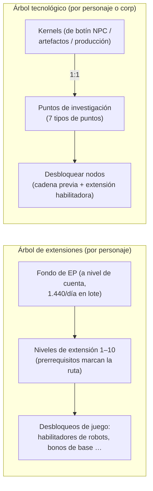

# Investigación

Existen **dos sistemas de progresión independientes**. Ambos funcionan únicamente acoplado.

> Las ubicaciones de la interfaz siguen el [resumen de la interfaz del cliente](/es/features/ui/) (Ventana de personaje → extensiones; el
> árbol tecnológico dispone de su propia ventana). Las mecánicas siguientes han sido confirmadas contra el servidor.

## El árbol de extensiones (habilidades de personaje)

Las extensiones son niveles de habilidad por personaje que desbloquean mecánicas de juego — especialmente las
**extensiones habilitadoras** que te permiten pilotar una clase de robot (requeridas para desacoplar y seleccionar
un robot, ver [movimiento](/es/features/movement/) y [robots](/es/features/robots/)).

### Cómo funciona el aprendizaje

- Debes estar **acoplado** para aprender.
- Cada extensión se puede subir hasta los **niveles 1–10** (el nivel 10 es el máximo).
- **El nivel 1 cuesta créditos** (el `price` de la extensión), descontados de tu cartera.
- **Cada nivel cuesta Puntos de Extensión (EP)** según una tabla fija de rango × nivel —
  para los niveles 1–5 el coste es `60 × rango × nivel`; los niveles 6–10 aumentan a
  `rango × (1440, 2520, 3840, 5400, 12000)`. Los diez niveles de una extensión de rango 1 cuestan
  de 60 → 6 000 EP, 13 500 en total; una de rango 10 cuesta diez veces más en cada nivel.
- Los **prerrequisitos** deben haberse aprendido previamente antes de poder adquirir una extensión
  (la lista "prerequire").
- Los EP constituyen un **fondo común a nivel de cuenta**: se comparten entre tus personajes y se acumulan
  con el tiempo (consulta "Fuentes de EP" más abajo).

### Gestión de extensiones

- **Lista de categorías / obtener todas / lista de aprendidas / lista de prerrequisitos** — explora el árbol y lo que
  ya posees.
- **Puntos disponibles** — consulta tu saldo actual de EP.
- **Eliminar un nivel** — reduce un único nivel de una extensión.
- **Reiniciar extensiones del personaje** — reinicia todo el árbol de un personaje.
- **Liberar EP bloqueados** — recupera los EP bloqueados (p. ej., tras eliminar niveles).
- **Comprar un potenciador de EP** — un acelerador de pago que incrementa la obtención de EP.
- **Registro diario de EP por actividad** — revisa cuánto EP has obtenido jugando.

### Fuentes de EP

El EP no es una divisa consumible que se compre — se acumula en un **lote diario**:

- Cada cuenta recibe **1 440 EP al día** (otorgados una vez al día, entre las 08:00 y las
  11:00 hora del servidor, mediante el procedimiento `extensionPointsAdd`). El código también contempla un lote doble
  de **2 880 EP** para cuentas con suscripción de pago, pero el procedimiento actual
  asigna el lote base a todas las cuentas.
- Los **potenciadores de pago** (compras de aumentos de EP) se suman a esta cantidad.
- Tus **EP disponibles** = todos los lotes diarios recibidos − penalizaciones − EP gastados en el juego.
  (El registro de EP por actividad muestra el desglose diario de ganancias).

**Catálogo completo** — cada extensión (rango, precio de nivel 1, bonificación, prerrequisitos) está en
[Extensiones](/es/content/extensions/), y cada nodo del árbol tecnológico (objeto desbloqueado, extensión
habilitadora, precios en puntos) se encuentra en [Árbol tecnológico](/es/content/techtree/).

## El árbol tecnológico (desbloqueos)

El árbol tecnológico es un grafo de **nodos** que desbloqueas gastando **puntos de investigación**. A diferencia
de los EP (fondo de cuenta), los puntos del árbol tecnológico se **obtienen consumiendo "kernels"** — objetos que
investigas y luego entregas.

### Cómo funciona

- **Investigar kernels** — entrega objetos kernel desde un contenedor. Cada kernel se convierte
  **1:1** en puntos de investigación de un **tipo de punto** determinado; los kernels se consumen.
  Hay siete tipos de kernels, uno por cada tipo de punto: Theodica, Pelistal, Nüimqol,
  Industrial, Common, HiTech y NewTech.
- **Desbloquear un nodo** — gasta los puntos de investigación requeridos. Un nodo solo se puede desbloquear si:
  - todos sus **nodos predecesores** ya están desbloqueados, y
  - tienes aprendida la **extensión habilitadora** del nodo en tu personaje.
- **Desbloqueos corporativos** — con el rol corporativo adecuado, se puede desbloquear un nodo
  **para la corporación** (compartido). Los desbloqueos corporativos cuestan más (se aplica un multiplicador
  de precio corporativo) y se pagan con los puntos de la corporación.
- **Donar** — dona puntos de investigación (p. ej., a tu corporación).
- **Información / registros** — consulta detalles de nodos y tu historial de desbloqueo/investigación.

### Por qué es importante

Los nodos desbloqueados del árbol tecnológico dan acceso a contenidos y funciones de niveles superiores. Revisa
los prerrequisitos de un nodo (cadena de nodos previos + extensión habilitadora) antes de gastar puntos.

## Notas prácticas

- **Las extensiones habilitadoras regulan los robots** — no puedes pilotar una clase de robot que no hayas
  investigado (esta es la misma comprobación que bloquea desacoplar o seleccionar).
- **El nivel 1 es el único coste en créditos** en el árbol de extensiones; a partir de ahí todo cuesta EP.
- **El árbol tecnológico es irreversible** — los puntos gastados en un desbloqueo se pierden definitivamente; planifica tu ruta.
- **La tecnología corporativa es un esfuerzo de equipo** — utiliza puntos compartidos y un multiplicador de coste.

<!-- Developer notes: Extensions/ExtensionBuyForPoints.cs (docked, prereq, level cap 10,
     level-1 credit price, EP by rank/level, account pool, training-char free);
     Extensions/ExtensionGetAvailablePoints.cs; Extensions/ExtensionBuyEpBoost.cs,
     ExtensionFreeLockedEp.cs, ExtensionRemoveLevel.cs, ExtensionResetCharacter.cs;
     EpForActivityDailyLog.cs; TechTree/TechTreeResearch.cs (kernels → points);
     TechTree/TechTreeUnlock.cs (parent chain + enabler extension, corp multiplier);
     TechTree/TechTreeDonate.cs. -->
