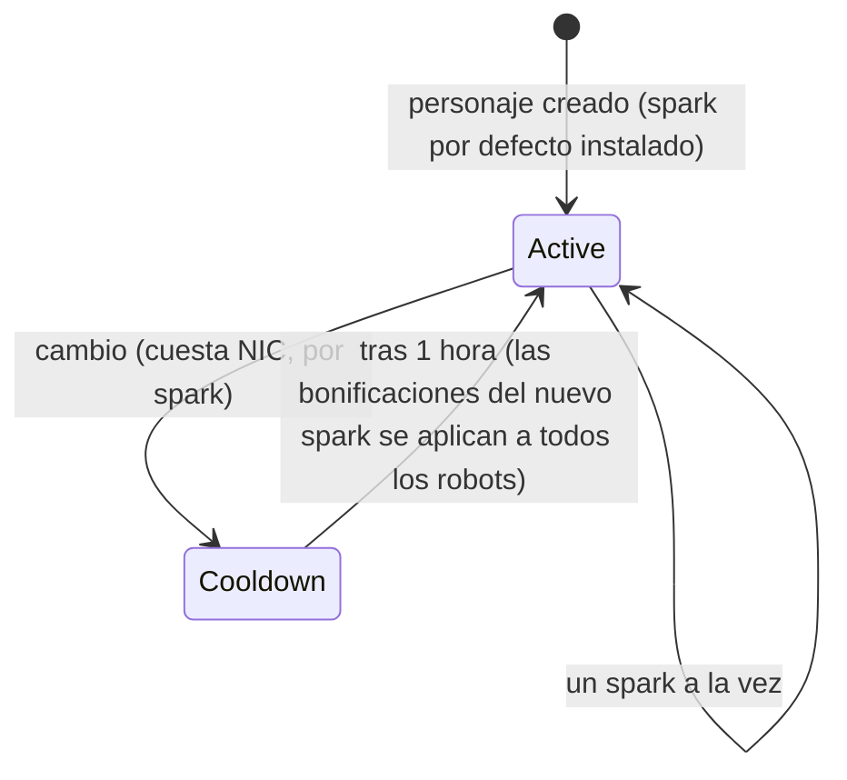

# Sparks

Un **spark** es una especialización de nanobots instalada en tu personaje. Mientras está
activo, sus bonificaciones se aplican a cada robot que pilotes — el spark de la línea de combate
de una facción, por ejemplo, aumenta el daño de las armas y la probabilidad de impacto crítico
nivel a nivel, mientras que una línea industrial eleva la capacidad del núcleo y el rendimiento de minería.

Cada personaje tiene un **spark por defecto** otorgado al crearlo. Más allá de eso, los sparks
se dividen en familias — las líneas básicas predeterminadas, líneas de combate/industrial/social por
facción (tres niveles cada una), líneas de pago del Sindicato y líneas especiales limitadas
— y las bonificaciones exactas de un spark son un lote de niveles fijos de habilidades que puedes
consultar en la [página de extensiones](/es/content/extensions/). El [resumen de familias a continuación](#familias-de-sparks)
salta directamente a los sparks de cada familia.

## Desbloquear (autorizar) un spark

Instalar un spark que aún no posees requiere **desbloquearlo** primero (únicamente
acoplado). Dependiendo del spark, el servidor comprueba:

- un **precio** en NIC (las líneas de pago — p. ej., los sparks de utilidad del Sindicato y los
  sparks especiales limitados),
- **relación** con la megacorporación desarrolladora (las líneas por facción requieren una
  relación mínima con la megacorporación de esa facción, desarrollada al completar sus
  [misiones](/es/features/missions/)),
- o un **objeto** extraído de tu inventario (algunos sparks especiales se desbloquean
  con un objeto llave).

El desbloqueo se realiza una sola vez: una vez desbloqueado, el spark permanece en tu colección.

## Cambiar de spark

- Solo puedes tener **un spark activo** a la vez; instalar otro lo sustituye.
- Cada cambio **cuesta NIC** — el importe es por spark (las líneas comunes cuestan
  10k, las líneas especiales de pago hasta un millón).
- Hay un **enfriamiento de una hora** entre cambios: el servidor registra cuándo se activó
  tu spark actual y rechaza uno nuevo hasta que transcurra el tiempo.

Dado que cambiar siempre cuesta NIC y requiere una hora, elige el spark que
se adapte a la actividad a la que dediques más tiempo, y enfoca el cambio de
especialización como una decisión ocasional y no de cada sesión.
<!-- sparkfamilies:generated -->

## Familias de sparks

Los 47 sparks en 6 familias de un vistazo: un recuadro por familia (recuento de sparks, cómo se desbloquea la línea), en el orden en que se añadieron las líneas (de izquierda a derecha, de arriba abajo). **Haz clic en un recuadro para saltar a los sparks de esa familia abajo.** **Desplázate sobre el diagrama para hacer zoom**, arrastra para desplazarte y usa el botón ⟲ para restablecer.

<button type="button" class="zoommap-reset" title="Restablecer el zoom">⟲</button>
<svg class="zoommap" xmlns="http://www.w3.org/2000/svg" viewBox="0 0 1008 278" width="960" height="264" role="img" aria-label="Familias de sparks: 6 familias, 47 sparks; haz clic en una familia para ir a sus sparks a continuación">
  <rect x="0" y="0" width="1008" height="278" fill="#10151f" stroke="#39445a" stroke-width="1"/>
  <g><title>Eventos y especiales: 9 sparks, se desbloquea gratis</title><a href="#family-special"><rect x="24" y="40" width="300" height="84" rx="10" fill="#10151f" stroke="#c8d2e0" stroke-width="1.5"/><text x="174" y="68" text-anchor="middle" fill="#e8eefc" font-size="15" font-weight="700">Eventos y especiales</text><text x="174" y="92" text-anchor="middle" fill="#c8d2e0" font-size="12">9 sparks · gratis</text></a></g>
  <g><title>TM (Truhold-Markson): 9 sparks, se desbloquea con relación TM</title><a href="#family-tm"><rect x="354" y="40" width="300" height="84" rx="10" fill="#10151f" stroke="#41d3ff" stroke-width="1.5"/><text x="504" y="68" text-anchor="middle" fill="#e8eefc" font-size="15" font-weight="700">TM (Truhold-Markson)</text><text x="504" y="92" text-anchor="middle" fill="#41d3ff" font-size="12">9 sparks · relación TM</text></a></g>
  <g><title>ICS: 9 sparks, se desbloquea con relación ICS</title><a href="#family-ics"><rect x="684" y="40" width="300" height="84" rx="10" fill="#10151f" stroke="#6ee7a0" stroke-width="1.5"/><text x="834" y="68" text-anchor="middle" fill="#e8eefc" font-size="15" font-weight="700">ICS</text><text x="834" y="92" text-anchor="middle" fill="#6ee7a0" font-size="12">9 sparks · relación ICS</text></a></g>
  <g><title>ASI: 9 sparks, se desbloquea con relación ASI</title><a href="#family-asi"><rect x="24" y="154" width="300" height="84" rx="10" fill="#10151f" stroke="#f5a05a" stroke-width="1.5"/><text x="174" y="182" text-anchor="middle" fill="#e8eefc" font-size="15" font-weight="700">ASI</text><text x="174" y="206" text-anchor="middle" fill="#f5a05a" font-size="12">9 sparks · relación ASI</text></a></g>
  <g><title>Sindicato (NIC): 5 sparks, se desbloquea con precio en NIC</title><a href="#family-syndicate"><rect x="354" y="154" width="300" height="84" rx="10" fill="#10151f" stroke="#a78bfa" stroke-width="1.5"/><text x="504" y="182" text-anchor="middle" fill="#e8eefc" font-size="15" font-weight="700">Sindicato (NIC)</text><text x="504" y="206" text-anchor="middle" fill="#a78bfa" font-size="12">5 sparks · precio en NIC</text></a></g>
  <g><title>Limitados: 6 sparks, se desbloquea con precio en NIC</title><a href="#family-limited"><rect x="684" y="154" width="300" height="84" rx="10" fill="#10151f" stroke="#f472b6" stroke-width="1.5"/><text x="834" y="182" text-anchor="middle" fill="#e8eefc" font-size="15" font-weight="700">Limitados</text><text x="834" y="206" text-anchor="middle" fill="#f472b6" font-size="12">6 sparks · precio en NIC</text></a></g>
</svg>

### Eventos y especiales (9)

Desbloqueo: ninguno — estas son las líneas básicas por defecto. Cada cambio cuesta NIC (el importe es por spark, consulta las fichas) y requiere un enfriamiento de una hora — ver [Cambiar de spark](#switching-sparks) arriba.

ww

desbloqueo sin coste · cambio 10k NIC

Spark por defecto — instalado al crear el personaje

wi

desbloqueo sin coste · cambio 10k NIC

Spark por defecto — instalado al crear el personaje

ws

desbloqueo sin coste · cambio 10k NIC

Spark por defecto — instalado al crear el personaje

iw

desbloqueo sin coste · cambio 10k NIC

Spark por defecto — instalado al crear el personaje

ii

desbloqueo sin coste · cambio 10k NIC

Spark por defecto — instalado al crear el personaje

is

desbloqueo sin coste · cambio 10k NIC

Spark por defecto — instalado al crear el personaje

sw

desbloqueo sin coste · cambio 10k NIC

Spark por defecto — instalado al crear el personaje

si

desbloqueo sin coste · cambio 10k NIC

Spark por defecto — instalado al crear el personaje

ss

desbloqueo sin coste · cambio 10k NIC

Spark por defecto — instalado al crear el personaje

### TM (Truhold-Markson) (9)

Desbloqueo: relación con la megacorporación TM (2 → 4 → 6 por nivel). Cada cambio cuesta NIC (el importe es por spark, consulta las fichas) y requiere un enfriamiento de una hora — ver [Cambiar de spark](#switching-sparks) arriba.

Combat Lvl1

desbloqueo relación 2 con TM · cambio 10k NIC

Incluye 2 niveles de extensión

Combat Lvl2

desbloqueo relación 4 con TM · cambio 100k NIC

Incluye 3 niveles de extensión

Combat Lvl3

desbloqueo relación 6 con TM · cambio 1M NIC

Incluye 3 niveles de extensión

Indy Lvl1

desbloqueo relación 2 con TM · cambio 10k NIC

Incluye 2 niveles de extensión

Indy Lvl2

desbloqueo relación 4 con TM · cambio 100k NIC

Incluye 3 niveles de extensión

Indy Lvl3

desbloqueo relación 6 con TM · cambio 1M NIC

Incluye 3 niveles de extensión

Social Lvl1

desbloqueo relación 2 con TM · cambio 10k NIC

Incluye 2 niveles de extensión

Social Lvl2

desbloqueo relación 4 con TM · cambio 100k NIC

Incluye 3 niveles de extensión

Social Lvl3

desbloqueo relación 6 con TM · cambio 1M NIC

Incluye 3 niveles de extensión

### ICS (9)

Desbloqueo: relación con la megacorporación ICS (2 → 4 → 6 por nivel). Cada cambio cuesta NIC (el importe es por spark, consulta las fichas) y requiere un enfriamiento de una hora — ver [Cambiar de spark](#switching-sparks) arriba.

Combat Lvl1

desbloqueo relación 2 con ICS · cambio 10k NIC

Incluye 2 niveles de extensión

Combat Lvl2

desbloqueo relación 4 con ICS · cambio 100k NIC

Incluye 3 niveles de extensión

Combat Lvl3

desbloqueo relación 6 con ICS · cambio 1M NIC

Incluye 3 niveles de extensión

Indy Lvl1

desbloqueo relación 2 con ICS · cambio 10k NIC

Incluye 2 niveles de extensión

Indy Lvl2

desbloqueo relación 4 con ICS · cambio 100k NIC

Incluye 3 niveles de extensión

Indy Lvl3

desbloqueo relación 6 con ICS · cambio 1M NIC

Incluye 3 niveles de extensión

Social Lvl1

desbloqueo relación 2 con ICS · cambio 10k NIC

Incluye 2 niveles de extensión

Social Lvl2

desbloqueo relación 4 con ICS · cambio 100k NIC

Incluye 3 niveles de extensión

Social Lvl3

desbloqueo relación 6 con ICS · cambio 1M NIC

Incluye 3 niveles de extensión

### ASI (9)

Desbloqueo: relación con la megacorporación ASI (2 → 4 → 6 por nivel). Cada cambio cuesta NIC (el importe es por spark, consulta las fichas) y requiere un enfriamiento de una hora — ver [Cambiar de spark](#switching-sparks) arriba.

Combat Lvl1

desbloqueo relación 2 con ASI · cambio 10k NIC

Incluye 2 niveles de extensión

Combat Lvl2

desbloqueo relación 4 con ASI · cambio 100k NIC

Incluye 3 niveles de extensión

Combat Lvl3

desbloqueo relación 6 con ASI · cambio 1M NIC

Incluye 3 niveles de extensión

Indy Lvl1

desbloqueo relación 2 con ASI · cambio 10k NIC

Incluye 2 niveles de extensión

Indy Lvl2

desbloqueo relación 4 con ASI · cambio 100k NIC

Incluye 3 niveles de extensión

Indy Lvl3

desbloqueo relación 6 con ASI · cambio 1M NIC

Incluye 3 niveles de extensión

Social Lvl1

desbloqueo relación 2 con ASI · cambio 10k NIC

Incluye 5 niveles de extensión

Social Lvl2

desbloqueo relación 4 con ASI · cambio 100k NIC

Incluye 6 niveles de extensión

Social Lvl3

desbloqueo relación 6 con ASI · cambio 1M NIC

Incluye 6 niveles de extensión

### Sindicato (NIC) (5)

Desbloqueo: un precio en NIC (1M por spark). Cada cambio cuesta NIC (el importe es por spark, consulta las fichas) y requiere un enfriamiento de una hora — ver [Cambiar de spark](#switching-sparks) arriba.

Syndicate Nic Combat

desbloqueo 1M NIC · cambio 100k NIC

Incluye 2 niveles de extensión

Syndicate Nic Scout

desbloqueo 1M NIC · cambio 100k NIC

Incluye 2 niveles de extensión

Syndicate Nic Coreboost

desbloqueo 1M NIC · cambio 100k NIC

Incluye 2 niveles de extensión

Syndicate Nic Allresist

desbloqueo 1M NIC · cambio 100k NIC

Incluye 4 niveles de extensión

Syndicate Nic Fitboost

desbloqueo 1M NIC · cambio 100k NIC

Incluye 2 niveles de extensión

### Limitados (6)

Desbloqueo: un precio en NIC (25–50M por spark). Cada cambio cuesta NIC (el importe es por spark, consulta las fichas) y requiere un enfriamiento de una hora — ver [Cambiar de spark](#switching-sparks) arriba.

Anniversary Combat

desbloqueo 25M NIC · cambio 1M NIC

Incluye 6 niveles de extensión

Anniversary Logistic

desbloqueo 25M NIC · cambio 1M NIC

Incluye 6 niveles de extensión

Amazon c1 Combat

desbloqueo 25M NIC · cambio 1M NIC

Incluye 2 niveles de extensión

Amazon c1 Indy

desbloqueo 25M NIC · cambio 1M NIC

Incluye 2 niveles de extensión

Steam a

desbloqueo 50M NIC · cambio 1M NIC

Incluye 2 niveles de extensión

Steam b

desbloqueo 50M NIC · cambio 1M NIC

Incluye 2 niveles de extensión

<!--
Written from scratch against the server backend, 2026-09-27:
RequestHandlers/Sparks/SparkUnlock.cs (unlock rules: price, standing, item),
RequestHandlers/Sparks/SparkChange.cs + Services/Sparks/SparkHelper.cs
(60-minute switch cooldown, per-spark change price),
Services/Sparks/Spark.cs, sparks + sparkextensions tables (47 sparks, per-line
bonus bundles).
An earlier version of this page was adapted from the Open Perpetuum
community wiki (perpetuum.miraheze.org) and has been fully rewritten from
backend sources; no text was reused.
-->
