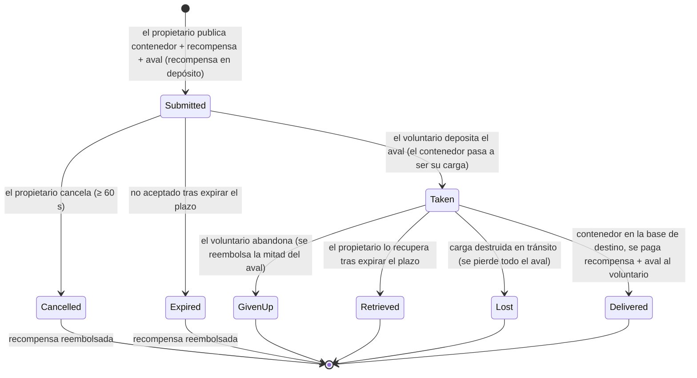

# Transporte (envío de objetos)

Una **tarea de transporte** traslada un contenedor de objetos de una base a otra mediante un
**transportista voluntario** al que se le paga. Es un mercado de dos partes: el **propietario** publica un
envío y un **voluntario** lo acepta y lo entrega.

> Las ubicaciones de la interfaz siguen el [resumen de la interfaz del cliente](/es/features/ui/) (la categoría **Tareas** en la
> barra superior). Las mecánicas siguientes han sido confirmadas contra el servidor.

## Las dos partes

- **Propietario (principal)** — publica un envío: un contenedor a trasladar, desde una **base de origen**
  a una **base de destino**, por una **recompensa**, con un **aval (fianza)** y durante un **plazo**.
- **Voluntario (transportista)** — acepta la tarea, transporta el contenedor y lo entrega.

## Publicar un transporte (propietario)

**Publica un transporte** indicando:
- el **contenedor** (un contenedor de volumen empaquetado) a transportar,
- la **recompensa** que pagarás al completarse la entrega,
- el **aval** (una fianza que deposita el transportista),
- la **base de origen** y la **base de destino**,
- una **duración** (días) durante la cual la tarea permanecerá abierta.

Al publicar, la **recompensa queda retenida** de tu saldo (depósito de garantía o escrow).

## Aceptar un transporte (voluntario)

- **Aceptar** una tarea — depositas el **aval** como fianza y el contenedor
  pasa a estar bajo tu custodia para transportarlo.

## Entrega y recuperación

- **Entregar** — lleva el contenedor a la base de destino. Al entregar, al **voluntario se le
  paga la recompensa + aval**, y el propietario recibe las mercancías.
- **Recuperar** — el propietario (o el voluntario, en el caso correspondiente) recupera el
  contenedor de vuelta a una base; al recuperarlo se **devuelve el aval** y la **recompensa
  se reembolsa** al propietario.

## Cancelar / abandonar

- **Cancelar** — cancela la tarea.
- **Abandonar** — el voluntario renuncia a la tarea. Abandonar conlleva una **penalización del aval**:
  solo se reembolsa la **mitad** del aval (el resto se pierde) — la constante
  de penalización es 0.5 en `TransportAssignment.cs`.

## Inspección

- **Listar** transportes, **ver contenido** de uno, **información del contenedor**, **¿está en ejecución?**,
  y el **registro de transporte**.

## El flujo de dinero (de un vistazo)

La **recompensa** es el pago del propietario, retenido al publicar y pagado solo al entregar.
El **aval** es la fianza del voluntario: pagada al propietario al aceptar, retenida mientras la
carga está en tránsito, y devuelta (junto con la recompensa) al realizar la entrega.

| Evento | Condición | Propietario | Voluntario | Contenedor |
|---|---|---|---|---|
| Publicar | — | recompensa retenida | — | trasladado a almacenamiento de transporte |
| Aceptar | no aceptado | recibe el aval de fianza | paga el aval | pasa a ser la carga del voluntario |
| Entregar | en la base de destino | mercancías recibidas | cobra **recompensa + aval** | entregado |
| Cancelar | no aceptado, ≥ 60 s tras publicar | recompensa reembolsada | — | devuelto a la base de origen |
| Abandonar | aceptado | recompensa reembolsada | **mitad** del aval reembolsado (penalización 0.5) | devuelto a la base de origen |
| Expirar | no aceptado, plazo vencido | recompensa reembolsada | — | devuelto a la base de origen |
| Recuperar | aceptado **y** plazo vencido | recompensa reembolsada | — | devuelto a la base de origen (inmediatamente si está acoplado, o en el próximo acoplamiento del voluntario) |
| Carga destruida | en tránsito | recompensa reembolsada **+ aval completo** | aval completo confiscado | perdido |

## Notas prácticas

- **Sin comisiones** — el único dinero que se mueve es la recompensa y el aval.
- **La recompensa queda retenida** — el propietario no puede gastarla hasta que se resuelva el transporte.
- **El aval es la fianza del transportista** — depositarlo es lo que te permite aceptar un envío;
  perder la carga en tránsito confisca la cantidad **total**.
- **Abandonar te cuesta caro** — renunciar a un transporte te hace perder la mitad de tu aval.
- **La duración importa, pero solo mientras no esté aceptado** — el plazo fijado al publicar solo
  cierra automáticamente las tareas que nadie ha tomado (el servidor limpia las tareas expiradas
  no aceptadas cada hora). Una tarea **aceptada** nunca expira por sí sola; la vía de escape del
  propietario es **Recuperar**, que pasa a estar disponible una vez vencido el plazo y
  retira la carga (y la recompensa) a la base de origen — de inmediato si el transportista está
  acoplado, o automáticamente en el siguiente acoplamiento del transportista.
- **Revisa el contenido antes de aceptar** — comprueba qué hay en el contenedor y la ruta.

<!-- Developer notes: TransportAssignments/TransportAssignmentSubmit.cs;
     Services/MissionEngine/TransportAssignments/TransportAssignment.cs (reward/collateral
     escrow, PayOutReward = reward+collateral, PaybackCollateral, PaybackHalfCollateral
     = COLLATERAL_PENALTY on give-up, RetrieveToBasePublicContainer, expiry);
     TransportAssignmentTake/Deliver/Retrieve/Cancel/GiveUp/List/ListContent/
     ContainerInfo/Running/Log. -->
