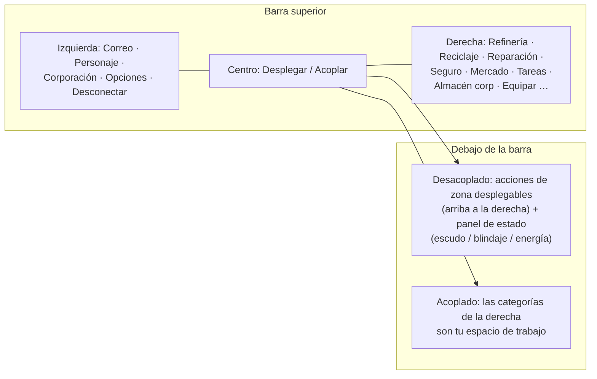

# Resumen de la interfaz del cliente

El cliente presenta una interfaz **estilo EVE Online**: una vista espacial/de zona a pantalla completa con
ventanas flotantes, **redimensionables y móviles** que se pueden **cerrar y reabrir** a voluntad.
La vinculación es por sistema — consulta las páginas enlazadas a continuación.

> Esta distribución es un modelo de trabajo proporcionado por el proyecto, utilizado para describir dónde se ubican
> las acciones. Los nombres exactos en pantalla pueden variar ligeramente; la estructura sirve de referencia.

## La barra superior

Una barra persistente situada en la parte superior de la pantalla.

| Área | Contenido |
|---|---|
| **Izquierda** | Botones principales: **Correo**, **Personaje**, **Corporación**, otras **Opciones** y **Desconectar** |
| **Centro** | El botón **Desplegar / Acoplar** — tu interruptor principal acoplado⇄desacoplado (ver [movimiento](/es/features/movement/)) |
| **Derecha** | Categorías de acción como botones: **Refinería**, **Reciclaje**, **Reparación**, **Seguro**, **Mercado**, **Tareas** (transportes), **Almacén corporativo**, **Equipar**, … |

Las categorías de la derecha abren sus respectivas ventanas del sistema:

| Botón | Abre / realiza | Página de la wiki |
|---|---|---|
| Refinería | Procesa recursos brutos para convertirlos en componentes | [producción](/es/features/production/) |
| Reciclaje | Descompone objetos en materiales base | [producción](/es/features/production/) |
| Reparación | Repara robots/módulos dañados | [producción](/es/features/production/) |
| Seguro | Pólizas de seguro de producción/robots | [producción](/es/features/production/) |
| Mercado | Órdenes de mercado y compras directas | [mercado](/es/features/market/) |
| Tareas | Tareas de transporte (envíos) | [transporte](/es/features/transport/) |
| Almacén corporativo | Hangar/almacén corporativo | [grupos](/es/features/groups/) |
| Equipar | Equipa módulos y munición en tu robot activo | [robots](/es/features/robots/) |

## Estado acoplado

Mientras estás **acoplado**, las categorías de acción del lado derecho son el espacio de trabajo principal: procesas,
comercies, equipas y gestionas el almacenamiento sin salir de la base. El botón Desplegar te desacopla
hacia la zona (ver [movimiento](/es/features/movement/) para conocer las condiciones previas de desacoplamiento).

## Estado desacoplado

Mientras estás **desacoplado** (pilotando tu robot activo en una zona):

- El área **superior derecha** incorpora un **botón desplegable de acciones**: haz clic en él y se expandirá
  hacia abajo una lista de acciones de zona adicionales (escaneo, acciones de cosecha/interacción, herramientas de zona —
  las acciones documentadas en [recolección](/es/features/gathering/) y [combate](/es/features/combat/)).
- El **panel de estado principal** muestra las condiciones de tu robot: **escudo, blindaje/casco, energía**,
  y el estado de combate correspondiente — los mismos datos a los que se refiere la página de [combate](/es/features/combat/)
  (p. ej., la comprobación de desacoplamiento "sistema de energía intacto").
- Las categorías exclusivas de base (refinería, mercado, …) no están disponibles hasta que vuelvas a acoplarte.

## Ventanas comunes

La mayoría de los sistemas se abren en una ventana flotante estándar: barra de título, botón de cierre, bordes
redimensionables, contenido en pestañas o listas. Los sistemas repetidos (inventario/contenedores, mercado, líneas
de producción) pueden tener varias ventanas abiertas al mismo tiempo.

- **Inventario / contenedores** — listar un contenedor, mover/apilar/empaquetar objetos, renombrar, destruir —
  ver [objetos](/es/features/items/).
- **Ventana de personaje** (botón superior izquierdo) — perfil, extensiones (investigación), ajustes,
  créditos — ver [primeros pasos](/es/features/getting-started/) e [investigación](/es/features/research/).
- **Ventana de corporación** (botón superior izquierdo) — información de la corporación, hangar, documentos, votaciones,
  tablón de anuncios — ver [grupos](/es/features/groups/).
- **Ventana de correo** (botón superior izquierdo) — correo personal y masivo — ver [social](/es/features/social/).

## Convención utilizada en esta wiki

- **"Barra superior → X"** = el botón llamado X en la barra superior.
- **"Acciones desacoplado"** = la lista desplegable en la parte superior derecha mientras estás en una zona.
- **Botón Desplegar/Acoplar** = el interruptor central de la barra superior.

<!-- Note: this page is the agreed UI model (project-provided). If the real client
     differs in button names or placement, update this page first — every other
     features/ page references the conventions defined here. -->
