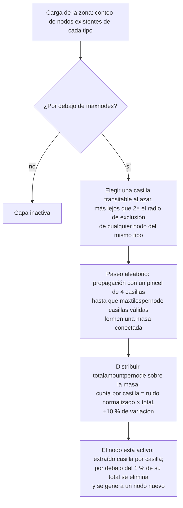

# Generación de recursos de zona

Esta página explica cómo el servidor mantiene abastecidos los recursos de una zona. Ambos sistemas funcionan
continuamente en segundo plano mientras la zona está cargada; no se requiere ninguna acción por parte del jugador
para que sigan ejecutándose.

## La configuración de recursos de la zona

Cada zona está configurada en la base de datos con dos listas independientes:

- **Configuración de minerales** (`mineralconfigs`) — una fila por cada tipo de mineral presente en la zona,
  con cuatro parámetros por tipo:
  | Columna | Significado |
  |---|---|
  | `maxnodes` | Cuántos nodos de este tipo mantiene la zona |
  | `maxtilespernode` | Número máximo de casillas que puede cubrir un único nodo |
  | `totalamountpernode` | Material total en un nodo nuevo, distribuido entre sus casillas |
  | `minthreshold` | Proporción mínima de llenado por casilla (0–1); las casillas por debajo tras la extracción se descartan |
- **Configuración de plantas** (`zones.fertility` + un conjunto de reglas de plantas) — el objetivo de cobertura
  vegetal de la zona (un porcentaje) y la lista de especies de plantas autorizadas a crecer allí
  (el comportamiento de cada especie es un archivo de reglas documentado en
  [Plantas](/es/content/plants/)).

Las zonas sin configuración de mineral (arenas, zonas de entrenamiento, fortalezas, algunas zonas
gamma) no tienen ninguna capa de mineral.

## Nodos de mineral

### Cómo se coloca un nodo

Cuando se carga una zona, la capa de cada tipo de mineral cuenta sus nodos existentes (almacenados en la
tabla `mineralnodes`) y genera otros nuevos hasta alcanzar `maxnodes`. Un nuevo nodo se
coloca mediante un **paseo aleatorio** (random walk):

1. Elegir una casilla transitable al azar.
2. Debe estar lejos del nodo existente más cercano del mismo tipo: el radio de exclusión
   se deriva de `maxtilespernode` (`√(maxtilespernode/π) × 2`, y el inicio debe estar
   al menos al doble de esa distancia), de modo que los nodos nunca se fusionen en un único yacimiento gigante.
3. Desde la casilla inicial, el recorrido se propaga aleatoriamente hacia afuera (un pincel de 4 casillas a la vez),
   reuniendo hasta `maxtilespernode` casillas válidas en una masa conectada.
4. El material `totalamountpernode` del nodo se distribuye sobre la masa: la porción de cada casilla
   es su valor de ruido (normalizado) multiplicado por el total, con una variación aleatoria de ±10 %, de modo que no
   haya dos nodos del mismo tipo idénticos.

Una casilla solo es válida para un nodo si está dentro de la zona, no es una isla, no está
protegida por terraformación de PBS y es transitable. Dos tipos raros reciben **zonas de exclusión** alrededor
de las bases de acoplamiento y teletransportes: **epriton** mantiene una distancia mínima y el **mineral flux**
mantiene el doble de esa distancia, por lo que el mineral flux nunca se encuentra justo al lado de una base.

### Cómo se consume un nodo

- La extracción retira material casilla por casilla.
- Un nodo que cae por debajo del **1 % de su total configurado** se elimina y se genera un nodo nuevo
  (volviendo al paso 1) para mantener la zona en `maxnodes`.
- Los nodos de mineral flux activan además la **aparición de NPCs**: los nodos que se están extrayendo (o eliminando)
  publican eventos que el sistema de NPCs escucha, razón por la cual los yacimientos de flux atraen
  atención.

## Plantas

### El escaneo de plantas

La zona se divide en bloques de **32×32 casillas**. Un gestor de plantas recorre estas casillas en orden,
procesando una por tick, a un ritmo calculado para que una **pasada completa por la zona tome unas 8 horas**
(anulable por zona). Cada «cubo» de 32×32 se procesa mediante una secuencia fija:

1. **Validar** — descartar plantas no válidas (suelo incorrecto, muertas, fuera de lugar).
2. **Crecer** — hacer avanzar cada planta por sus fases de crecimiento (ver
   [recolección](/es/features/gathering/) para `growRate` y fructificación).
3. **Generar** — añadir nuevas plantas donde el cubo esté por debajo de su objetivo de fertilidad.
4. **Dañar muros** — la altura de bloqueo de las plantas decae con el tiempo.
5. **Eliminar por distancia** — aplicar el espaciado entre plantas del mismo tipo (`killDistance`).
6. **Renovar material** — se regenera una pequeña cantidad de frutos.

### Cómo se elige una nueva planta

Una casilla solo puede brotar si el archivo de zona le otorga **potencial de aparición** (un byte por casilla
integrado en la capa de plantas de la zona; 0 significa que la casilla nunca brota). En cada tick, para
cada casilla elegible:

- **Comprobación previa de fertilidad de la zona**: si la cobertura de plantas bloqueadoras del cubo ya alcanza
  el `fertility%` de sus casillas de suelo, no aparece nada nuevo allí.
- **Probabilidad por casilla**: una tirada aleatoria debe superar el potencial de aparición de la casilla.
- **Selección de especie**:
  - Si la casilla **no tiene vecinos vegetales**, la especie se determina mediante un sorteo aleatorio ponderado
    donde el peso de cada especie permitida es su `fertilidad` (las especies sembradas por jugadores quedan
    excluidas de las apariciones naturales).
  - Si **los tiene**, se echa a suertes: 50 % para la especie vecina actualmente *dominante*
    (la más común en las inmediaciones), 50 % para un sorteo de **propagación** ponderado por
    `(recuento de vecinos × spreading)` para cada especie; esto es lo que hace que las agrupaciones
    se expandan con su propia especie.
- **Límites y espaciado**: una especie con límite `maxAmount` se omite en cuanto la zona tiene
  suficiente de ella, y una casilla situada dentro de `killDistance` de otra planta del mismo tipo se
  omite.

### Qué significa esto para los jugadores

- La densidad de plantas está limitada por la fertilidad de la zona: nunca verás una zona con
  un 100 % de cobertura vegetal si su fertilidad es 20.
- Las agrupaciones son la norma: la propagación hace que cada especie expanda sus propias parcelas, por lo que una
  zona tiende a formar territorios de especies en lugar de una mezcla heterogénea.
- Las especies con `killDistance` (por ejemplo, ciertas plantas de alto valor) están espaciadas uniformemente, lo que
  hace que sus ubicaciones sean predecibles una vez que encuentras una.
- Los nuevos nodos aparecen donde concluye el paseo aleatorio: no hay un «punto de mineral» fijo en una
  zona; es necesario escanear (ver [recolección](/es/features/gathering/)).

<!-- Developer notes: TerrainsModule.cs (per-zone layer construction: OreLayer for
     Solid, LiquidLayer for Liquid, GravelLayer for TrainingZone; LoadMineralNodes
     top-up); MineralLayer.cs (LoadMineralNodes: delete <1% nodes, generate to
     maxnodes; FluxOre -> OreNpcSpawnMessage on decrease/expiry);
     Generators/MineralNodeGeneratorBase.cs (FindStartPosition keep-out + spacing,
     NormalizeNoise, CreateMineralNode jitter); RandomWalkMineralNodeGenerator.cs
     (flood-fill brush 4, 50k step cap); MineralNodeRepository.cs (mineralnodes table,
     compressed per-tile values); PlantHandler.cs (32x32 areas, 8h full pass,
     PlantsGrowthTimerOverrideMin, scanner modes); NatureCube.cs (ProcessAll pipeline,
     SpawnPlants fertility/spawn/killDistance logic, GetNewPlantRule 50/50 ruling vs
     spreading); PlantRuleExtensions.cs (fertility-weighted + spreading-weighted
     draws); PlantInfo.cs (per-tile spawn byte comes from the zone's plant layer
     file, never assigned by server code). -->
