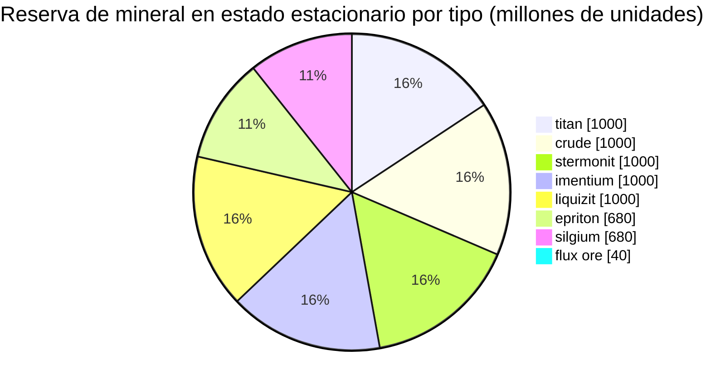

# Daoden (zone_ASI) — ejemplo práctico

  <a href="/es/zones/map/">
    
    <strong>Mapa del mundo</strong> — dónde se ubica esta zona entre todas las demás, con las conexiones de teletransporte. Abrir el mapa completo.
  </a>

Ubicación de las columnas de teletransporte de esta zona (puntos, etiquetados con el destino — atenuados cuando
la columna está actualmente apagada), los puntos de llegada de los teletransportes que provienen de otras
zonas (círculos discontinuos) y las puertas de salida (rombos) si existen. Las posiciones son las
coordenadas de casilla que registra el servidor.
Las líneas discontinuas conectan los pares de columnas de teletransporte locales (dentro de la zona).

Una zona **PvP abierta** de nivel alfa: la configuración de minerales más rica del juego y
el lugar donde habitan los tipos raros. Todo lo que tiene New Virginia, más epriton, silgium y
los yacimientos de mineral flux que atraen ataques de NPCs.

| Dato | Valor |
|---|---|
| ID de zona | 2 |
| Tipo | PvP (abierta) |
| Protección | [Beta](/es/zones/protection/) — PvP abierto, terreno estándar |
| Tamaño | 2048 × 2048 casillas |
| Fertilidad | 20 |
| Conjunto de reglas de plantas | 2 — 19 especies (incl. cosechables de alto nivel) |
| Tipos de mineral | 8 (titan, crude, stermonit, imentium, liquizit, epriton, silgium, flux ore) |
| Total de nodos de mineral | 64 (8 por tipo) |

## Configuración de mineral

| Material | Nodos | Máx. casillas/nodo | Total por nodo | Umbral mínimo |
|---|---|---|---|---|
| [titan](/es/content/ores/titan/) | 8 | 500 | 125,000,000 | 0.5 |
| [crude](/es/content/ores/crude/) | 8 | 1257 | 125,000,000 | 0.5 |
| [stermonit](/es/content/ores/stermonit/) | 8 | 500 | 125,000,000 | 0.5 |
| [imentium](/es/content/ores/imentium/) | 8 | 500 | 125,000,000 | 0.5 |
| [liquizit](/es/content/ores/liquizit/) | 8 | 500 | 125,000,000 | 0.5 |
| [epriton](/es/content/ores/epriton/) | 8 | 500 | 85,000,000 | 0.5 |
| [silgium](/es/content/ores/silgium/) | 8 | 500 | 85,000,000 | 0.5 |
| [fluxore](/es/content/ores/fluxore/) | 8 | 300 | 5,000,000 | 0.5 |

Aspectos destacados:

- **8× más nodos que New Virginia**, pero cada nodo es más pequeño (500 casillas frente a 1000): el
  radio de paso se reduce de 34 a 24 casillas para los minerales estándar. El escaneo importa más
  aquí: los yacimientos son más delgados y numerosos.
- **Epriton y silgium** cuentan con totales reducidos (85 M frente a 125 M): mayor valor, existencias más
  escasas. Epriton mantiene además una **distancia mínima respecto a bases y teletransportes**, de
  modo que sus nodos nunca se sitúan en un punto de aparición.
- **El mineral flux es el caso extremo**: solo 5 M por nodo a lo largo de 300 casillas (~16 600 por
  casilla: un goteo, no un yacimiento), 8 nodos y una zona de exclusión del **doble** de distancia
  del epriton respecto a bases. Extraer un nodo de flux publica eventos de aparición para el sistema de NPCs:
  los yacimientos de flux son disputados por diseño (ver [sistemas de intrusión y NPCs](/es/features/intrusion/)).
- Reserva en estado estacionario: ~6,4 mil millones de unidades de material en total.

## Mezcla de plantas

El conjunto de reglas 2 permite 19 especies, la mezcla alfa completa: las básicas, más **devrinol**,
**wall**, **titanplant** y los **cosechables de alto nivel** (high electroplant, high
iron tree, high rustbush, high slimeroot). La fertilidad sigue siendo 20, por lo que la densidad es la
misma que en New Virginia; lo que cambia es *qué* especies pueden ganar el sorteo de fertilidad. Los
pesos de `fertility` de los cosechables de alto nivel deciden con qué frecuencia superan a
las hierbas.

Las reglas por especie están en [Plantas](/es/content/plants/); los rendimientos por mineral en
[Minerales](/es/content/ores/).

## Qué significa esto para un jugador

- Toda la escala de minerales está disponible, incluida la economía del mineral flux, pero es PvP
  abierto, por lo que todo lo que extraigas te lo pueden quitar (ver
  [transporte](/es/features/transport/) para trasladar mercancías de forma segura entre bases).
- Cuenta con presión de NPCs cerca de los nodos de mineral flux; el generador escucha los eventos de extracción en
  dichos nodos.
- La recolección de plantas aquí se enfoca en las variantes de alto nivel, que producen mejores frutos que
  las especies de nivel bajo de las zonas iniciales.

<!-- Developer notes: zones row id 2 (zonetype 2 = PvP, protected 0, fertility 20,
     plantruleset 2); mineralconfigs 8 rows (7 standard + fluxore 8/300/5M);
     MineralNodeGeneratorBase.KeepOutDist: Epriton = MINERAL_DISTANCE_FROM_BASE_MIN,
     FluxOre = 2x; MineralLayer.OnNodeDecrease/OnNodeExpired -> OreNpcSpawnMessage for
     FluxOre; plantrules rulesetid 2 = 19 files (4 harvestable, incl. devrinol and
     wall). -->
