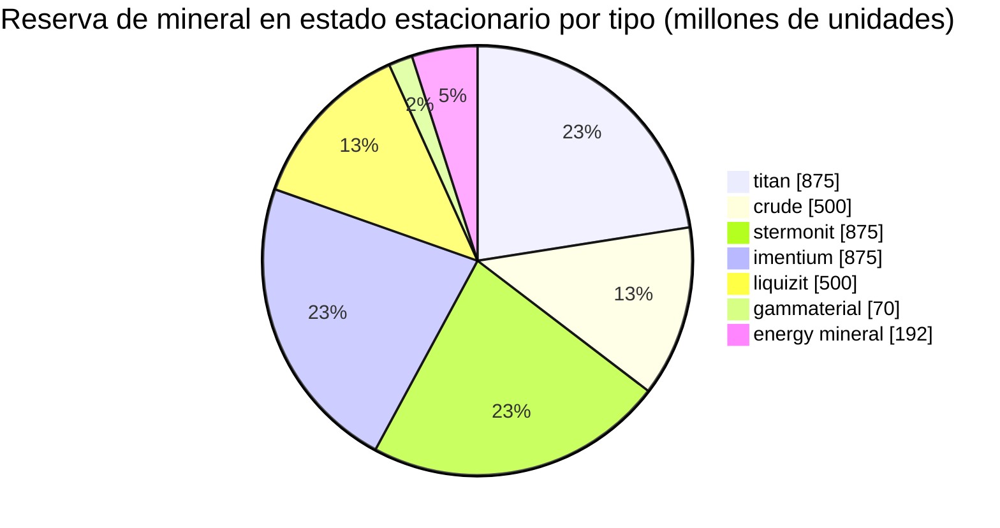

# zone_gamma_z106 — ejemplo práctico

  <a href="/es/zones/map/">
    
    <strong>Mapa del mundo</strong> — dónde se ubica esta zona entre todas las demás, con las conexiones de teletransporte. Abrir el mapa completo.
  </a>

Ubicación de las columnas de teletransporte de esta zona (puntos, etiquetados con el destino — atenuados cuando
la columna está actualmente apagada), los puntos de llegada de los teletransportes que provienen de otras
zonas (círculos discontinuos) y las puertas de salida (rombos) si existen. Las posiciones son las
coordenadas de casilla que registra el servidor.

Una zona **PvP abierta** de nivel alto: terraformable, baja fertilidad, variantes de plantas de nivel 2 y
una economía de mineral más ajustada. Esta es la forma típica de «fin de juego» de una zona: recursos
más escasos y más disputados.

| Dato | Valor |
|---|---|
| ID de zona | 106 |
| Tipo | PvP (abierta) |
| Protección | [Gamma](/es/zones/protection/) — PvP abierto, terraformable |
| Tamaño | 2048 × 2048 casillas |
| Fertilidad | 15 |
| Terraformable | sí (límite tecnológico PBS 2) |
| Conjunto de reglas de plantas | 22 — 17 especies («Gamma Plant Rules», mezcla tier 2) |
| Tipos de mineral | 7 (titan, crude, stermonit, imentium, liquizit, gammaterial, energy mineral) |
| Total de nodos de mineral | 44 |

## Configuración de mineral

| Material | Nodos | Máx. casillas/nodo | Total por nodo | Umbral mínimo |
|---|---|---|---|---|
| [titan](/es/content/ores/titan/) | 7 | 600 | 125,000,000 | 0.5 |
| [crude](/es/content/ores/crude/) | 4 | 600 | 125,000,000 | 0.5 |
| [stermonit](/es/content/ores/stermonit/) | 7 | 600 | 125,000,000 | 0.5 |
| [imentium](/es/content/ores/imentium/) | 7 | 600 | 125,000,000 | 0.5 |
| [liquizit](/es/content/ores/liquizit/) | 4 | 600 | 125,000,000 | 0.5 |
| [gammaterial](/es/content/ores/gammaterial/) | 7 | 100 | 10,000,000 | 0.5 |
| [energymineral](/es/content/ores/energymineral/) | 8 | 300 | 24,000,000 | 0.5 |

Aspectos destacados:

- **Menos nodos que en las zonas alfa** (44 frente a 64 en Daoden): crude y liquizit se reducen a
  solo 4 nodos cada uno. Mismos totales por nodo que los minerales estándar alfa, por lo que el estado
  estacionario (~3,9 mil millones de unidades en total) es más austero y tarda más en recuperarse.
- **Dos tipos exóticos**: **gammaterial** en diminutos nodos de 100 casillas (radio de paso de 10 casillas:
  pequeños, fáciles de detectar, ~1,4 M por nodo) y **energy mineral** con 24 M por nodo.
- Sin epriton ni mineral flux: los minerales raros y económicos se quedan en el nivel alfa.

## Mezcla de plantas

El conjunto de reglas 22 permite 17 especies: las básicas, más las **variantes de nivel 2** (high iron
tree t2 y high rustbush t2 como cosechables silvestres) y las **plantas sembradas de nivel 2**
(high electroplant t2, high slimeroot t2). Las sembradas tienen el atributo `playerSeeded`: **nunca**
aparecen de forma natural; solo existen en huertos de jugadores (ver
[recolección → plantas](/es/features/gathering/)).

La fertilidad es de **15**, no 20: un cubo de 32×32 puede albergar como máximo ~15 % de plantas bloqueadoras, por lo
que la vegetación es visiblemente más dispersa que en las zonas alfa, y el sorteo de fertilidad tiene
algo menos de margen para rellenar antes de que el cubo se «sature».

Las reglas por especie (incluidas las cantidades de frutos t2) están en
[Plantas](/es/content/plants/); los rendimientos por mineral en [Minerales](/es/content/ores/).

## Qué significa esto para un jugador

- Economía más ajustada y lenta: menos nodos de los minerales comunes significa que la presión minera se
  nota antes; la zona tarda más en reemplazar un nodo de crude agotado.
- Vegetación más dispersa: con 15 % de fertilidad, el terreno despejado es la norma y las manchas de plantas
  la excepción.
- La recolección de gran valor aquí se centra en las plantas silvestres árbol de hierro / rustbush de nivel 2, más
  el mantenimiento de huertos de jugadores con las variantes sembradas t2 de electroplant y slimeroot.
- La terraformación (límite tecnológico PBS 2) significa que los propios jugadores pueden remodelar el terreno
  (ver [Estaciones base (PBS)](/es/features/pbs/)).

<!-- Developer notes: zones row id 106 (zonetype 2 = PvP, protected 0, fertility 15,
     terraformable 1, pbsTechLimit 2, plantruleset 22); mineralconfigs 7 rows (crude
     and liquizit 4 nodes each); plantrules rulesetid 22 = 17 files, note "Gamma
     Plant Rules"; electroplant_seeded_t2.txt / slimeroot_seeded_t2.txt set
     playerSeeded=n1 (inherited via source= from electroplant_hi.txt /
     slimeroot_hi.txt) -> excluded from natural spawns in
     PlantRuleExtensions.GetWinnerPlantTypeBasedOnFertility. -->
