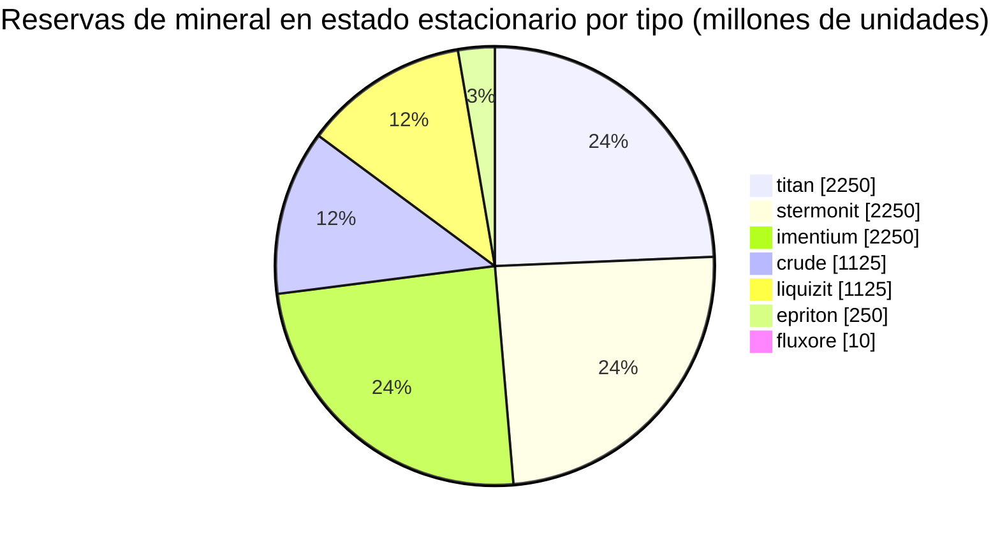

<!-- Generated by tools/generate from the live database (source: zones, mineralconfigs, plantrules, teleportdescriptions, strongholdexitconfig).
     Do not edit by hand; regenerate instead. -->
# zone_gamma_z131

  <a href="/es/zones/map/">
    
    <strong>Mapa del mundo</strong> — dónde se ubica esta zona entre todas las demás, con las conexiones de teletransporte. Abrir el mapa completo.
  </a>

Ubicación de las columnas de teletransporte de esta zona (puntos etiquetados con el destino — atenuados si la columna está desactivada), puntos de llegada de teletransportes desde otras zonas (círculos discontinuos) y puertas de salida (rombos) si existen. Las posiciones corresponden a las coordenadas de casillas registradas por el servidor.

Una isla de PvP abierto (beta) de frontier belt — los jugadores pueden atacar libremente y se aplican blobs. Mantiene 7 tipos de mineral.

| Dato | Valor |
|---|---|
| ID de zona | 131 |
| Tipo | PvP |
| Protección | [Beta](/es/zones/protection/) — PvP abierto, terreno estándar |
| Tamaño | 2048×2048 casillas |
| Nivel (Tier) | T0 (registrado en el servidor) |
| Fertilidad | 15 |
| Especies vegetales | 15 (conjunto de reglas 20) |
| Tipos de mineral | 7 |
| Nodos de mineral totales | 47 |
| Límite tecnológico de PBS | 0 |
| Bases de acoplamiento máx. | ninguna |

## Configuración de mineral

La generación de nodos que mantiene esta zona. El rendimiento por mineral y las fórmulas de generación se encuentran en [Minerales](/es/content/ores/) (la sección de esta zona está enlazada abajo).

| Material | Nodos | Casillas máx./nodo | Total por nodo | Umbral mín. |
|---|---|---|---|---|
| [titan](/es/content/ores/titan/) | 10 | 600 | 225M | 0.5 |
| [crude](/es/content/ores/crude/) | 5 | 600 | 225M | 0.5 |
| [stermonit](/es/content/ores/stermonit/) | 10 | 600 | 225M | 0.5 |
| [imentium](/es/content/ores/imentium/) | 10 | 600 | 225M | 0.5 |
| [liquizit](/es/content/ores/liquizit/) | 5 | 600 | 225M | 0.5 |
| [epriton](/es/content/ores/epriton/) | 5 | 300 | 50M | 0.5 |
| [fluxore](/es/content/ores/fluxore/) | 2 | 200 | 5M | 0.5 |

[Índice de zonas](/es/zones/zone-index/) · [Mapa del mundo](/es/zones/map/#t1) · [Niveles de protección](/es/zones/protection/)
