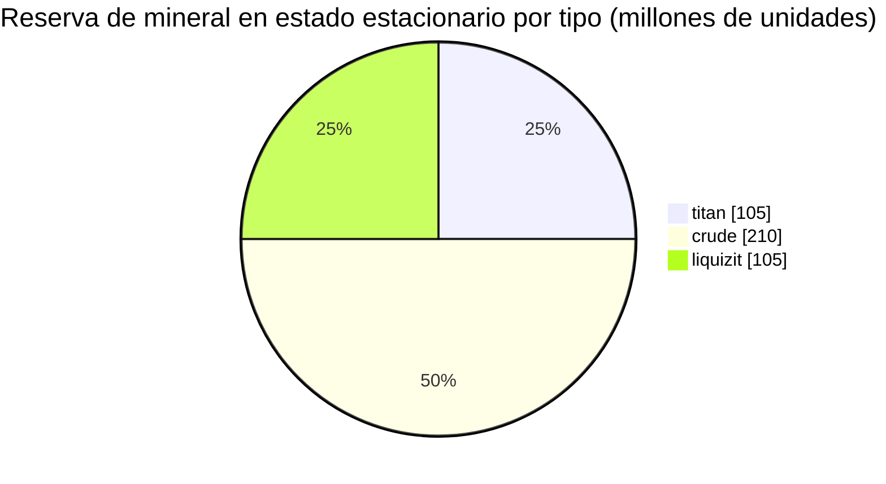

# New Virginia (zone_TM) — ejemplo práctico

  <a href="/es/zones/map/">
    
    <strong>Mapa del mundo</strong> — dónde se ubica esta zona entre todas las demás, con las conexiones de teletransporte. Abrir el mapa completo.
  </a>

Ubicación de las columnas de teletransporte de esta zona (puntos, etiquetados con el destino — atenuados cuando
la columna está actualmente apagada), los puntos de llegada de los teletransportes que provienen de otras
zonas (círculos discontinuos) y las puertas de salida (rombos) si existen. Las posiciones son las
coordenadas de casilla que registra el servidor.
Las líneas discontinuas conectan los pares de columnas de teletransporte locales (dentro de la zona).

Una zona **PvE protegida** de nivel bajo: un lugar seguro donde recolectan los nuevos personajes. Su
configuración muestra el extremo más simple del espectro: pocos tipos de mineral, nodos grandes y
la mezcla básica de plantas.

| Dato | Valor |
|---|---|
| ID de zona | 0 |
| Tipo | PvE (protegida) |
| Protección | [Alfa](/es/zones/protection/) — protegida, PvP deshabilitado |
| Tamaño | 2048 × 2048 casillas |
| Fertilidad | 20 |
| Conjunto de reglas de plantas | 0 — 15 especies (mezcla básica «tm pve») |
| Tipos de mineral | 3 (titan, crude, liquizit) |
| Total de nodos de mineral | 21 (7 por tipo) |

## Configuración de mineral

| Material | Nodos | Máx. casillas/nodo | Total por nodo | Umbral mínimo |
|---|---|---|---|---|
| [titan](/es/content/ores/titan/) | 7 | 1000 | 15,000,000 | 0.5 |
| [crude](/es/content/ores/crude/) | 7 | 1257 | 30,000,000 | 0.5 |
| [liquizit](/es/content/ores/liquizit/) | 7 | 1000 | 15,000,000 | 0.5 |

Aspectos destacados:

- **Nodos grandes y dispersos**: de 1000 a 1257 casillas cada uno (radio de paso
  `(int)√(tiles/π)×2` = 34–40 casillas), por lo que cada nodo es una gran masa, y solo hay 7
  de cada tipo por zona. La reserva en estado estacionario es de ~420 millones de unidades de material en total
  (105 M de titan + 210 M de crude + 105 M de liquizit).
- **Sin tipos raros**: sin epriton ni mineral flux, por lo que no hay zonas de exclusión alrededor
  de las bases ni sitios mineros que generen NPCs.
- `minthreshold` de 0.5 significa que una casilla solo se puede aprovechar si el llenado de ruido del nodo en ella alcanza al
  menos la mitad de su máximo; los bordes de cada masa son delgados.

Los rendimientos por tipo (en qué se refina una unidad de cada mineral y las fórmulas de generación
de nodos que sustentan las cifras anteriores) se encuentran en [Minerales](/es/content/ores/).

## Mezcla de plantas

El conjunto de reglas 0 permite 15 especies, el repertorio inicial básico: hierba (a/b), pino, arbustos (a/b),
rango, árbol de cobre, junco, nanotrigal, rustbush/slimeroot/electroplant de nivel bajo, bonsái
y árbol de hierro de nivel bajo. Sin muros, sin devrinol ni recursos cosechables de alto nivel.

Con fertilidad 20, un cubo de 32×32 puede albergar como máximo ~20 % de plantas bloqueadoras; en todo el
mapa de 2048×2048, esto representa un límite superior de aproximadamente 838 000 casillas de plantas (menos en la práctica:
el agua y las islas no son tierra firme). La selección de especies se pondera según la `fertility` de cada regla,
por lo que las hierbas y arbustos básicos predominan mientras que los cosechables de nivel bajo siguen siendo escasos.

Las reglas completas por especie (growRate, frutos, salud) están en [Plantas](/es/content/plants/).

## Qué significa esto para un jugador

- Economía inicial segura: tres minerales comunes en masas grandes y fáciles de escanear.
- Los cosechables aquí son las variantes de nivel bajo; las plantas de gran valor (variantes de alto
  nivel de electroplant/árbol de hierro/rustbush/slimeroot) aparecen en zonas posteriores.
- Dado que la zona está protegida, el riesgo de PvP es lo único que falta en el ciclo
  de recolección (ver [movimiento](/es/features/movement/) para la entrada a la zona).

<!-- Developer notes: zones row id 0 (zonetype 1 = PvE, protected 1, fertility 20,
     plantruleset 0); mineralconfigs 3 rows (titan/crude/liquizit, 7 nodes each);
     plantrules rulesetid 0 = 15 files, note "tm pve". Node radius formula and
     threshold semantics: see generation.md. -->
