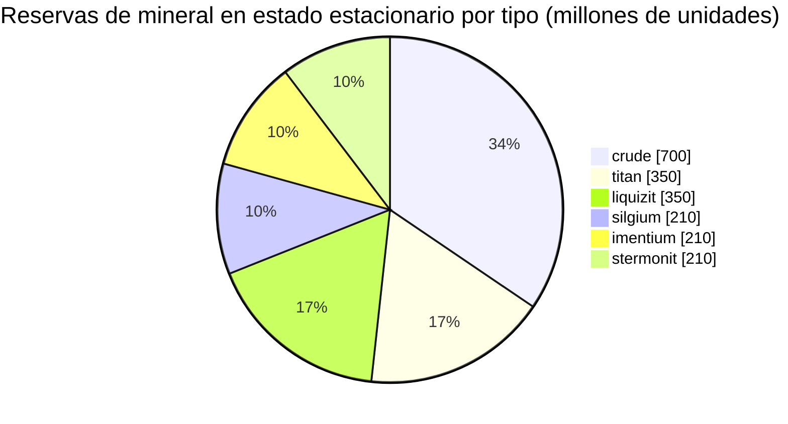

<!-- Generated by tools/generate from the live database (source: zones, mineralconfigs, plantrules, teleportdescriptions, strongholdexitconfig).
     Do not edit by hand; regenerate instead. -->
# Hershfield (zone_TM_pve)

  <a href="/es/zones/map/">
    
    <strong>Mapa del mundo</strong> — dónde se ubica esta zona entre todas las demás, con las conexiones de teletransporte. Abrir el mapa completo.
  </a>

Ubicación de las columnas de teletransporte de esta zona (puntos etiquetados con el destino — atenuados si la columna está desactivada), puntos de llegada de teletransportes desde otras zonas (círculos discontinuos) y puertas de salida (rombos) si existen. Las posiciones corresponden a las coordenadas de casillas registradas por el servidor. Las líneas discontinuas conectan los pares de columnas de teletransporte locales (dentro de la zona).

Una zona protegida (Alpha) de New Virginia (TM) — a salvo de ataques de jugadores, el terreno habitual de recolección para la galaxia New Virginia (TM). Mantiene 6 tipos de mineral.

| Dato | Valor |
|---|---|
| ID de zona | 8 |
| Tipo | PvE |
| Protección | [Alpha](/es/zones/protection/) — protegida, PvP deshabilitado |
| Tamaño | 2048×2048 casillas |
| Fertilidad | 20 |
| Especies vegetales | 15 (conjunto de reglas 0) |
| Tipos de mineral | 6 |
| Nodos de mineral totales | 42 |
| Bases de acoplamiento máx. | ninguna |

## Configuración de mineral

La generación de nodos que mantiene esta zona. El rendimiento por mineral y las fórmulas de generación se encuentran en [Minerales](/es/content/ores/) (la sección de esta zona está enlazada abajo).

| Material | Nodos | Casillas máx./nodo | Total por nodo | Umbral mín. |
|---|---|---|---|---|
| [titan](/es/content/ores/titan/) | 7 | 750 | 50M | 0.5 |
| [crude](/es/content/ores/crude/) | 7 | 750 | 100M | 0.5 |
| [stermonit](/es/content/ores/stermonit/) | 7 | 750 | 30M | 0.5 |
| [imentium](/es/content/ores/imentium/) | 7 | 750 | 30M | 0.5 |
| [liquizit](/es/content/ores/liquizit/) | 7 | 750 | 50M | 0.5 |
| [silgium](/es/content/ores/silgium/) | 7 | 750 | 30M | 0.5 |

[Índice de zonas](/es/zones/zone-index/) · [Mapa del mundo](/es/zones/map/#alpha) · [Niveles de protección](/es/zones/protection/)
