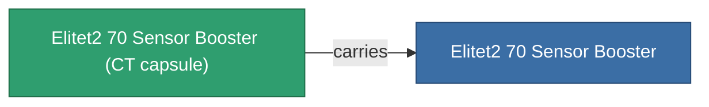

<!-- Generated by tools/generate from the live database (source: entitydefaults definition 5943, aggregatevalues via aggregatefields).
     Do not edit by hand; regenerate instead. -->

# Elitet2 70 Sensor Booster

|  |  |
|---|---|
| Définition | `def_elitet2_70_sensor_booster` |
| Niveau | T2 (special) |
| Points de vie | 100 |
| Volume | 0.5 |
| Masse | 60 |
| Catégorie | Modules / Sensors & scanning |
| Note | elite module |

## Statistiques

| Champ | Valeur |
|---|---|
| core_usage | 8 |
| cpu_usage | 12 |
| cycle_time | 10k |
| effect_sensor_booster_locking_range_modifier | 1.4 |
| effect_sensor_booster_locking_time_modifier | 0.75 |
| powergrid_usage | 5 |
| sensor_strength_modifier | 17.5 |

## Capsule de transport

A transport capsule (CT) exists for this item — it is how the item moves between players and zones.

## Où acheter

Fixed-price vendors that sell this item (see the [Item shop](/fr/content/shop/) for the full catalog).

| Vendor | Qty | Credits | UniCoin |
|---|---|---|---|
| Daoden outpost | ∞ | 250M | 10k |

<!-- production:generated -->
## Production

**Produit à partir de 2 composants** — assemblez les composants pour le fabriquer (liste complète dans [Recettes](/fr/content/recipes/)):

**Plan :** [Elitet2 70 Sensor Booster Cprg](/fr/content/items/elitet2-70-sensor-booster-cprg/)

<svg class="prod-card-icon" aria-hidden="true"><use href="#mi-grid"/></svg><a class="prod-card-name" href="/fr/content/items/material-boss-z70/">Material Boss Z70</a>

requis : <b>300</b>

<svg class="prod-card-icon" aria-hidden="true"><use href="#mi-grid"/></svg><a class="prod-card-name" href="/fr/content/items/named1-sensor-booster/">Bullz-I 6601 sensor amplifier</a>

requis : <b>1</b>

