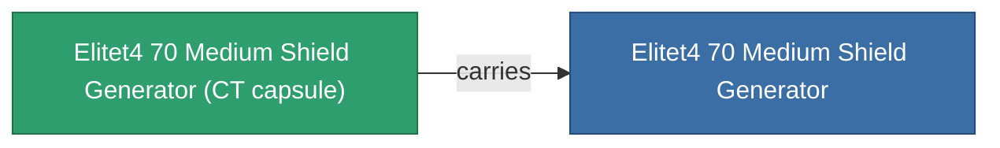

<!-- Generated by tools/generate from the live database (source: entitydefaults definition 5942, aggregatevalues via aggregatefields).
     Do not edit by hand; regenerate instead. -->

# Elitet4 70 Medium Shield Generator

|  |  |
|---|---|
| Définition | `def_elitet4_70_medium_shield_generator` |
| Niveau | T4 (special) |
| Points de vie | 100 |
| Volume | 0.5 |
| Masse | 352.5 |
| Catégorie | Modules / Shield |
| Note | elite module |

## Statistiques

| Champ | Valeur |
|---|---|
| core_recharge_time_modifier | 0.96 |
| core_usage | 10 |
| cpu_usage | 67 |
| cycle_time | 6.5k |
| powergrid_usage | 271 |
| shield_absorbtion | 2 |
| shield_radius | 25 |

## Capsule de transport

A transport capsule (CT) exists for this item — it is how the item moves between players and zones.

## Où acheter

Fixed-price vendors that sell this item (see the [Item shop](/fr/content/shop/) for the full catalog).

| Vendor | Qty | TM Coin | Credits |
|---|---|---|---|
| Daoden outpost | ∞ | 5k | 750M |

<!-- production:generated -->
## Production

**Produit à partir de 2 composants** — assemblez les composants pour le fabriquer (liste complète dans [Recettes](/fr/content/recipes/)):

**Plan :** [Elitet4 70 Medium Shield Generator Cprg](/content/items/elitet4-70-medium-shield-generator-cprg/)

<svg class="prod-card-icon" aria-hidden="true"><use href="#mi-grid"/></svg><a class="prod-card-name" href="/fr/content/items/material-boss-z70/">Material Boss Z70</a>

requis : <b>400</b>

<svg class="prod-card-icon" aria-hidden="true"><use href="#mi-tree"/></svg><a class="prod-card-name" href="/fr/content/items/named3-medium-shield-generator/">Penik medium shield generator</a>

requis : <b>1</b>

