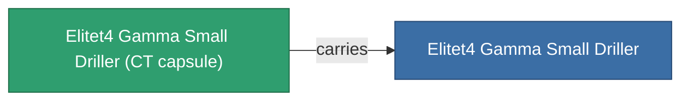

<!-- Generated by tools/generate from the live database (source: entitydefaults definition 6215, aggregatevalues via aggregatefields).
     Do not edit by hand; regenerate instead. -->

# Elitet4 Gamma Small Driller

|  |  |
|---|---|
| Définition | `def_elitet4_gamma_small_driller` |
| Niveau | T4 (special) |
| Points de vie | 100 |
| Volume | 1 |
| Masse | 300 |
| Catégorie | Modules / Enhancements |
| Note | elite module |

## Statistiques

| Champ | Valeur |
|---|---|
| core_usage | 20 |
| cpu_usage | 43 |
| cycle_time | 11.75k |
| optimal_range | 3.5 |
| powergrid_usage | 31 |

## Capsule de transport

A transport capsule (CT) exists for this item — it is how the item moves between players and zones.

## Où acheter

Fixed-price vendors that sell this item (see the [Item shop](/fr/content/shop/) for the full catalog).

| Vendor | Qty | Credits | UniCoin |
|---|---|---|---|
| Daoden outpost | ∞ | 500M | 25k |

<!-- production:generated -->
## Production

**Produit à partir de 4 composants** — assemblez les composants pour le fabriquer (liste complète dans [Recettes](/fr/content/recipes/)):

**Plan :** [Elitet4 Gamma Small Driller Cprg](/fr/content/items/elitet4-gamma-small-driller-cprg/)

<svg class="prod-card-icon" aria-hidden="true"><use href="#mi-grid"/></svg><a class="prod-card-name" href="/fr/content/items/material-boss-gamma-nuimqol/">Material Boss Gamma Nuimqol</a>

requis : <b>67</b>

<svg class="prod-card-icon" aria-hidden="true"><use href="#mi-grid"/></svg><a class="prod-card-name" href="/fr/content/items/material-boss-gamma-pelistal/">Material Boss Gamma Pelistal</a>

requis : <b>67</b>

<svg class="prod-card-icon" aria-hidden="true"><use href="#mi-grid"/></svg><a class="prod-card-name" href="/fr/content/items/material-boss-gamma-thelodica/">Material Boss Gamma Thelodica</a>

requis : <b>67</b>

<svg class="prod-card-icon" aria-hidden="true"><use href="#mi-panel"/></svg><a class="prod-card-name" href="/fr/content/items/named3-small-driller/">Scraper-990 small miner module</a>

requis : <b>1</b>

