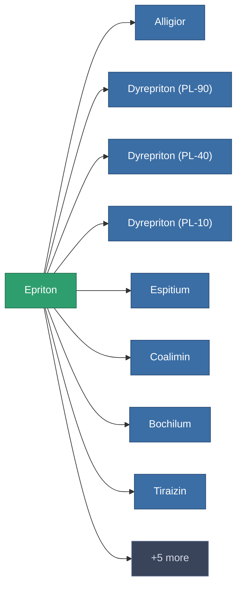

<!-- Generated by tools/generate from the live database (source: entitydefaults definition 174, aggregatevalues via aggregatefields).
     Do not edit by hand; regenerate instead. -->

# Epriton

|  |  |
|---|---|
| Définition | `def_epriton` |
| Niveau | – |
| Points de vie | 100 |
| Volume | 0 |
| Masse | 0.03 |
| Catégorie | Materials |

_Aucune statistique — cet article ne porte aucune valeur agrégée._

<!-- production:generated -->
## Utilisé en production

**Composant de 13 articles** — un aperçu de ce qui peut être produit avec (liste complète dans [Recettes](/fr/content/recipes/)).

