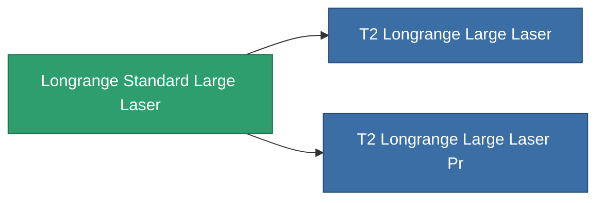

<!-- Generated by tools/generate from the live database (source: entitydefaults definition 1003, aggregatevalues via aggregatefields).
     Do not edit by hand; regenerate instead. -->

# Longrange Standard Large Laser

|  |  |
|---|---|
| Définition | `def_longrange_standard_large_laser` |
| Niveau | T1 |
| Points de vie | 100 |
| Volume | 1.5 |
| Masse | 1300 |
| Catégorie | Modules / Weapons |

## Statistiques

| Champ | Valeur |
|---|---|
| accuracy | 36 |
| core_usage | 14 |
| cpu_usage | 75 |
| cycle_time | 6k |
| damage_modifier | 1.5 |
| falloff | 25 |
| optimal_range | 44 |
| powergrid_usage | 402.5 |

<!-- production:generated -->
## Production

**Produit à partir de 6 composants** — assemblez les composants pour le fabriquer (liste complète dans [Recettes](/fr/content/recipes/)):

**Plan :** [Longrange Standard Large Laser Cprg](/content/items/longrange-standard-large-laser-cprg/)

<svg class="prod-card-icon" aria-hidden="true"><use href="#mi-grid"/></svg><a class="prod-card-name" href="/fr/content/items/axicol/">Cryoperine</a>

requis : <b>75</b>

<svg class="prod-card-icon" aria-hidden="true"><use href="#mi-grid"/></svg><a class="prod-card-name" href="/fr/content/items/axicoline/">Axicoline</a>

requis : <b>150</b>

<svg class="prod-card-icon" aria-hidden="true"><use href="#mi-grid"/></svg><a class="prod-card-name" href="/fr/content/items/polynucleit/">Polynucleit</a>

requis : <b>150</b>

<svg class="prod-card-icon" aria-hidden="true"><use href="#mi-grid"/></svg><a class="prod-card-name" href="/fr/content/items/prilumium/">Prilumium</a>

requis : <b>75</b>

<svg class="prod-card-icon" aria-hidden="true"><use href="#mi-grid"/></svg><a class="prod-card-name" href="/fr/content/items/specimen-sap-item-flux/">Specimen Sap Item Flux</a>

requis : <b>10</b>

<svg class="prod-card-icon" aria-hidden="true"><use href="#mi-grid"/></svg><a class="prod-card-name" href="/fr/content/items/titanium/">Titanium</a>

requis : <b>150</b>

## Utilisé en production

**Composant de 2 articles** — tout ce qui l'utilise en production :

