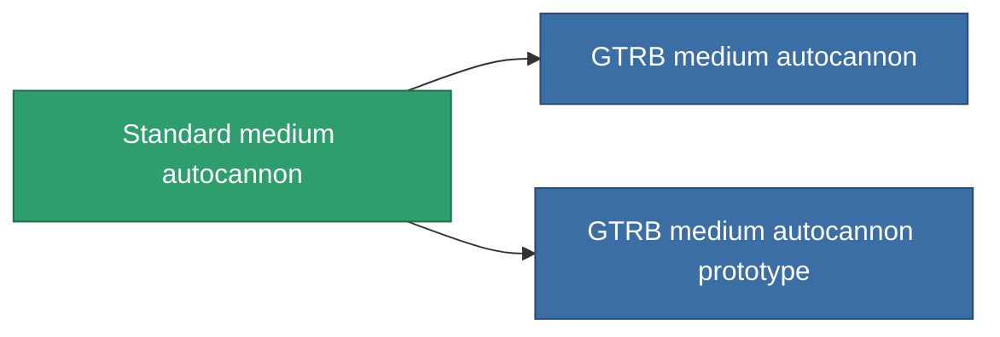

<!-- Generated by tools/generate from the live database (source: entitydefaults definition 1004, aggregatevalues via aggregatefields).
     Do not edit by hand; regenerate instead. -->

# Standard medium autocannon

|  |  |
|---|---|
| Définition | `def_longrange_standard_medium_autocannon` |
| Niveau | T1 |
| Points de vie | 100 |
| Volume | 1.2 |
| Masse | 650 |
| Catégorie | Modules / Weapons |

## Statistiques

| Champ | Valeur |
|---|---|
| accuracy | 18 |
| core_usage | 2 |
| cpu_usage | 12 |
| cycle_time | 8k |
| damage_modifier | 2 |
| falloff | 28 |
| least_optimal | 5 |
| optimal_range | 22 |
| powergrid_usage | 140 |

<!-- production:generated -->
## Production

**Produit à partir de 3 composants, niveau de recherche 3** — assemblez les composants pour le fabriquer (liste complète dans [Recettes](/fr/content/recipes/)):

**Plan :** [Standard medium autocannon CT](/content/items/longrange-standard-medium-autocannon-cprg/)

<svg class="prod-card-icon" aria-hidden="true"><use href="#mi-grid"/></svg><a class="prod-card-name" href="/fr/content/items/axicol/">Cryoperine</a>

requis : <b>100</b>

<svg class="prod-card-icon" aria-hidden="true"><use href="#mi-grid"/></svg><a class="prod-card-name" href="/fr/content/items/axicoline/">Axicoline</a>

requis : <b>200</b>

<svg class="prod-card-icon" aria-hidden="true"><use href="#mi-grid"/></svg><a class="prod-card-name" href="/fr/content/items/titanium/">Titanium</a>

requis : <b>100</b>

## Utilisé en production

**Composant de 2 articles** — tout ce qui l'utilise en production :

