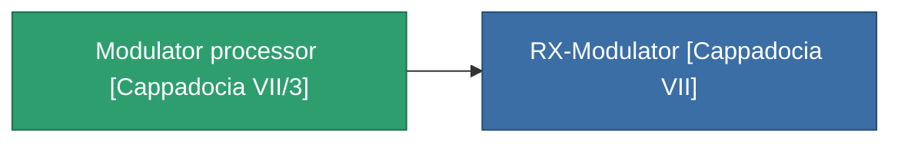

<!-- Generated by tools/generate from the live database (source: entitydefaults definition 3843, aggregatevalues via aggregatefields).
     Do not edit by hand; regenerate instead. -->

# Modulator processor [Cappadocia VII/3]

|  |  |
|---|---|
| Définition | `def_missionitem_ics_ii_level01_exp3_07_t03` |
| Niveau | – |
| Points de vie | 100 |
| Volume | 0.01 |
| Masse | 50 |
| Catégorie | Mission items |

_Aucune statistique — cet article ne porte aucune valeur agrégée._

<!-- production:generated -->
## Utilisé en production

**Composant de 1 articles** — tout ce qui l'utilise en production :

