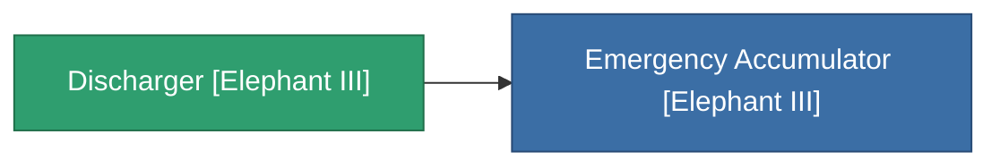

<!-- Generated by tools/generate from the live database (source: entitydefaults definition 4531, aggregatevalues via aggregatefields).
     Do not edit by hand; regenerate instead. -->

# Discharger [Elephant III]

|  |  |
|---|---|
| Définition | `def_missionitem_tm_i_level00_exp3_03_t03` |
| Niveau | – |
| Points de vie | 100 |
| Volume | 1 |
| Masse | 50 |
| Catégorie | Mission items |

_Aucune statistique — cet article ne porte aucune valeur agrégée._

<!-- production:generated -->
## Utilisé en production

**Composant de 1 articles** — tout ce qui l'utilise en production :

