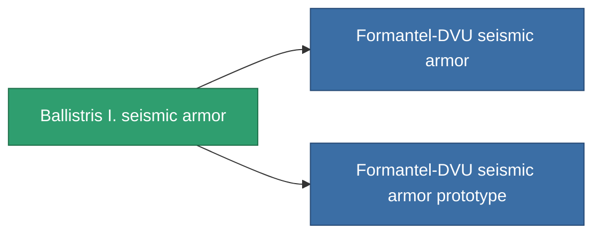

<!-- Generated by tools/generate from the live database (source: entitydefaults definition 714, aggregatevalues via aggregatefields).
     Do not edit by hand; regenerate instead. -->

# Ballistris I. seismic armor

|  |  |
|---|---|
| Définition | `def_named1_exp_armor_hardener` |
| Niveau | T2 |
| Points de vie | 100 |
| Volume | 1 |
| Masse | 90 |
| Catégorie | Modules / Armor |
| Tier line | [Standard seismic armor](/fr/content/items/standard-exp-armor-hardener/) (T1) → **Ballistris I. seismic armor** (T2) → [Formantel-DVU seismic armor](/fr/content/items/named2-exp-armor-hardener/) (T3) → [Sheltor seismic armor](/fr/content/items/named3-exp-armor-hardener/) (T4) |

## Statistiques

| Champ | Valeur |
|---|---|
| core_usage | 11 |
| cpu_usage | 22 |
| cycle_time | 10k |
| effect_resist_explosive | 100 |
| powergrid_usage | 4 |
| resist_explosive | 25 |

<!-- production:generated -->
## Production

**Produit à partir de 8 composants, niveau de recherche 4** — assemblez les composants pour le fabriquer (liste complète dans [Recettes](/fr/content/recipes/)):

**Plan :** [Ballistris I. seismic armor CT](/content/items/named1-exp-armor-hardener-cprg/)

<svg class="prod-card-icon" aria-hidden="true"><use href="#mi-grid"/></svg><a class="prod-card-name" href="/fr/content/items/axicol/">Cryoperine</a>

requis : <b>50</b>

<svg class="prod-card-icon" aria-hidden="true"><use href="#mi-grid"/></svg><a class="prod-card-name" href="/fr/content/items/chollonin/">Chollonin</a>

requis : <b>50</b>

<svg class="prod-card-icon" aria-hidden="true"><use href="#mi-grid"/></svg><a class="prod-card-name" href="/fr/content/items/plasteosine/">Plasteosine</a>

requis : <b>125</b>

<svg class="prod-card-icon" aria-hidden="true"><use href="#mi-crystal"/></svg><a class="prod-card-name" href="/fr/content/items/robotshard-common-basic/">Damaged common fragment</a>

requis : <b>15</b>

<svg class="prod-card-icon" aria-hidden="true"><use href="#mi-crystal"/></svg><a class="prod-card-name" href="/fr/content/items/robotshard-thelodica-basic/">Damaged thelodica fragment</a>

requis : <b>15</b>

<svg class="prod-card-icon" aria-hidden="true"><use href="#mi-tree"/></svg><a class="prod-card-name" href="/fr/content/items/standard-exp-armor-hardener/">Standard seismic armor</a>

requis : <b>1</b>

<svg class="prod-card-icon" aria-hidden="true"><use href="#mi-grid"/></svg><a class="prod-card-name" href="/fr/content/items/statichnol/">Statichnol</a>

requis : <b>125</b>

<svg class="prod-card-icon" aria-hidden="true"><use href="#mi-grid"/></svg><a class="prod-card-name" href="/fr/content/items/titanium/">Titanium</a>

requis : <b>100</b>

## Utilisé en production

**Composant de 2 articles** — tout ce qui l'utilise en production :

