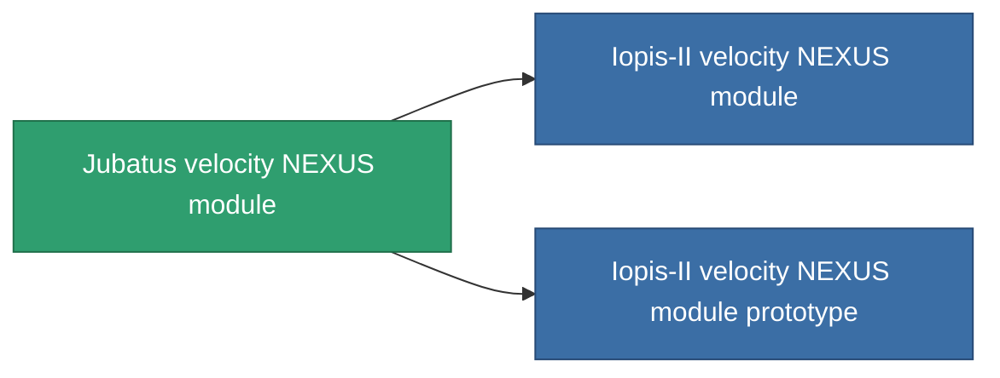

<!-- Generated by tools/generate from the live database (source: entitydefaults definition 2568, aggregatevalues via aggregatefields).
     Do not edit by hand; regenerate instead. -->

# Jubatus velocity NEXUS module

|  |  |
|---|---|
| Définition | `def_named1_gang_assist_speed_module` |
| Niveau | T2 |
| Points de vie | 100 |
| Volume | 0.2 |
| Masse | 10 |
| Catégorie | Modules / Enhancements |
| Tier line | [Standard velocity NEXUS module](/fr/content/items/standard-gang-assist-speed-module/) (T1) → **Jubatus velocity NEXUS module** (T2) → [Iopis-II velocity NEXUS module](/fr/content/items/named2-gang-assist-speed-module/) (T3) → [Contra velocity NEXUS module](/fr/content/items/named3-gang-assist-speed-module/) (T4) |
| Note | speed 0.5% / extension lvl   |

## Statistiques

| Champ | Valeur |
|---|---|
| core_usage | 31 |
| cpu_usage | 78 |
| cycle_time | 10k |
| default_effect_range | 100 |
| effect_speed_max_modifier | 1.02 |
| powergrid_usage | 31 |

<!-- production:generated -->
## Production

**Produit à partir de 6 composants, niveau de recherche 5** — assemblez les composants pour le fabriquer (liste complète dans [Recettes](/fr/content/recipes/)):

**Plan :** [Jubatus velocity NEXUS module CT](/fr/content/items/named1-gang-assist-speed-module-cprg/)

<svg class="prod-card-icon" aria-hidden="true"><use href="#mi-grid"/></svg><a class="prod-card-name" href="/fr/content/items/axicol/">Cryoperine</a>

requis : <b>300</b>

<svg class="prod-card-icon" aria-hidden="true"><use href="#mi-grid"/></svg><a class="prod-card-name" href="/fr/content/items/chollonin/">Chollonin</a>

requis : <b>300</b>

<svg class="prod-card-icon" aria-hidden="true"><use href="#mi-crystal"/></svg><a class="prod-card-name" href="/fr/content/items/robotshard-nuimqol-basic/">Damaged nuimqol fragment</a>

requis : <b>15</b>

<svg class="prod-card-icon" aria-hidden="true"><use href="#mi-crystal"/></svg><a class="prod-card-name" href="/fr/content/items/robotshard-pelistal-basic/">Damaged pelistal fragment</a>

requis : <b>15</b>

<svg class="prod-card-icon" aria-hidden="true"><use href="#mi-panel"/></svg><a class="prod-card-name" href="/fr/content/items/standard-gang-assist-speed-module/">Standard velocity NEXUS module</a>

requis : <b>1</b>

<svg class="prod-card-icon" aria-hidden="true"><use href="#mi-grid"/></svg><a class="prod-card-name" href="/fr/content/items/titanium/">Titanium</a>

requis : <b>50</b>

## Utilisé en production

**Composant de 2 articles** — tout ce qui l'utilise en production :

