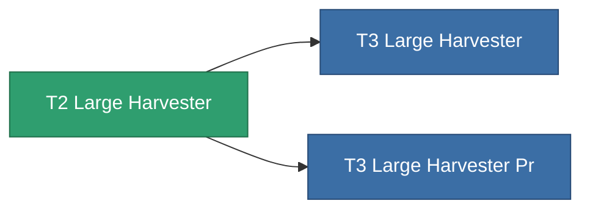

<!-- Generated by tools/generate from the live database (source: entitydefaults definition 8863, aggregatevalues via aggregatefields).
     Do not edit by hand; regenerate instead. -->

# T2 Large Harvester

|  |  |
|---|---|
| Définition | `def_named1_large_harvester` |
| Niveau | T2 |
| Points de vie | 100 |
| Volume | 2.5 |
| Masse | 1500 |
| Catégorie | Modules / Harvesting |
| Tier line | [Standard Large Harvester](/fr/content/items/standard-large-harvester/) (T1) → **T2 Large Harvester** (T2) → [T3 Large Harvester](/fr/content/items/named2-large-harvester/) (T3) → [T4 Large Harvester](/fr/content/items/named3-large-harvester/) (T4) |

## Statistiques

| Champ | Valeur |
|---|---|
| core_usage | 135 |
| cpu_usage | 432 |
| cycle_time | 12k |
| powergrid_usage | 1.215k |

<!-- production:generated -->
## Production

**Produit à partir de 4 composants** — assemblez les composants pour le fabriquer (liste complète dans [Recettes](/fr/content/recipes/)):

**Plan :** [T2 Large Harvester Cprg](/fr/content/items/named1-large-harvester-cprg/)

<svg class="prod-card-icon" aria-hidden="true"><use href="#mi-grid"/></svg><a class="prod-card-name" href="/fr/content/items/axicol/">Cryoperine</a>

requis : <b>600</b>

<svg class="prod-card-icon" aria-hidden="true"><use href="#mi-crystal"/></svg><a class="prod-card-name" href="/fr/content/items/robotshard-common-basic/">Damaged common fragment</a>

requis : <b>120</b>

<svg class="prod-card-icon" aria-hidden="true"><use href="#mi-grid"/></svg><a class="prod-card-name" href="/fr/content/items/standard-large-harvester/">Standard Large Harvester</a>

requis : <b>1</b>

<svg class="prod-card-icon" aria-hidden="true"><use href="#mi-grid"/></svg><a class="prod-card-name" href="/fr/content/items/titanium/">Titanium</a>

requis : <b>2.4k</b>

## Utilisé en production

**Composant de 2 articles** — tout ce qui l'utilise en production :

