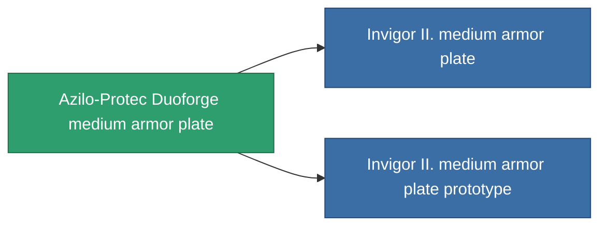

<!-- Generated by tools/generate from the live database (source: entitydefaults definition 687, aggregatevalues via aggregatefields).
     Do not edit by hand; regenerate instead. -->

# Azilo-Protec Duoforge medium armor plate

|  |  |
|---|---|
| Définition | `def_named1_medium_armor_plate` |
| Niveau | T2 |
| Points de vie | 100 |
| Volume | 2 |
| Masse | 2400 |
| Catégorie | Modules / Armor |
| Tier line | [Standard medium armor plate](/fr/content/items/standard-medium-armor-plate/) (T1) → **Azilo-Protec Duoforge medium armor plate** (T2) → [Invigor II. medium armor plate](/fr/content/items/named2-medium-armor-plate/) (T3) → [THL-Testudo medium armor plate](/fr/content/items/named3-medium-armor-plate/) (T4) |

## Statistiques

| Champ | Valeur |
|---|---|
| armor_max | 1.35k |
| cpu_usage | 2 |
| massiveness | 0.12 |
| powergrid_usage | 60 |
| signature_radius | 1 |

<!-- production:generated -->
## Production

**Produit à partir de 4 composants, niveau de recherche 4** — assemblez les composants pour le fabriquer (liste complète dans [Recettes](/fr/content/recipes/)):

**Plan :** [Azilo-Protec Duoforge medium armor plate CT](/fr/content/items/named1-medium-armor-plate-cprg/)

<svg class="prod-card-icon" aria-hidden="true"><use href="#mi-grid"/></svg><a class="prod-card-name" href="/fr/content/items/plasteosine/">Plasteosine</a>

requis : <b>700</b>

<svg class="prod-card-icon" aria-hidden="true"><use href="#mi-crystal"/></svg><a class="prod-card-name" href="/fr/content/items/robotshard-common-basic/">Damaged common fragment</a>

requis : <b>60</b>

<svg class="prod-card-icon" aria-hidden="true"><use href="#mi-tree"/></svg><a class="prod-card-name" href="/fr/content/items/standard-medium-armor-plate/">Standard medium armor plate</a>

requis : <b>1</b>

<svg class="prod-card-icon" aria-hidden="true"><use href="#mi-grid"/></svg><a class="prod-card-name" href="/fr/content/items/titanium/">Titanium</a>

requis : <b>500</b>

## Utilisé en production

**Composant de 2 articles** — tout ce qui l'utilise en production :

